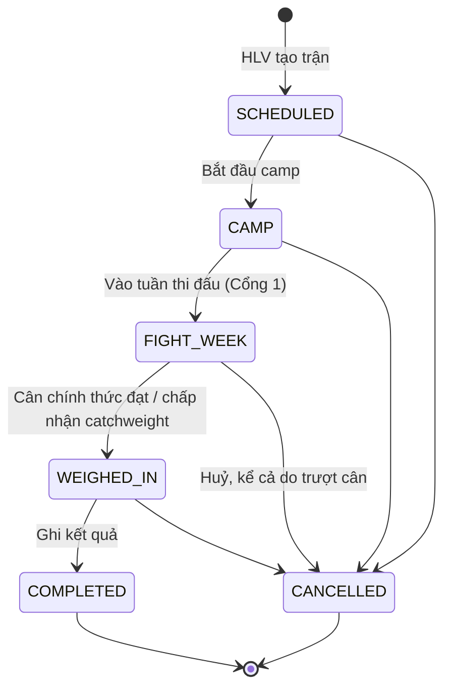

# Fight Camp — Luồng nghiệp vụ

**Cập nhật**: 2026-10-11
**Thuộc bộ tài liệu**: [Phạm vi](./SCOPE-FIGHT-CAMP.md) · [Nghiên cứu](./FIGHT-CAMP-DOMAIN-RESEARCH.md) · **Luồng nghiệp vụ** · [Tech spec](./FIGHT-CAMP-TECH-SPEC.md) · [Kiểm thử người dùng](./FIGHT-CAMP-USER-TESTING.md) · [Câu hỏi mở](./FIGHT-CAMP-OPEN-QUESTIONS.md)

Tài liệu này mô tả **ai làm gì, khi nào, app kiểm tra gì** trong vòng đời một trận. Dev dùng nó để viết rule và test, QA dùng phần tiêu chí nghiệm thu. Chỗ nào chưa chốt thì ghi **[Chờ chốt]** và trỏ tới câu hỏi ở [SCOPE-FIGHT-CAMP.md](./SCOPE-FIGHT-CAMP.md#quyết-định-và-câu-hỏi).

**Phạm vi trước 31/10:** một số phần dưới đây (thông báo, camp tự sinh từ template, ghi buổi tập nhanh, màn Admin bật/tắt chế độ không có bác sĩ) đã được cắt khỏi đợt đồ án; xem [Phạm vi – Cắt khỏi đợt đồ án](./SCOPE-FIGHT-CAMP.md#cắt-khỏi-đợt-đồ-án). Thiết kế vẫn giữ để làm sau.

Tài liệu này thay [BUSINESS-FLOWS.md](./BUSINESS-FLOWS.md) cho phần fight camp. Các luồng cũ (tuyển võ sĩ, cổng Doctor đầy đủ, AI review) vẫn giữ nguyên nhưng đang đóng băng.

---

## 1. Khái niệm

| Khái niệm | Ý nghĩa | Ví dụ |
| --- | --- | --- |
| **Bộ luật (Ruleset)** | Quy định của một giải hay tổ chức: hạng cân, giờ cân, hồ sơ yêu cầu, số ngày đình chỉ, ngưỡng giảm cấp tốc | "Boxing chuyên nghiệp – tham khảo (chưa xác minh)" |
| **Trận (Bout)** | Một trận cụ thể của một võ sĩ, gắn với một ruleset | Võ sĩ A, hạng 60 kg, cân 14/12 10:00, thi 15/12 19:00 |
| **Camp** | Kế hoạch tập (`training_plans`, phase `fight_camp`) gắn với trận, đếm ngược từ ngày thi | Camp 6 tuần từ template Boxing |
| **Hồ sơ (Requirement)** | Một mục trong checklist hồ sơ của trận, sinh từ ruleset | "Giấy khám sức khỏe – hiệu lực 6 tháng" |
| **Đình chỉ (Suspension)** | Khoảng thời gian võ sĩ không được tập một số loại buổi; có thể có hoặc không gắn với trận | KO ngày 15/12, đình chỉ đến 13/2, chặn `SPARRING` |
| **Ngày học viện** | Ngày theo lịch `Asia/Ho_Chi_Minh`, như module goals đang dùng | — |

## 2. Vai trò và quyền

Phạm vi HLV = các võ sĩ HLV đang được phân công (`coach_fighters` còn hiệu lực), giống quy tắc của module goals.

| Hành động | HLV | Võ sĩ | Bác sĩ | Admin |
| --- | --- | --- | --- | --- |
| Xem ruleset | Có | Không | Có | Có |
| Tạo, sửa ruleset dùng chung | Không. HLV nhập quy định riêng trên trận của mình (F1, F4) | Không | Không | Có |
| Tạo, sửa, huỷ trận | Võ sĩ được phân công | Không | Không | Có |
| Xem trận | Võ sĩ được phân công | Trận của mình | Võ sĩ được phân công | Có |
| Ghi cân hằng ngày | Có | Cân của mình | Có | Có |
| Cập nhật hồ sơ (đã có, ngày cấp, hạn); thêm, sửa, bỏ mục hồ sơ của trận | Có | Không | Có | Có |
| Xác nhận hồ sơ (`CONFIRMED`) | Không | Không | Có | Không |
| Ghi cân chính thức, kết quả trận | Có | Không | Không | Có |
| Xác nhận số ngày đình chỉ | Có | Không | Có | Có |
| Kết thúc đình chỉ cần xác nhận | Có | Không | Có | Không |

Bác sĩ không bắt buộc. Khi không có bác sĩ, việc kết thúc đình chỉ sau KO do HLV làm, và app ghi rõ "HLV xác nhận, không có xác nhận y tế".

## 3. Trạng thái trận

| Từ | Sang | Ai | Điều kiện | Nếu không đạt |
| --- | --- | --- | --- | --- |
| — | `SCHEDULED` | HLV, Admin | Đủ trường bắt buộc (F1); `weighInAt` < `boutAt`; `boutAt` ở tương lai | 422 kèm trường lỗi |
| `SCHEDULED` | `CAMP` | HLV | Có camp gắn với trận (F2) | 409 `BOUT_CAMP_REQUIRED` |
| `CAMP` | `FIGHT_WEEK` | HLV | Hôm nay ≥ ngày cân − `fightWeekDays`; **Cổng 1 đạt** (F4) | 409 `BOUT_REQUIREMENTS_INCOMPLETE` kèm danh sách mục thiếu |
| `FIGHT_WEEK` | `WEIGHED_IN` | HLV | Đã ghi cân chính thức; đạt cân, hoặc HLV chọn tiếp tục với catchweight (F5) | — |
| `WEIGHED_IN` | `COMPLETED` | HLV | Đã ghi kết quả (F6); hôm nay ≥ ngày thi | 409 `BOUT_NOT_STARTED` |
| Bất kỳ trừ `COMPLETED` | `CANCELLED` | HLV | Có lý do huỷ | 422 |

Quy tắc chung:

- Mỗi võ sĩ có **tối đa một trận** ở `CAMP`, `FIGHT_WEEK` hoặc `WEIGHED_IN` tại một thời điểm. Trận `SCHEDULED` thì không giới hạn, vì có thể nhận lời nhiều trận rồi chọn một.
- Không quay lui trạng thái. Sửa nhầm thì huỷ trận và tạo lại, lịch sử được giữ.
- `COMPLETED` và `CANCELLED` là trạng thái cuối, chỉ còn sửa được ghi chú.
- Mọi chuyển trạng thái được ghi audit (người làm, thời điểm, lý do).

## 4. Các luồng

### F1. Tạo trận

**Ai:** HLV, cho võ sĩ mình được phân công. **Khi nào:** khi CLB nhận lời một trận.

Dữ liệu nhập:

| Trường | Bắt buộc | Ghi chú |
| --- | --- | --- |
| Võ sĩ | Có | Trong phạm vi HLV |
| Ruleset | Có | Chọn preset ("MMA – VMMAF 2021", "Boxing nghiệp dư – AIBA (tham khảo)") hoặc "Tự nhập". Preset chưa xác minh hiện nhãn cảnh báo |
| Tên giải / sự kiện, địa điểm | Tên giải bắt buộc | — |
| Hạng cân | Có | Chọn từ danh sách hạng cân của preset, hoặc nhập số kg khi "Tự nhập"; app lưu `weightLimitKg` |
| Thời điểm cân | Có | Ngày + giờ |
| Thời điểm thi đấu | Có | Ngày + giờ, sau thời điểm cân |
| Đối thủ | Không | Bổ sung sau được |

Quy tắc:

- Hạng cân lưu bằng kg. Sửa ruleset sau này không làm đổi trận đã tạo.
- App tính và hiển thị ngay: số ngày đến ngày cân, khoảng cân – thi đấu (giờ), ngưỡng giảm cấp tốc áp dụng (8% hay 5%, xem [Nghiên cứu §4](./FIGHT-CAMP-DOMAIN-RESEARCH.md#4-giảm-cân-cấp-tốc-giới-hạn-khuyến-nghị)).
- App sinh checklist hồ sơ từ ruleset, mỗi mục ở trạng thái `MISSING`.
- Nếu võ sĩ đang bị đình chỉ và đình chỉ kết thúc sau ngày thi đấu, app **cảnh báo** nhưng vẫn cho tạo, vì HLV có thể đang đàm phán lại ngày.

Kết quả: trận `SCHEDULED`, xuất hiện ở "Trận sắp tới" trên dashboard HLV và trang của võ sĩ.

### F2. Lập camp

**Ai:** HLV. **Khi nào:** sau khi tạo trận, thường 6–8 tuần trước ngày thi.

1. HLV chọn template camp theo bộ môn (MMA 6 tuần ở bản đầu, quyết định 2 trong [Phạm vi](./SCOPE-FIGHT-CAMP.md#quyết-định-và-câu-hỏi)) hoặc gắn một plan đã có.
2. App tạo `training_plan` phase `fight_camp`, ngày kết thúc là ngày thi đấu, và dàn các buổi tập đếm ngược từ ngày thi.
3. Tuần cuối dùng phase `taper` nếu template có.
4. HLV sửa buổi bất kỳ. App không tự xếp lại khi HLV đã sửa tay.
5. Đổi ngày thi (F8) thì app hỏi HLV có dịch toàn bộ buổi `SCHEDULED` còn lại hay không.

Ghi buổi tập nhanh: HLV ghi kết quả một buổi bằng RPE (1–10) và ghi chú ngắn, hoặc ghi cho cả nhóm 5–8 võ sĩ cùng buổi. Form đầy đủ hiện có vẫn giữ làm tùy chọn "Chi tiết".

Kết quả: HLV bấm "Bắt đầu camp", trận chuyển sang `CAMP`.

### F3. Ghi cân hằng ngày và cảnh báo

**Ai:** võ sĩ tự ghi (quyết định 3 trong Phạm vi) hoặc HLV ghi hộ. **Khi nào:** mỗi sáng trong camp.

1. Màn ghi cân trên điện thoại: một ô số kg, mặc định ngày hôm nay, mặc định bối cảnh "Buổi sáng". Mục tiêu là ghi xong trong 30 giây trở xuống.
2. Lưu vào `fighter_measurements` với bối cảnh `SELF_REPORTED` (võ sĩ ghi) hoặc `TRAINING` (HLV ghi). Ghi lại trong cùng ngày học viện thì bản mới thay bản cũ (dùng `supersedes_id`), không tạo hai điểm.
3. App vẽ đường cân thực tế, giới hạn hạng cân và đường tham chiếu, rồi tính trạng thái cảnh báo theo [Tech spec §5](./FIGHT-CAMP-TECH-SPEC.md#5-cảnh-báo-cân-nặng):

| Trạng thái | Ý nghĩa | App làm gì |
| --- | --- | --- |
| Xanh | Đang theo đường tham chiếu | Không làm gì |
| Vàng | Cao hơn đường tham chiếu quá dung sai | Hiện trên dashboard HLV |
| Đỏ | Phần còn phải giảm vượt ngưỡng giảm cấp tốc an toàn với thời gian còn lại | Thông báo HLV; hiện câu khuyến nghị trao đổi chuyên môn, cân nhắc đổi hạng |
| Xám | Không có số cân 3 ngày liền | Nhắc võ sĩ ghi cân |

App không đề xuất chế độ ăn, hạn chế nước hay xông hơi ([Nghiên cứu §4](./FIGHT-CAMP-DOMAIN-RESEARCH.md#4-giảm-cân-cấp-tốc-giới-hạn-khuyến-nghị)).

### F4. Hồ sơ y tế và Cổng 1

**Ai:** HLV cập nhật, bác sĩ (nếu có) xác nhận. **Khi nào:** trong camp, trước hạn nộp.

Checklist sinh từ preset của trận (preset "Tự nhập" thì bắt đầu rỗng). HLV **thêm, sửa, bỏ** mục theo thông báo của giải: tên giấy tờ, bắt buộc hay không, thời hạn hiệu lực. Mục do HLV thêm mang nhãn "HLV nhập, chưa xác minh". Mọi thay đổi checklist được ghi lịch sử.

Mỗi mục hồ sơ có trạng thái:

| Trạng thái | Ý nghĩa |
| --- | --- |
| `MISSING` | Chưa có |
| `PROVIDED` | HLV xác nhận đã có giấy tờ; có ngày cấp, ngày hết hạn; không đính kèm ảnh giấy tờ (quyết định 9 trong Phạm vi) |
| `CONFIRMED` | Bác sĩ đã xem và xác nhận |
| `REJECTED` | Bác sĩ hoặc HLV đánh dấu không hợp lệ, kèm lý do |

**Cổng 1 đạt** khi mọi mục bắt buộc ở `PROVIDED` hoặc `CONFIRMED` và mỗi mục còn hiệu lực đến hết ngày thi đấu.

- Hạn nộp hồ sơ = ngày cân − `requirementsDueDays` (lấy từ preset, mặc định 7 ngày; HLV sửa được trên trận).
- Từ 14 ngày trước hạn nộp, mục còn `MISSING` hiện cảnh báo trên dashboard HLV.
- Qua hạn nộp mà chưa đạt: trận đánh dấu "Hồ sơ trễ hạn" và không chuyển được sang `FIGHT_WEEK`.
- App **không** chặn được việc võ sĩ ra thi ngoài đời. Cổng chỉ ngăn trận đi tiếp trong app và làm cho thiếu sót hiện ra rõ ràng.

Liên quan đến medical clearance hiện có: clearance `COMPETITION` trong `medical_clearances` có thể là một mục của checklist (mã `COMPETITION_CLEARANCE`) khi CLB có bác sĩ. Khi đó mục này tự chuyển `CONFIRMED` nếu có clearance `COMPETITION` còn hiệu lực đến ngày thi.

### F5. Tuần thi đấu và cân chính thức

**Ai:** HLV. **Khi nào:** từ ngày cân − `fightWeekDays` (ruleset, mặc định 7) đến lúc cân.

1. HLV bấm "Vào tuần thi đấu". App kiểm tra Cổng 1 rồi chuyển sang `FIGHT_WEEK`.
2. Hồ sơ bị khoá: muốn sửa phải mở khoá và ghi lý do.
3. Cảnh báo cân dùng ngưỡng của tuần cuối và nhắc ghi cân mỗi ngày.
4. Buổi cân chính thức, HLV ghi:
    - Số cân chính thức (kg), lưu thêm vào `fighter_measurements` với bối cảnh `WEIGH_IN`.
    - Đạt hay không đạt (app gợi ý từ số cân so với `weightLimitKg`, HLV xác nhận).
    - Kiểm tra nước: không áp dụng / đạt / không đạt (tùy chọn).
5. Không đạt cân, HLV chọn một trong hai:
    - **Tiếp tục với catchweight:** ghi giới hạn mới và ghi chú (ví dụ bị phạt tiền thưởng), trận sang `WEIGHED_IN`.
    - **Huỷ trận:** sang `CANCELLED` với lý do "Không đạt cân".

### F6. Ghi kết quả trận

**Ai:** HLV. **Khi nào:** sau giờ thi đấu.

| Trường | Giá trị |
| --- | --- |
| Kết quả | Thắng, Thua, Hoà, Không kết quả |
| Cách kết thúc | KO, TKO, Tính điểm, Khóa siết (MMA), Truất quyền, Khác |
| Hiệp kết thúc | Số (bỏ trống nếu tính điểm) |
| Bị đánh ngã trong trận | Có / Không (kể cả khi thắng) |
| Ghi chú, video | Tùy chọn; video gắn vào trận |

Sau khi lưu, trận sang `COMPLETED`, và app chạy F7.

### F7. Đình chỉ và Cổng 2

**Tạo đình chỉ tự động** khi ghi kết quả:

| Trường hợp | Đình chỉ gợi ý | Cần xác nhận để kết thúc |
| --- | --- | --- |
| Thua KO, hoặc TKO do đòn vào đầu | Quy tắc nặng nhất khớp trong `suspensionRules` của ruleset, tính theo số lần KO trước đó và mức mất ý thức | Có |
| Bị truất quyền | Theo `suspensionRules` nếu ruleset có | Không |
| Mọi trận | `restDaysAfterBout` (nghỉ bắt buộc) | Không |

Ví dụ với preset AIBA: KO lần đầu gợi ý 30 ngày. KO lần hai trong vòng 90 ngày gợi ý 90 ngày. Mất ý thức hơn 1 phút gợi ý 180 ngày, dù là lần đầu.

- Khi ghi kết quả thua KO/TKO, app hỏi thêm "Có mất ý thức không?" (Không / Dưới 1 phút / Trên 1 phút / Không rõ).
- App hiện số ngày gợi ý và quy tắc đã áp dụng. HLV (hoặc bác sĩ) xác nhận hoặc sửa; sửa thì phải ghi lý do. Ruleset không có quy tắc thì HLV tự nhập số ngày.
- Nhiều đình chỉ chồng nhau thì mỗi cái vẫn giữ riêng. Võ sĩ bị chặn khi có ít nhất một đình chỉ còn hiệu lực.
- **Tạo đình chỉ thủ công:** HLV hoặc bác sĩ tạo đình chỉ không gắn trận, ví dụ võ sĩ bị KO trong buổi sparring. Đình chỉ lý do KO tạo thủ công vẫn được tính vào số lần KO khi gợi ý cho lần sau, như luật AIBA yêu cầu.

**Đình chỉ còn hiệu lực** khi hôm nay nằm trong khoảng [ngày bắt đầu, ngày kết thúc], hoặc khi đã qua ngày kết thúc nhưng đình chỉ cần xác nhận mà chưa ai xác nhận.

**Cổng 2:** trong thời gian đình chỉ còn hiệu lực, với các loại buổi tập bị chặn (mặc định theo ruleset: `SPARRING`, hoặc mọi loại trừ `RECOVERY` và `PHYSICAL_THERAPY` với preset AIBA; HLV chặn thêm được):

- Không xếp được buổi tập loại đó vào ngày nằm trong đình chỉ: 409 `TRAINING_SUSPENSION_ACTIVE`.
- Không bắt đầu được buổi tập loại đó (chuyển sang `IN_PROGRESS`): cùng mã lỗi.
- Buổi đã xếp trước khi có đình chỉ thì hiện cảnh báo trên lịch để HLV đổi hoặc huỷ. App không tự huỷ.
- Huỷ, dừng hay bỏ buổi tập thì không bị chặn.

Cổng 2 chạy **cùng lúc** với medical gate hiện có (D9). Buổi tập phải qua cả hai.

**Kết thúc đình chỉ cần xác nhận:** sau ngày kết thúc, HLV hoặc bác sĩ bấm "Xác nhận được tập lại", ghi căn cứ, không đính kèm ảnh giấy tờ (ví dụ "đã khám thần kinh, CT bình thường" hoặc "HLV xác nhận, không có khám"). Luật AIBA yêu cầu xác nhận bằng văn bản của bác sĩ thần kinh hoặc y học thể thao; không có giấy thì app ghi rõ "không có xác nhận y tế". Võ sĩ về trạng thái được tập.

### F8. Đổi ngày, đổi hạng, huỷ

- **Đổi ngày cân hoặc thi đấu:** được phép khi trận chưa `WEIGHED_IN`. App tính lại hạn nộp hồ sơ, cảnh báo cân và kiểm tra hồ sơ còn hiệu lực đến ngày mới, rồi hỏi có dịch lịch camp không.
- **Đổi hạng cân trước ngày cân:** được phép đến hết `FIGHT_WEEK`, ghi lý do. Đổi hạng không cần tạo trận mới.
- **Huỷ:** bắt buộc chọn lý do (Đối thủ rút, Chấn thương, Không đạt cân, Hồ sơ, BTC huỷ, Khác). Camp giữ lại, các buổi `SCHEDULED` còn lại do HLV quyết định giữ hay huỷ.

## 5. Thông báo

Toàn bộ thông báo đã cắt khỏi đợt đồ án; trong demo, cảnh báo hiển thị trực tiếp trên dashboard HLV. Bảng dưới giữ thiết kế để làm sau. Zalo nằm ngoài phạm vi.

| Sự kiện | Người nhận | Khi nào | Đợt |
| --- | --- | --- | --- |
| Trận mới được tạo | Võ sĩ | Ngay khi tạo | Cắt khỏi đợt đồ án |
| Cân chuyển sang đỏ | HLV phụ trách | Khi số cân mới làm trạng thái thành đỏ (một lần mỗi lần chuyển) | Cắt khỏi đợt đồ án |
| Thiếu số cân 3 ngày | Võ sĩ | Hằng ngày khi đang thiếu | Cắt khỏi đợt đồ án |
| Hồ sơ sắp tới hạn nộp còn thiếu | HLV | 14, 7, 3 ngày trước hạn | Cắt khỏi đợt đồ án |
| Hồ sơ bị `REJECTED` | HLV | Ngay | Cắt khỏi đợt đồ án |
| Đình chỉ được tạo | Võ sĩ, HLV phụ trách | Ngay | Cắt khỏi đợt đồ án |
| Đình chỉ hết hạn, chờ xác nhận | HLV, bác sĩ phụ trách | Ngày hết hạn | Cắt khỏi đợt đồ án |

## 6. Tiêu chí nghiệm thu chính

### Tạo trận

- Khi HLV tạo trận với giờ cân sau giờ thi, app từ chối và chỉ ra trường lỗi.
- Khi HLV tạo trận cho võ sĩ không được phân công, app trả 403.
- Khi tạo trận với ruleset có 3 mục hồ sơ, trận có đúng 3 mục `MISSING`.

### Cân

- Võ sĩ ghi cân hai lần trong cùng một ngày thì chỉ còn một điểm trên biểu đồ, là số mới nhất.
- Với trận cân trước thi đấu 24 giờ (ngưỡng 8%), giới hạn 60 kg, khi còn 2 ngày đến ngày cân mà võ sĩ ghi 66 kg (còn phải giảm 9,1%), trạng thái là đỏ và HLV nhận một thông báo.

### Cổng 1

- Trận còn một mục `MISSING` thì không chuyển được sang `FIGHT_WEEK` và lỗi liệt kê đúng mục đó.
- Mục `PROVIDED` hết hạn trước ngày thi đấu thì Cổng 1 không đạt.

### Cổng 2

- Võ sĩ thua KO, đình chỉ 45 ngày đã xác nhận: xếp buổi `SPARRING` vào ngày thứ 10 bị từ chối 409, xếp buổi `PAD_WORK` thì được.
- Qua ngày kết thúc mà chưa xác nhận được tập lại thì vẫn không xếp được `SPARRING`.
- Sau khi xác nhận được tập lại thì xếp được `SPARRING`.

### Luồng hoàn chỉnh

- Một trận demo đi từ `SCHEDULED` đến khi võ sĩ được tập lại mà không phải mở trang nào đang bị đóng băng.

## 7. Chế độ không có bác sĩ

**Quyết định của chủ dự án ngày 11/10/2026:** khi CLB không có bác sĩ, app tắt các yêu cầu y tế cần bác sĩ để HLV vẫn tập và ghi buổi tập được.

### Vì sao cần

Theo spec v3 (D9 sửa ngày 04/10) và code hiện tại, một buổi tập chỉ chuyển sang `IN_PROGRESS` khi võ sĩ đủ điều kiện y tế TRAINING, và chỉ buổi `IN_PROGRESS` mới thành `COMPLETED` được. Điều kiện đó đòi hỏi bác sĩ:

1. Khám BASELINE (sinh hiệu, hạng mục khám, SCAT6).
2. Ghi kết luận khám TRAINING.
3. Cấp clearance từ kết luận đó.

Ngoài ra, một yêu cầu khám đang mở cũng chặn tập. CLB không có bác sĩ thì không làm được bước nào ở trên, nên HLV không ghi được buổi tập nào.

### Quy tắc

| Hạng mục | Chế độ có bác sĩ (mặc định, như hiện tại) | Chế độ không có bác sĩ |
| --- | --- | --- |
| Ai bật / tắt | — | Admin, ghi lý do; mọi lần đổi được audit |
| Khám BASELINE trước khi tập | Bắt buộc | Không bắt buộc |
| Chưa có kết luận khám TRAINING | Chặn tập | Không chặn |
| Có kết luận do bác sĩ ghi từ trước | Áp dụng | **Vẫn áp dụng**: `NOT_ELIGIBLE`, clearance có hạn chế, clearance hết hạn có hạn chế, loại buổi bị giới hạn |
| Yêu cầu khám đang mở | Chặn tập | Không chặn; không tạo được yêu cầu khám mới |
| Nhắc Admin phân công bác sĩ cho võ sĩ mới | Có | Không gửi |
| Đình chỉ (Cổng 2) | Áp dụng | **Vẫn áp dụng**; HLV xác nhận được tập lại, ghi "không có xác nhận y tế" |
| Hồ sơ trận (Cổng 1) | Bác sĩ có thể xác nhận | `PROVIDED` là đủ, như đã quy định ở F4 |
| Clearance COMPETITION | Như hiện tại | Không đổi; hồ sơ trận dùng checklist của ruleset |

### Hiển thị

- Khi chế độ đang bật, dashboard HLV và trang sức khỏe của võ sĩ hiện một dòng cố định: "CLB đang dùng chế độ không có bác sĩ. App không thay thế giám sát y tế."
- Kết quả kiểm tra điều kiện y tế trả thêm `supervision: "NONE"`, để mọi nơi hiển thị trạng thái y tế đều biết lý do võ sĩ "đủ điều kiện".

### Chuyển từ không có bác sĩ sang có bác sĩ

- Trước khi Admin tắt chế độ này, app hiện số võ sĩ chưa có BASELINE và số buổi tập sắp tới sẽ bị chặn.
- Sau khi tắt, quy tắc cũ áp dụng ngay cho mọi buổi chưa bắt đầu.

### Tiêu chí nghiệm thu

- Ở chế độ không có bác sĩ, võ sĩ mới chưa từng được khám: bắt đầu và hoàn thành được buổi `PAD_WORK`.
- Ở chế độ không có bác sĩ, võ sĩ có kết luận `NOT_ELIGIBLE` do bác sĩ ghi trước đó: vẫn bị chặn.
- Ở chế độ không có bác sĩ, võ sĩ đang bị đình chỉ chặn `SPARRING`: vẫn không xếp được buổi `SPARRING`.
- Tắt chế độ: võ sĩ chưa có BASELINE bị chặn ở buổi tiếp theo, với lý do `EXAMINATION_REQUIRED` như hiện tại.
