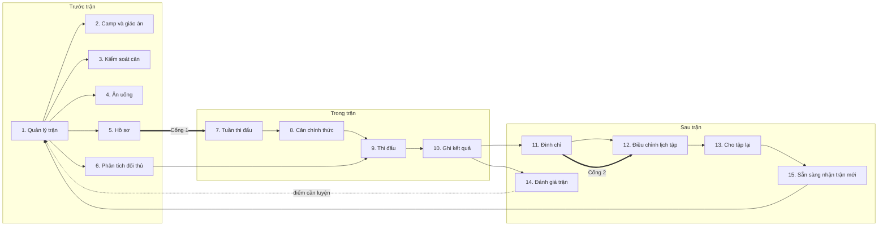
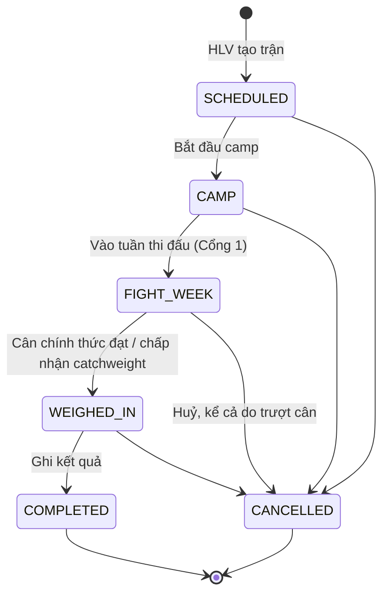

# Fight Camp — Luồng nghiệp vụ

**Cập nhật**: 2026-10-21 (viết lại đề xuất thành 15 nghiệp vụ, sửa các lỗi đã kiểm chứng); 2026-10-20 (thêm đề xuất [Nghiệp vụ hệ thống trước, trong và sau trận](#nghiệp-vụ-hệ-thống-trước-trong-và-sau-trận-đề-xuất-2010-chờ-duyệt), chờ duyệt); 2026-10-14 (thêm mục [Nghiệp vụ theo giai đoạn](#nghiệp-vụ-theo-giai-đoạn))
**Thuộc bộ tài liệu**: [Phạm vi](./SCOPE-FIGHT-CAMP.md) · [Nghiên cứu](./FIGHT-CAMP-DOMAIN-RESEARCH.md) · **Luồng nghiệp vụ** · [Tech spec](./FIGHT-CAMP-TECH-SPEC.md) · [Kiểm thử người dùng](./FIGHT-CAMP-USER-TESTING.md) · [Câu hỏi mở](./FIGHT-CAMP-OPEN-QUESTIONS.md)

Tài liệu này mô tả **ai làm gì, khi nào, app kiểm tra gì** trong vòng đời một trận, tức là phạm vi đã chốt: quản lý võ sĩ trước, trong và sau trận đấu. Dev dùng nó để viết rule và test, QA dùng phần tiêu chí nghiệm thu. Chỗ nào chưa chốt thì ghi **[Chờ chốt]** và trỏ tới câu hỏi ở [SCOPE-FIGHT-CAMP.md](./SCOPE-FIGHT-CAMP.md#quyết-định-và-câu-hỏi).

**Phạm vi trước 31/10:** một số phần dưới đây (thông báo, ghi buổi tập nhanh, màn Admin bật/tắt chế độ không có bác sĩ) đã được cắt khỏi đợt đồ án (mẫu giáo án cho từng buổi tập đã mở lại ngày 20/10, quyết định 21; camp tự sinh từ template vẫn cắt); xem [Phạm vi – Cắt khỏi đợt đồ án](./SCOPE-FIGHT-CAMP.md#cắt-khỏi-đợt-đồ-án). Thiết kế vẫn giữ để làm sau.

Tài liệu này thay [BUSINESS-FLOWS.md](./BUSINESS-FLOWS.md) cho phần fight camp. Các luồng cũ (tuyển võ sĩ, cổng Doctor đầy đủ, AI review) vẫn giữ nguyên nhưng đang đóng băng.

---

## Nghiệp vụ theo giai đoạn

Phạm vi đã chốt ngày 14/10 ([Phạm vi, quyết định 10](./SCOPE-FIGHT-CAMP.md#quyết-định-và-câu-hỏi)) là quản lý võ sĩ **trước, trong và sau trận**. Mục này gom các luồng F1–F8 theo ba giai đoạn, cho biết mỗi giai đoạn bắt đầu và kết thúc khi nào, HLV cần biết điều gì, ai làm việc gì và app kiểm tra gì. Quy tắc chi tiết nằm ở luồng được dẫn chiếu. Quy tắc mới duy nhất là 7 điểm trong bảng [Các điểm đã làm rõ](#các-điểm-đã-làm-rõ-h1h7).

| Giai đoạn | Bắt đầu | Kết thúc | Trạng thái trận | HLV cần trả lời | Luồng |
| --- | --- | --- | --- | --- | --- |
| **Trước trận** | HLV tạo trận | Trận vào tuần thi đấu (qua Cổng 1) | `SCHEDULED`, `CAMP` | Võ sĩ có kịp cân không? Hồ sơ đủ chưa? | F1, F2, F3, F4, F8 |
| **Trong trận** | Vào tuần thi đấu, sớm nhất là ngày cân − `fightWeekDays` (mặc định 7 ngày) | Kết quả trận được ghi | `FIGHT_WEEK`, `WEIGHED_IN` | Võ sĩ có đạt cân không? Trận kết thúc thế nào? | F5, F6, F8 |
| **Sau trận** | Trận `COMPLETED` | Võ sĩ không còn đình chỉ nào có hiệu lực | `COMPLETED` | Võ sĩ đã được tập lại chưa? | F7 |

Trận có thể bị huỷ ở bất kỳ giai đoạn nào trước khi có kết quả ([Huỷ trận theo giai đoạn](#huỷ-trận-theo-giai-đoạn)).

Sau review 2 (20/10), cả ba giai đoạn có bản viết lại thành 15 nghiệp vụ, mỗi nghiệp vụ ghi người dùng làm gì và app tự làm gì, chờ duyệt: [Nghiệp vụ hệ thống trước, trong và sau trận](#nghiệp-vụ-hệ-thống-trước-trong-và-sau-trận-đề-xuất-2010-chờ-duyệt). Các bảng dưới đây là thiết kế đã duyệt ngày 14/10.

### Trước trận

Mục tiêu: đưa võ sĩ vào tuần thi đấu đúng hạng cân và đủ hồ sơ.

| Việc | Ai làm | App ghi lại và kiểm tra | Luồng | Đợt đồ án |
| --- | --- | --- | --- | --- |
| Tạo trận: giải, ruleset, hạng cân (kg), giờ cân, giờ thi, đối thủ | HLV | Giờ cân trước giờ thi; võ sĩ thuộc phạm vi HLV; sinh checklist hồ sơ từ ruleset; cảnh báo nếu đình chỉ của võ sĩ kéo dài quá ngày thi | F1 | Làm |
| Gắn camp, bắt đầu camp | HLV | Plan của cùng võ sĩ, phase `fight_camp`; mỗi võ sĩ tối đa một trận đang chạy | F2 | Làm: gắn plan có sẵn; camp tự sinh từ template vẫn cắt; mẫu buổi tập trong form tạo buổi: T-026 |
| Ghi cân mỗi sáng | Võ sĩ, hoặc HLV ghi hộ | Mỗi ngày học viện chỉ giữ một số; trạng thái xanh / vàng / đỏ / xám | F3 | Làm: cảnh báo hiện trên dashboard, không gửi thông báo |
| Cập nhật checklist hồ sơ | HLV; bác sĩ xác nhận nếu có | Trạng thái, ngày cấp, hạn hiệu lực; mục HLV thêm mang nhãn "HLV nhập, chưa xác minh" | F4 | Làm: chưa có quyền xác nhận của bác sĩ |
| Đổi ngày, đổi hạng cân | HLV | Tính lại hạn nộp hồ sơ, ngưỡng cảnh báo cân, hiệu lực hồ sơ đến ngày thi mới | F8 | Làm |
| Kế hoạch ăn, một chạm "ăn theo kế hoạch?" khi ghi cân | HLV hoặc chuyên gia nhập kế hoạch; võ sĩ trả lời | Kế hoạch theo giai đoạn của trận; mỗi ngày học viện một câu trả lời; chấm màu trên biểu đồ cân. App không tự đề xuất chế độ ăn | E1 | Làm (T-009) |
| Phân tích đối thủ: hồ sơ, quan sát, kế hoạch thi đấu, gắn chiến thuật với buổi tập | HLV | Tối đa 6 quan sát; mỗi chiến thuật có quan sát làm căn cứ; báo chiến thuật chưa có buổi tập | E2 | Làm (T-010) |
| Vào tuần thi đấu | HLV | **Cổng 1**: hôm nay ≥ ngày cân − `fightWeekDays`, và mọi mục bắt buộc ở `PROVIDED` / `CONFIRMED`, còn hiệu lực đến ngày thi | F4, F5 | Làm |

Kết thúc khi trận sang `FIGHT_WEEK`. Nếu Cổng 1 không đạt, trận đứng ở `CAMP` và app liệt kê các mục thiếu hoặc hết hạn. HLV bổ sung hồ sơ, đổi ngày hoặc huỷ trận.

### Trong trận

Mục tiêu: võ sĩ qua cân chính thức và kết quả trận được ghi lại. Giai đoạn này gồm tuần thi đấu, buổi cân và ngày thi.

| Việc | Ai làm | App ghi lại và kiểm tra | Luồng | Đợt đồ án |
| --- | --- | --- | --- | --- |
| Tuần thi đấu | HLV, võ sĩ | Hồ sơ bị khoá, muốn sửa phải mở khoá và ghi lý do; cảnh báo cân dùng ngưỡng tuần cuối, nhắc ghi cân mỗi ngày | F5 | Làm |
| Cân chính thức | HLV | Số cân chính thức, lưu thêm vào `fighter_measurements` với bối cảnh `WEIGH_IN`; app gợi ý đạt / không đạt so với giới hạn, HLV xác nhận; kiểm tra nước là trường tùy chọn | F5 | Làm |
| Xử lý trượt cân | HLV | Chọn catchweight (ghi giới hạn mới và ghi chú) để sang `WEIGHED_IN`, hoặc huỷ trận với lý do "Không đạt cân" | F5 | Làm |
| Thi đấu | — | App không làm gì trong lúc thi đấu: không chấm điểm, không theo dõi trực tiếp, không kê chế độ bù nước sau cân ([Nghiên cứu §4](./FIGHT-CAMP-DOMAIN-RESEARCH.md#4-giảm-cân-cấp-tốc-giới-hạn-khuyến-nghị)) | — | — |
| Ghi kết quả | HLV | Kết quả, cách kết thúc, hiệp, có bị đánh ngã không, ghi chú chấn thương; thua KO/TKO thì hỏi thêm về mất ý thức; thua TKO thì hỏi trận có dừng vì đòn vào đầu không; chỉ ghi được từ ngày thi | F6 | Làm |

Kết thúc khi kết quả được lưu và trận sang `COMPLETED`.

### Sau trận

Mục tiêu: võ sĩ không tập các loại buổi bị cấm khi chưa hồi phục, và khi được tập lại thì có căn cứ rõ ràng.

| Việc | Ai làm | App ghi lại và kiểm tra | Luồng | Đợt đồ án |
| --- | --- | --- | --- | --- |
| Đình chỉ từ kết quả trận | App gợi ý; HLV hoặc bác sĩ xác nhận | Thua KO, hoặc TKO do đòn vào đầu: số ngày theo `suspensionRules`, có tính các lần KO trước. Bị truất quyền: theo ruleset. Mọi trận: nghỉ bắt buộc `restDaysAfterBout`. Sửa số ngày gợi ý phải ghi lý do; ruleset không có quy tắc thì HLV tự nhập | F7 | Làm |
| Đình chỉ thủ công | HLV, bác sĩ | Đình chỉ không gắn trận, ví dụ KO trong buổi sparring; vẫn được tính vào lịch sử KO | F7 | Làm |
| Cổng 2 | App | Còn đình chỉ có hiệu lực thì không xếp lịch và không bắt đầu được loại buổi bị chặn (409 `TRAINING_SUSPENSION_ACTIVE`); buổi đã xếp từ trước hiện cảnh báo trên lịch | F7 | Làm |
| Xác nhận được tập lại | HLV hoặc bác sĩ | Chỉ sau ngày kết thúc đình chỉ; bắt buộc ghi căn cứ; không có giấy thì ghi "không có xác nhận y tế" | F7 | Làm |
| Ghi chấn thương sau trận | HLV | Ô chữ tùy chọn "Chấn thương sau trận" trong form kết quả (H2). Không ghi vào `injury_records` | F6 | Làm |
| Đánh giá chiến thuật | HLV | Mỗi chiến thuật: hiệu quả, không hiệu quả, không dùng tới; chỉ nhập khi trận đã `COMPLETED` | E2 | Làm (T-010) |
| Xem lại video trận | HLV | — | — | Cắt khỏi đợt đồ án |

Kết thúc khi võ sĩ không còn đình chỉ nào có hiệu lực. Võ sĩ thắng mà ruleset không có ngày nghỉ bắt buộc thì kết thúc ngay khi ghi kết quả.

Võ sĩ **sẵn sàng nhận trận mới** khi không có trận nào ở `CAMP`, `FIGHT_WEEK` hoặc `WEIGHED_IN` và không có đình chỉ nào có hiệu lực. Đây là giá trị tính khi đọc, không lưu. App không chặn tạo trận mới khi võ sĩ chưa sẵn sàng; F1 chỉ cảnh báo. Trạng thái này hiện ở tab Đình chỉ của hub "Trận" và trên trang chi tiết trận (H7).

### Huỷ trận theo giai đoạn

| Thời điểm huỷ | Quy tắc |
| --- | --- |
| Trước trận, tuần thi đấu | Bắt buộc chọn lý do. Camp được giữ, HLV quyết định giữ hay huỷ các buổi `SCHEDULED` còn lại (F8) |
| Sau cân chính thức (`WEIGHED_IN`), ví dụ đối thủ rút hoặc võ sĩ không qua khám của ban tổ chức | Bắt buộc chọn lý do. Không tạo đình chỉ hay ngày nghỉ bắt buộc (H4). Không qua khám của ban tổ chức thì chọn "Khác" và ghi chú (H5) |
| Sau khi có kết quả | Không huỷ được, vì `COMPLETED` là trạng thái cuối |

### Nghiệp vụ hệ thống trước, trong và sau trận (đề xuất 20/10, chờ duyệt)

**Vì sao có mục này.** Ở review 2 (20/10), giảng viên nhận xét phần trước trận đã ổn, còn phần trong và sau trận chưa rõ nghiệp vụ: người dùng tự làm hầu hết, hệ thống chủ yếu nhận dữ liệu. Giảng viên gợi ý một ví dụ cho phần trong trận: phân tích đối thủ giữa các hiệp. Mục này liệt kê **15 nghiệp vụ** của ba giai đoạn. Mỗi nghiệp vụ ghi người dùng làm gì và app tự làm gì. Quy tắc chi tiết (R1–R32) nằm ở [phụ lục](#phụ-lục-quy-tắc-chi-tiết-r1r32) cuối mục.

**Nguyên tắc.** Người dùng chỉ nhập những gì app không tự biết, tức những gì xảy ra ngoài đời: số cân, giấy tờ đã có, diễn biến từng hiệp, kết quả. Phần nào suy ra được từ dữ liệu đã có thì app tự tính, tự kiểm tra, tự chuyển trạng thái.



#### Trước trận

Bắt đầu khi HLV tạo trận, kết thúc khi trận vào tuần thi đấu. Trạng thái `SCHEDULED`, `CAMP`.

| # | Nghiệp vụ | Người dùng làm | App tự làm | Quy tắc | Ticket |
| --- | --- | --- | --- | --- | --- |
| 1 | **Quản lý trận** | HLV tạo trận: giải, bộ luật, hạng cân, giờ cân, giờ thi, đối thủ, số hiệp. Đổi ngày, đổi hạng, huỷ | Kiểm tra phạm vi HLV và ngày giờ; chụp quy định từ bộ luật; sinh checklist hồ sơ; kiểm tra khả thi về cân ngay trên form; tính lại khi đổi ngày, đổi hạng; nhắc điểm cần luyện của trận trước | R1–R4c, R31 | T-003, T-004 |
| 2 | **Lập camp và giáo án** | HLV gắn kế hoạch tập vào trận và xếp buổi tập. Ba mức giáo án: (a) mẫu cho từng buổi; (b) giáo án cả camp, app dàn buổi tập đếm ngược từ ngày thi; (c) giáo án theo đối thủ (nghiệp vụ 6) | Kiểm tra plan cùng võ sĩ, phase `fight_camp`, mỗi võ sĩ một trận đang chạy; điền sẵn buổi tập từ mẫu | R5 | (a) T-026; (b) cắt khỏi đợt đồ án; (c) T-010 |
| 3 | **Kiểm soát cân** | Võ sĩ ghi một số kg mỗi sáng | Đường tham chiếu; trạng thái xanh, vàng, đỏ, xám; câu khuyến nghị khi đỏ | R6, R7 | T-003, T-005 |
| 4 | **Ăn uống** | HLV hoặc chuyên gia nhập kế hoạch ăn cho ba giai đoạn; võ sĩ một chạm "Hôm qua ăn theo kế hoạch không?" | Hiện đúng kế hoạch của giai đoạn hiện tại; chấm màu trên biểu đồ cân | R8, R9 | T-009 |
| 5 | **Hồ sơ thi đấu** | HLV đánh dấu từng giấy tờ đã có, ngày cấp, hạn hiệu lực | Hạn nộp; cảnh báo mục còn thiếu; nhãn "Hồ sơ trễ hạn"; **Cổng 1** | R10–R12, R15 | T-003 |
| 6 | **Phân tích đối thủ** | HLV nhập quan sát có bằng chứng, chiến thuật "Khi … thì …", gắn chiến thuật với buổi tập | Kiểm tra mỗi chiến thuật có căn cứ; đánh dấu chiến thuật chưa luyện | R13, R14 | T-010 |

Giai đoạn kết thúc khi HLV bấm "Vào tuần thi đấu" và Cổng 1 đạt. App báo trong Việc cần làm ngay khi trận đủ điều kiện (R16).

#### Trong trận

Gồm tuần thi đấu, buổi cân chính thức và ngày thi. Trạng thái `FIGHT_WEEK`, `WEIGHED_IN`.

| # | Nghiệp vụ | Người dùng làm | App tự làm | Quy tắc | Ticket |
| --- | --- | --- | --- | --- | --- |
| 7 | **Tuần thi đấu** | Không nhập thêm | Khoá hồ sơ; dùng ngưỡng cân tuần cuối; đổi sang kế hoạch ăn "Tuần thi đấu"; nhắc võ sĩ khi hôm nay chưa ghi cân | T0 | T-006 |
| 8 | **Cân chính thức** | HLV nhập số cân, và kết quả kiểm tra nước nếu giải yêu cầu | Đạt thì tự sang `WEIGHED_IN`; không đạt thì chỉ hỏi catchweight hay huỷ; cờ "giảm cấp tốc vượt ngưỡng" | R17–R19 | T-006 |
| 9 | **Thi đấu** | Xem thẻ góc đài trên điện thoại hoặc in ra. Trợ lý ghi từng hiệp trong lúc thi (tối đa 4 chạm mỗi hiệp); không ghi kịp thì ghi lại sau trận trên cùng màn | Dựng thẻ góc đài từ phân tích đối thủ; sau mỗi hiệp: xếp lại chiến thuật, lời dặn cho hiệp sau, thế trận, cảnh báo an toàn | R20–R24 | Chưa có ticket; đề xuất làm cùng T-010 |
| 10 | **Ghi kết quả** | HLV 2 chạm: kết quả, cách kết thúc. Thua KO/TKO thì thêm 2 câu; ô chữ tùy chọn "Chấn thương sau trận" | Điền sẵn từ bản ghi các hiệp; kiểm tra mâu thuẫn; trận sang `COMPLETED`; chạy các nghiệp vụ sau trận | R25, R26 | T-006 |

#### Sau trận

Bắt đầu khi có kết quả, kết thúc khi võ sĩ được tập lại.

| # | Nghiệp vụ | Người dùng làm | App tự làm | Quy tắc | Ticket |
| --- | --- | --- | --- | --- | --- |
| 11 | **Đình chỉ** | Không nhập, trừ khi bộ luật không có quy tắc. Sửa số ngày thì ghi lý do | Áp quy tắc nặng nhất của bộ luật, đình chỉ có hiệu lực ngay, kèm câu giải thích; áp ngày nghỉ bắt buộc; tạo việc "Cân nhắc đình chỉ thủ công" khi cần | R27 | T-007 |
| 12 | **Điều chỉnh lịch tập** | Một chạm "Áp dụng tất cả", hoặc bỏ chọn từng buổi | **Cổng 2** chặn xếp và bắt đầu loại buổi bị cấm; tìm buổi đã xếp bị xung đột, đề xuất đổi, dời hoặc huỷ | R28 | T-007 |
| 13 | **Cho tập lại** | HLV hoặc bác sĩ ghi căn cứ, chỉ với đình chỉ cần xác nhận | Tính trạng thái theo ngày; tạo việc "Chờ xác nhận được tập lại" | S3 | T-007 |
| 14 | **Đánh giá trận** | Sửa nếu không đồng ý | Tự đánh giá từng chiến thuật từ bản ghi các hiệp; cập nhật hồ sơ đối thủ; lập danh sách điểm cần luyện | R29, R30 | T-010 |
| 15 | **Sẵn sàng nhận trận mới** | Không | Tính khi đọc: không có trận đang chạy, không có đình chỉ còn hiệu lực; bảng sẵn sàng toàn CLB; quay lại nghiệp vụ 1 | S3, H7, R32 | T-007 |

#### Việc cần làm của HLV

Một thẻ trên dashboard HLV, gom việc của cả ba giai đoạn. Thẻ tính khi đọc, không cần job chạy nền, không gửi thông báo. Thẻ "Cảnh báo cân" của T-005 phần B thành một nhóm trong thẻ này.

| Giai đoạn | Việc | Sinh từ |
| --- | --- | --- |
| Trước | Hồ sơ còn thiếu, còn ≤ 14 ngày đến hạn nộp; hồ sơ trễ hạn | R11 |
| Trước | Cân vàng, đỏ hoặc xám | R7 |
| Trước | Chiến thuật chưa có buổi tập | R14 |
| Trước | Đủ điều kiện vào tuần thi đấu | R16 |
| Trong | Hôm nay cân chính thức | R17 |
| Trong | Đã qua ngày thi mà chưa có kết quả | R26 |
| Sau | Buổi tập xung đột với đình chỉ chưa xử lý | R28 |
| Sau | Đình chỉ chờ xác nhận được tập lại | S3 |
| Sau | Cân nhắc đình chỉ thủ công | R27 |

#### Bổ sung 21/10 (chờ duyệt)

| Ý | Nghiệp vụ | Mức | Ticket đề xuất |
| --- | --- | --- | --- |
| Kiểm tra khả thi về cân ngay khi tạo trận (R31) | 1, 3 | Làm | T-004 (form), backend kèm T-006 |
| Bảng "Sẵn sàng nhận trận" toàn CLB, lọc theo hạng cân và ngày thi dự kiến (R32) | 15 | Làm | T-007 |
| Dữ liệu demo theo giai đoạn: 5 võ sĩ giả, mỗi người đứng ở một giai đoạn (camp, tuần thi đấu, vừa cân xong, đang đình chỉ, sẵn sàng) | Demo | Làm | T-008 |
| Dòng thời gian của trận: mọi chuyển trạng thái, đình chỉ, xác nhận tập lại, kèm người làm và lý do; đọc từ `bouts.history` và bảng đình chỉ | Cả 15 | Nếu còn thời gian | T-004 |
| Nút "Đã trao đổi" trên Việc cần làm: HLV ghi một câu, dòng đó ẩn đến khi trạng thái gốc đổi. Cần chỗ lưu mới; đề xuất gộp vào migration 027 | Việc cần làm | Nếu còn thời gian | Cùng thẻ Việc cần làm |
| Trang tóm tắt chấn thương đầu khi xác nhận cho tập lại: các lần KO/TKO do đòn vào đầu, mức mất ý thức, các đình chỉ trước | 13 | Nếu còn thời gian | T-007 |
| Võ sĩ xem báo cáo trận bản rút gọn: kết quả đánh giá chiến thuật và điểm cần luyện, không có quan sát chi tiết | 14 | Nếu còn thời gian | T-010 |

Dữ liệu demo theo giai đoạn là cần thiết, vì gần như mọi trạng thái đổi theo ngày: không có dữ liệu như vậy thì demo phải chờ đến ngày cân hay ngày hết đình chỉ. Không dùng cách "ngày giả lập" (tua thời gian), vì phải sửa mọi phép tính theo ngày.

#### Thay đổi so với thiết kế đã duyệt

1. Bước "Thi đấu" ở mục [Trong trận](#trong-trận) đổi từ "app không làm gì" thành nghiệp vụ 9. Đây không phải checklist ngày thi đã cắt ở H1. HLV tự chấm từng hiệp (R23) là đánh giá riêng của HLV, không phải chấm điểm chính thức như ý "không chấm điểm" ở thiết kế cũ.
2. F5: đạt cân thì tự sang `WEIGHED_IN`, bỏ bước HLV xác nhận. Kiểm tra nước không đạt thì xử lý như không đạt cân (R17).
3. F7: đình chỉ tự áp dụng thay vì gợi ý rồi chờ xác nhận. Số ngày vẫn sửa được, kèm lý do.
4. E2 phần 5: app tự điền đánh giá từ bản ghi các hiệp (R29). Thứ tự cắt khi trễ cần lập lại, vì mục này không còn đứng đầu.
5. Mới: thẻ Việc cần làm, R4b và R30 nối sau trận với trận tiếp theo.
6. Dữ liệu mới: `bouts.scheduled_rounds` và bảng ghi theo hiệp (đề xuất `bout_rounds`, mỗi trận và mỗi số hiệp một dòng). Đưa cả hai vào migration 027 cùng E2 (T-010 chưa bắt đầu), để không mở lại T-003. Chi tiết sẽ ghi vào Tech spec sau khi chủ dự án duyệt.
7. Nghiệp vụ 2, giáo án cả camp: vẫn cắt khỏi đợt đồ án (quyết định 21; chủ dự án giữ cắt ngày 21/10). Đợt này làm mẫu cho từng buổi (T-026) và giáo án theo đối thủ (T-010).
8. Mới (21/10): R31 kiểm tra khả thi khi tạo trận, R32 bảng sẵn sàng toàn CLB, và các ý ở mục [Bổ sung 21/10](#bổ-sung-2110-chờ-duyệt).

Phần trước trận không đổi quy tắc nào đã duyệt; chỉ thêm ô số hiệp ở form tạo trận, R4b, R16 và R31.

#### Thứ tự ticket

Để T-006 không phải chờ T-007 và T-010:

- T-006 ghi kết quả như F6. R25 chỉ điền sẵn khi trận đã có bản ghi hiệp; chưa có thì HLV nhập tay.
- Đình chỉ (nghiệp vụ 11) chạy cùng giao dịch ghi kết quả khi T-007 đã merge. Báo cáo trận (nghiệp vụ 14) có khi T-010 đã merge.
- Nghiệp vụ 9 và ô số hiệp cần migration 027, nên đi cùng hoặc sau T-010.

#### Tiêu chí nghiệm thu (dự kiến, bổ sung cho §6)

- Giới hạn 60 kg, cân chính thức 59,8 kg, không có kiểm tra nước: trận sang `WEIGHED_IN` mà không có bước xác nhận.
- Cân chính thức đạt nhưng kiểm tra nước `FAILED`: app hỏi catchweight hay huỷ, trận chưa sang `WEIGHED_IN`.
- Màn ghi hiệp mặc định hỏi đúng 4 câu; tình trạng võ sĩ chỉ hiện khi người ghi mở thêm.
- Chiến thuật t1 không hiệu quả ở hiệp 1 và hiệp 2: lời dặn hiệp 3 không có t1 và có t2, nếu t2 có cùng quan sát làm căn cứ.
- Trận 3 hiệp, HLV tự chấm thua hiệp 1 và hiệp 2: app hiện "Khó thắng tính điểm".
- Bị đánh ngã ở hiệp 1 và hiệp 2: hiện cảnh báo an toàn trước hiệp 3. Võ sĩ thắng hoặc thua tính điểm: không có đình chỉ tự động, nhưng có việc "Cân nhắc đình chỉ thủ công".
- Preset AIBA, võ sĩ có đình chỉ KO tạo thủ công 40 ngày trước, nay thua KO: đình chỉ 90 ngày được tạo và có hiệu lực ngay, kèm quy tắc đã áp dụng.
- Buổi `SPARRING` đã xếp vào ngày thứ 5 của đình chỉ: nằm trong danh sách đề xuất đổi sang `RECOVERY`; sau khi áp dụng, loại buổi đã đổi.
- t1 hiệu quả ở hiệp 1 và hiệp 2, không dùng ở hiệp 3: đánh giá sau trận là *Hiệu quả*.
- Đình chỉ `MANDATORY_REST` qua ngày kết thúc: võ sĩ về "Được tập" mà không ai phải bấm.
- Đình chỉ KO kết thúc ngày D: việc "Chờ xác nhận được tập lại" xuất hiện ngày D + 1, không phải ngày D.
- Tạo trận mới cho võ sĩ vừa thua với chiến thuật t1 *không hiệu quả*: form tạo trận hiện t1 trong "Điểm cần luyện".
- HLV tạo trận gặp đối thủ trùng tên với trận của võ sĩ mà HLV không được phân công: app không đề nghị chép phân tích.
- Trận ở `CAMP`, Cổng 1 đạt, hôm nay đúng ngày cân − 7: Việc cần làm có dòng "Đủ điều kiện vào tuần thi đấu".
- Tạo trận giới hạn 60 kg, ngưỡng 8%, cân sau 2 ngày, số cân gần nhất của võ sĩ là 66 kg ghi hôm qua: form hiện trạng thái đỏ và phần phải giảm 9,1% trước khi lưu; HLV vẫn lưu được.
- Võ sĩ không có số cân nào trong 7 ngày gần nhất: form tạo trận hiện "Chưa đủ dữ liệu cân", không hiện trạng thái.
- Bảng sẵn sàng, lọc hạng 60 kg, ngày thi dự kiến sau 30 ngày: võ sĩ có đình chỉ kết thúc sau ngày đó hiện "Chưa sẵn sàng" kèm ngày dự kiến tập lại; võ sĩ đang có trận ở `CAMP` không nằm trong nhóm sẵn sàng.
- HLV chỉ thấy trên bảng sẵn sàng các võ sĩ mình được phân công; Admin thấy toàn CLB.
- Thẻ góc đài in được trên một trang A4 từ trình duyệt.

#### Chờ chốt

- Ai ghi giữa hiệp: HLV chính ở góc đài hay trợ lý ngồi ngoài. Chưa kiểm chứng giải có cho dùng điện thoại ở góc đài không; nếu không cho thì vẫn dùng được thẻ in và ghi sau trận.
- Các ngưỡng đánh dấu **(đề xuất)** ở R21, R22, R24 cần HLV có chuyên môn duyệt.
- Ước lượng: khoảng 1,5–2 ngày công cho nghiệp vụ 9, 10, 14 (bảng hiệp, API, màn ghi hiệp trên điện thoại, thẻ in); khoảng 1 ngày cho nghiệp vụ 11–13 so với thiết kế cũ; khoảng 0,5 ngày cho thẻ Việc cần làm. Chủ dự án chọn phần cắt bù trong Sprint 2.

#### Phụ lục: quy tắc chi tiết (R1–R32)

Ký hiệu: **(T-003)** là quy tắc đã duyệt ngày 14/10 và đã code trên nhánh `feat/T-003-bouts-core`; nhánh này đang chờ review, chưa merge vào `fight-camp`. **(đã duyệt)** là quy tắc đã duyệt nhưng chưa code. **(mới)** là quy tắc của đề xuất này. Các ngưỡng ghi **(đề xuất)** là đề xuất của Claude, chưa có nguồn.

**Trạng thái trận: ai kích hoạt**

| Chuyển | Người kích hoạt | Quy tắc | Thay đổi |
| --- | --- | --- | --- |
| Tạo → `SCHEDULED` | HLV | R1–R4 | Thêm số hiệp |
| `SCHEDULED` → `CAMP` | HLV gắn plan; `POST /bouts/:id/camp` gắn và chuyển trong một bước | R5 | Không |
| `CAMP` → `FIGHT_WEEK` | HLV bấm "Vào tuần thi đấu" | R15 | Không; app báo "Đủ điều kiện" trong Việc cần làm |
| `FIGHT_WEEK` → `WEIGHED_IN` | **Hệ thống**, ngay khi cân chính thức đạt; HLV chỉ chọn khi không đạt | R17, R18 | Bỏ bước HLV xác nhận đạt |
| `WEIGHED_IN` → `COMPLETED` | **Hệ thống**, khi HLV lưu kết quả (từ ngày thi) | R25, R26 | Không |
| Bất kỳ trừ `COMPLETED` → `CANCELLED` | HLV, bắt buộc lý do | — | Không |
| Đình chỉ: có hiệu lực → chờ xác nhận → hết | **Hệ thống**, theo ngày. Với đình chỉ cần xác nhận, HLV hoặc bác sĩ xác nhận được tập lại | R27, S3 | Đình chỉ tự áp dụng thay vì gợi ý |

**Nghiệp vụ 1. Quản lý trận**

- **R1 (T-003).** Võ sĩ phải thuộc phạm vi HLV (403). Giờ cân trước giờ thi, giờ thi ở tương lai (422).
- **R2 (T-003).** Chụp lại từ bộ luật: giới hạn kg của hạng cân, số ngày hạn nộp hồ sơ, ngưỡng giảm cấp tốc (8% nếu cân trước thi ≥ 12 giờ, 5% nếu dưới 12 giờ).
- **R3 (T-003).** Sinh checklist hồ sơ từ bộ luật, mỗi mục ở `MISSING`.
- **R4 (đã duyệt, chưa code).** Cảnh báo, không chặn: võ sĩ còn đình chỉ kéo dài quá ngày thi, hoặc đang có trận khác đang chạy. Cần bảng `suspensions` của T-007.
- **R4b (mới).** Võ sĩ có trận `COMPLETED` trước đó: form tạo trận hiện "Điểm cần luyện" của trận đó (R30). Đối thủ trùng tên với một trận cũ thì app đề nghị chép phân tích đối thủ cũ. Chỉ xét các trận HLV được xem; so tên không phân biệt hoa thường và bỏ khoảng trắng thừa.
- **R4c (T-003).** Đổi ngày cân hoặc ngày thi (khi trận chưa `WEIGHED_IN`), đổi hạng cân kèm lý do (đến hết `FIGHT_WEEK`). Hạn nộp, trạng thái cân và Cổng 1 là giá trị tính khi đọc nên tự tính lại. Ngưỡng giảm cấp tốc và giới hạn kg được chụp lại.

- **R31 (mới). Kiểm tra khả thi khi tạo trận.** Khi HLV chọn võ sĩ, hạng cân và giờ cân, form lấy số cân gần nhất của võ sĩ trong 7 ngày **(đề xuất)** và tính phần phải giảm, trạng thái cân như R7 cho trận sắp tạo. Chỉ cảnh báo, không chặn lưu. Không có số cân trong khoảng đó thì hiện "Chưa đủ dữ liệu cân". App không gợi ý cách giảm cân.

**Nghiệp vụ 2. Lập camp và giáo án**

- **R5 (T-003).** Plan phải của cùng võ sĩ, phase `fight_camp`. Mỗi võ sĩ tối đa một trận ở `CAMP`, `FIGHT_WEEK` hoặc `WEIGHED_IN` (409). Cổng 2 vẫn áp dụng khi xếp buổi.
- Mẫu cho từng buổi: theo [T-026](./tickets/T-026-session-templates.md).

**Nghiệp vụ 3, 4. Cân và ăn uống**

- **R6 (T-003).** Mỗi ngày học viện chỉ giữ một số cân; ghi lại thì bản mới thay bản cũ.
- **R7 (T-003).** Tính phần còn phải giảm (%), đường tham chiếu và trạng thái theo [Tech spec §5](./FIGHT-CAMP-TECH-SPEC.md#5-cảnh-báo-cân-nặng). App không đề xuất chế độ ăn, hạn chế nước hay xông hơi.
- **R8 (E1).** Chấm màu mỗi điểm cân theo câu trả lời ăn uống. Khi trạng thái vàng hoặc đỏ, thẻ cảnh báo kèm tóm tắt 3 ngày gần nhất.
- **R9 (E1).** Tự hiện kế hoạch ăn đúng giai đoạn: *Trong camp*, *Tuần thi đấu*, *Từ lúc cân đến giờ thi*.

**Nghiệp vụ 5. Hồ sơ và Cổng 1**

- **R10 (T-003).** Cổng 1 đạt khi mọi mục bắt buộc ở `PROVIDED` hoặc `CONFIRMED` và còn hiệu lực đến hết ngày thi.
- **R11 (T-003).** Hạn nộp = ngày cân − số ngày hạn nộp. Từ 14 ngày trước hạn nộp, mục còn `MISSING` được cảnh báo. Quá hạn mà chưa đạt thì trận mang nhãn "Hồ sơ trễ hạn".
- **R12 (T-003).** Mục do HLV thêm mang nhãn "HLV nhập, chưa xác minh"; mọi thay đổi checklist được ghi lịch sử.
- **R15 (T-003).** Chỉ chuyển `FIGHT_WEEK` khi trận ở `CAMP`, hôm nay ≥ ngày cân − `fightWeekDays`, và Cổng 1 đạt; không đạt thì trả 409 kèm danh sách mục thiếu.
- **R16 (mới).** Đúng ngày đủ điều kiện, app đưa "Đủ điều kiện vào tuần thi đấu" vào Việc cần làm.

**Nghiệp vụ 6. Phân tích đối thủ**

- **R13 (E2).** Chiến thuật phải có ít nhất một quan sát làm căn cứ (422). Tối đa 6 quan sát, 5 chiến thuật.
- **R14 (E2).** Tự đánh dấu chiến thuật chưa có buổi tập nào.

**Nghiệp vụ 7. Tuần thi đấu (T0)**

Khi trận ở `FIGHT_WEEK`, app tự khoá checklist hồ sơ (muốn sửa phải mở khoá và ghi lý do, F5), dùng ngưỡng giảm cấp tốc của tuần cuối (R7), hiện kế hoạch ăn "Tuần thi đấu" (R9), và nhắc trên trang trận của võ sĩ nếu hôm nay chưa ghi cân.

**Nghiệp vụ 8. Cân chính thức**

- **R17 (mới).** Số cân ≤ giới hạn và kiểm tra nước không phải `FAILED`: đạt, trận tự sang `WEIGHED_IN`. Kiểm tra nước `FAILED` thì xử lý như không đạt cân (R18).
- **R18 (mới).** Không đạt: tính phần vượt bằng kg và %, rồi chỉ hỏi một câu: catchweight (giới hạn mới mặc định bằng số cân chính thức) hay huỷ với lý do "Không đạt cân".
- **R19 (mới).** So số cân chính thức với số cân tự ghi đầu tiên trong `acute_window_days` ngày cuối. Giảm quá ngưỡng giảm cấp tốc thì đánh dấu trận "Giảm cấp tốc vượt ngưỡng"; cờ hiện trên thẻ góc đài và báo cáo trận. Không có số cân nào trong khoảng đó thì không đánh dấu và ghi "không đủ dữ liệu". App không kê chế độ bù nước.

**Nghiệp vụ 9. Thi đấu**

- **R20 (mới). Thẻ góc đài.** Khi trận sang `WEIGHED_IN`, app dựng thẻ từ phân tích đối thủ. Chiến thuật dựa trên quan sát `REPEATED` xếp trước `ONCE`; cùng mức thì chiến thuật đã có buổi tập xếp trước, chiến thuật chưa luyện mang nhãn "Chưa luyện". Chiến thuật gán cho một hiệp (trường `round`) chỉ hiện ở hiệp đó. Thẻ kèm cờ R19 nếu có. Xem được trên điện thoại và in được trên một trang A4 bằng chức năng in của trình duyệt.
- **Ghi mỗi hiệp: mặc định 4 chạm, không gõ chữ.** Hai chiến thuật đang được dặn: *hiệu quả*, *không hiệu quả* hoặc *không dùng*. Quan sát chính của hiệp: *thấy lại* hoặc *không thấy*. HLV tự chấm hiệp: *thắng*, *thua* hoặc *sát*. Tình trạng võ sĩ (số lần bị đánh ngã, choáng, chảy máu, đuối sức) và các chiến thuật, quan sát khác chỉ nhập khi người ghi mở thêm. Ghi được trong lúc thi hoặc sau trận; lời dặn (R21–R24) chỉ có ý nghĩa khi ghi trước hiệp cuối.
- **R21 (mới). Xếp lại chiến thuật.** Mỗi chiến thuật được +1 cho mỗi hiệp hiệu quả, −1 cho mỗi hiệp không hiệu quả; chưa dùng thì 0. Lời dặn xếp các chiến thuật chưa bị "Bỏ" theo điểm giảm dần; bằng điểm thì theo thứ tự R20. Không hiệu quả 2 hiệp liền **(đề xuất)** thì chuyển sang "Bỏ"; chiến thuật chưa dùng có cùng quan sát làm căn cứ được đẩy lên trước khi bằng điểm.
- **R22 (mới). Cập nhật quan sát.** Quan sát *thấy lại* được nâng lên `REPEATED`, nên chiến thuật dựa trên nó lên thứ tự cao hơn khi bằng điểm. Quan sát *không thấy* 2 hiệp liền **(đề xuất)** thì chiến thuật chỉ dựa trên quan sát đó xếp xuống cuối, kèm câu "Đối thủ có thể đã đổi cách đánh".
- **R23 (mới). Thế trận.** Gọi *w*, *l* là số hiệp HLV tự chấm thắng và thua, *r* là số hiệp còn lại. Nếu *l* ≥ *w*, app hiện "Cần thắng ít nhất *l − w + 1* trong *r* hiệp còn lại"; con số đó lớn hơn *r* thì hiện "Khó thắng tính điểm". Phép tính coi các hiệp còn lại không thắng là hiệp sát, và không tính hiệp 10-8. App luôn ghi rõ đây là HLV tự chấm, không phải điểm chính thức.
- **R24 (mới). Cảnh báo an toàn.** Bị đánh ngã cộng dồn từ 2 lần, hoặc choáng ở 2 hiệp liền **(đề xuất)**: trước hiệp tiếp theo, app hiện cảnh báo đỏ "Cân nhắc dừng trận, báo bác sĩ của giải". Sau hiệp cuối, cảnh báo chuyển sang form kết quả và R27. App chỉ cảnh báo, không quyết định thay HLV.

Số hiệp lấy từ trường mới `scheduled_rounds` nhập lúc tạo trận. Ghi xong hiệp cuối thì app chuyển sang màn ghi kết quả.

**Nghiệp vụ 10. Ghi kết quả**

- **R25 (mới). Điền sẵn.** Thắng hoặc thua trước giới hạn: hiệp kết thúc là hiệp cuối có bản ghi. Tính điểm: bỏ trống như F6. "Bị đánh ngã" lấy từ tổng số lần bị đánh ngã. Không có bản ghi hiệp thì HLV nhập tay như F6, và báo cáo trận chỉ có phần thành tích.
- **R26 (đã duyệt, bổ sung).** Chỉ ghi được từ ngày thi (409 `BOUT_NOT_STARTED`). Kết quả tính điểm mà số hiệp đã ghi nhỏ hơn `scheduled_rounds`: app hỏi lại. Hiệp kết thúc lớn hơn `scheduled_rounds`: 422.

**Nghiệp vụ 11. Đình chỉ**

- **R27 (đã duyệt, đổi thành tự áp dụng).** Chọn quy tắc nặng nhất khớp trong `suspension_rules` theo lý do, số lần KO trước đó trong `withinDays` (tính cả đình chỉ tạo thủ công) và mức mất ý thức; luôn áp thêm `rest_days_after_bout`. Đình chỉ có hiệu lực ngay, kèm câu giải thích, ví dụ "KO lần 2 trong 90 ngày, preset AIBA: 90 ngày". Bộ luật không có quy tắc (ví dụ VMMAF) mà võ sĩ thua KO, hoặc thua TKO do đòn vào đầu: HLV nhập số ngày ngay trong form kết quả. Trận có cảnh báo R24 mà không tạo đình chỉ KO/TKO (thắng, hoà, thua tính điểm, truất quyền): app không tự đình chỉ (giữ H6), nhưng tạo việc "Cân nhắc đình chỉ thủ công".

**Nghiệp vụ 12. Điều chỉnh lịch tập**

- **R28 (mới).** Tìm các buổi `SCHEDULED` của võ sĩ trong khoảng đình chỉ có loại bị chặn. Với từng buổi, app đề xuất: đổi sang `RECOVERY` nếu loại này không bị chặn; nếu không đổi được và đình chỉ không cần xác nhận thì dời sang ngày đầu tiên sau ngày kết thúc muộn nhất của các đình chỉ còn hiệu lực; còn lại thì huỷ. Người dùng một chạm "Áp dụng tất cả" hoặc bỏ chọn từng buổi. Buổi xếp mới vẫn bị chặn bằng 409 `TRAINING_SUSPENSION_ACTIVE` như F7.

**Nghiệp vụ 13, 15. Cho tập lại và sẵn sàng nhận trận (S3)**

```text
Đang đình chỉ (ngày x/y, bị chặn loại gì, được tập loại gì, dự kiến tập lại ngày nào)
  → Chờ xác nhận (chỉ khi đình chỉ cần xác nhận và đã qua ngày kết thúc)
  → Được tập
  → Sẵn sàng nhận trận mới (không có trận đang chạy, không có đình chỉ còn hiệu lực)
```

Đình chỉ không cần xác nhận (nghỉ bắt buộc, bị truất quyền) tự hết sau ngày kết thúc. Đình chỉ cần xác nhận tạo việc cho HLV hoặc bác sĩ vào ngày sau ngày kết thúc, vì F7 chỉ cho xác nhận sau ngày đó; người dùng chỉ nhập căn cứ khi xác nhận. HLV và võ sĩ cùng thấy trạng thái này.

- **R32 (mới). Bảng sẵn sàng toàn CLB.** Một tab "Sẵn sàng" trong hub "Trận". Mỗi võ sĩ trong phạm vi người xem (HLV: võ sĩ được phân công; Admin: toàn CLB) có một dòng: trạng thái S3, số cân gần nhất, ngày dự kiến tập lại nếu đang đình chỉ, trận đang chạy nếu có. Lọc theo hạng cân (kg) và ngày thi dự kiến: với từng võ sĩ, app tính khả thi về cân như R31, và đánh dấu "Chưa sẵn sàng" nếu có đình chỉ còn hiệu lực đến sau ngày đó hoặc đang có trận ở `CAMP`, `FIGHT_WEEK`, `WEIGHED_IN`. Bảng chỉ đọc, tính khi đọc.

**Nghiệp vụ 14. Đánh giá trận**

- **R29 (mới). Đánh giá chiến thuật và hồ sơ đối thủ.** Thay cho việc HLV tự nhập E2 phần 5:
  - *hiệu quả*: có ít nhất 1 hiệp hiệu quả, và số hiệp hiệu quả ≥ số hiệp không hiệu quả;
  - *không hiệu quả*: số hiệp không hiệu quả nhiều hơn số hiệp hiệu quả;
  - *không dùng tới*: không hiệp nào dùng;
  - quan sát không thấy trong cả trận mang nhãn "Không thấy lại ở trận ngày …".

  App điền sẵn vào `tactics[].review`; HLV sửa được. Phân tích này được đề nghị chép khi tạo trận mới gặp cùng đối thủ (R4b).
- **R30 (mới). Điểm cần luyện cho camp sau.** Gồm chiến thuật *không hiệu quả*, cờ giảm cấp tốc (R19), và tình trạng lặp lại trong trận, ví dụ "đuối sức từ hiệp 2". Danh sách hiện khi HLV tạo trận tiếp theo cho võ sĩ (R4b). App chỉ hiện, không tự tạo kế hoạch tập.
- **Thành tích:** thắng – thua – hoà và số lần KO trong 12 tháng, tính từ trận và đình chỉ.

### Các điểm đã làm rõ (H1–H7)

Ngày 14/10, Claude đối chiếu sơ đồ trong [Phạm vi](./SCOPE-FIGHT-CAMP.md#vòng-đời-một-trận), các luồng F1–F8, [Tech spec](./FIGHT-CAMP-TECH-SPEC.md) và code, và tìm ra 7 điểm chưa được định nghĩa. **Chủ dự án duyệt cả 7 quyết định dưới đây ngày 14/10** (Phạm vi, quyết định 11). Các luồng F5–F8 và tiêu chí nghiệm thu §6 đã được cập nhật theo.

| # | Điểm | Hiện trạng trước 14/10 | Quyết định | Ảnh hưởng |
| --- | --- | --- | --- | --- |
| H1 | "Checklist ngày thi" | Có trong sơ đồ Phạm vi (bước Thi đấu) nhưng không có luồng, dữ liệu hay API | Cắt khỏi đợt đồ án; sơ đồ đổi thành "ghi kết quả" | Sơ đồ Phạm vi |
| H2 | HLV ghi chấn thương sau trận | Phạm vi (bảng Giữ, gộp, đóng băng) ghi "Cho phép HLV ghi chấn thương sau trận". Trong code, `POST /fighters/:id/injuries` cần quyền `fighter.medical:write`, và quyền này chỉ cấp cho DOCTOR ([migration 011](../nestjs-api/migrations/011_medical_clinical_records.sql)). Ở chế độ không có bác sĩ thì không ai ghi được. Chưa ticket nào nhận việc này | Trong đợt đồ án: thêm trường tùy chọn "Chấn thương sau trận" (chữ) vào form kết quả F6, không sửa module medical. Việc cấp quyền ghi `injury_records` cho HLV để sau | T-006 |
| H3 | TKO "do đòn vào đầu" | F7 chỉ tạo đình chỉ khi TKO do đòn vào đầu, nhưng `bout_method` chỉ có `TKO` và `suspension_rules` của preset AIBA khớp mọi TKO | Khi thua TKO, app hỏi thêm "Trận dừng vì đòn vào đầu?". Có: gợi ý như KO. Không: chỉ áp ngày nghỉ bắt buộc. Câu trả lời quyết định có tạo đình chỉ lý do `TKO` hay không, không cần cột mới | T-006, T-007 |
| H4 | Huỷ sau khi đã cân | Bảng trạng thái cho phép `WEIGHED_IN → CANCELLED` nhưng không nói gì về đình chỉ hay ngày nghỉ | Không tạo đình chỉ hay ngày nghỉ bắt buộc | T-006 |
| H5 | Khám y tế trước và sau trận của ban tổ chức | Luật VMMAF Điều 8 có quy định này ([Nghiên cứu §1](./FIGHT-CAMP-DOMAIN-RESEARCH.md#1-quy-định-tại-việt-nam-tìm-được-gì-chưa-tìm-được-gì)); luồng chưa nói app ghi gì | Không làm màn riêng. Võ sĩ không qua khám trước trận: huỷ với lý do "Khác" kèm ghi chú. Ban tổ chức ra đình chỉ sau trận: HLV tạo đình chỉ thủ công, lý do `MEDICAL` | Không cần ticket mới |
| H6 | Bị đánh ngã nhưng thắng | F6 có trường "bị đánh ngã" nhưng F7 không dùng | Chỉ lưu để tham khảo, không tự tạo đình chỉ; HLV tạo thủ công nếu cần | T-006 |
| H7 | Nơi hiển thị trạng thái "sẵn sàng nhận trận mới" | Sơ đồ Phạm vi có bước này nhưng chưa có màn nào | Không thêm màn mới. Hiện ở tab Đình chỉ của hub "Trận" ([Tech spec §9](./FIGHT-CAMP-TECH-SPEC.md#9-frontend)) và trang chi tiết trận | T-007 |

## 1. Khái niệm

| Khái niệm | Ý nghĩa | Ví dụ |
| --- | --- | --- |
| **Bộ luật (Ruleset)** | Quy định của một giải hay tổ chức: hạng cân, giờ cân, hồ sơ yêu cầu, số ngày đình chỉ, ngưỡng giảm cấp tốc | "Boxing chuyên nghiệp – tham khảo (chưa xác minh)" |
| **Trận (Bout)** | Một trận cụ thể của một võ sĩ, gắn với một ruleset | Võ sĩ A, hạng 60 kg, cân 14/12 10:00, thi 15/12 19:00 |
| **Camp** | Kế hoạch tập (`training_plans`, phase `fight_camp`) gắn với trận, đếm ngược từ ngày thi | Camp 6 tuần từ template Boxing |
| **Hồ sơ (Requirement)** | Một mục trong checklist hồ sơ của trận, sinh từ ruleset | "Giấy khám sức khỏe – hiệu lực 6 tháng" |
| **Đình chỉ (Suspension)** | Khoảng thời gian võ sĩ không được tập một số loại buổi; có thể có hoặc không gắn với trận | KO ngày 15/12, đình chỉ đến 13/2, chặn `SPARRING` |
| **Ngày học viện** | Ngày theo lịch `Asia/Ho_Chi_Minh`, như module goals đang dùng | — |

## 2. Vai trò và quyền

Phạm vi HLV = các võ sĩ HLV đang được phân công (`coach_fighters` còn hiệu lực), giống quy tắc của module goals.

| Hành động | HLV | Võ sĩ | Bác sĩ | Admin |
| --- | --- | --- | --- | --- |
| Xem ruleset | Có | Không | Có | Có |
| Tạo, sửa ruleset dùng chung | Không. HLV nhập quy định riêng trên trận của mình (F1, F4) | Không | Không | Có |
| Tạo, sửa, huỷ trận | Võ sĩ được phân công | Không | Không | Có |
| Xem trận | Võ sĩ được phân công | Trận của mình | Võ sĩ được phân công | Có |
| Ghi cân hằng ngày | Có | Cân của mình | Có | Có |
| Cập nhật hồ sơ (đã có, ngày cấp, hạn); thêm, sửa, bỏ mục hồ sơ của trận | Có | Không | Có | Có |
| Xác nhận hồ sơ (`CONFIRMED`) | Không | Không | Có | Không |
| Ghi cân chính thức, kết quả trận | Có | Không | Không | Có |
| Xác nhận số ngày đình chỉ | Có | Không | Có | Có |
| Kết thúc đình chỉ cần xác nhận | Có | Không | Có | Không |

Bác sĩ không bắt buộc. Khi không có bác sĩ, việc kết thúc đình chỉ sau KO do HLV làm, và app ghi rõ "HLV xác nhận, không có xác nhận y tế".

## 3. Trạng thái trận



| Từ | Sang | Ai | Điều kiện | Nếu không đạt |
| --- | --- | --- | --- | --- |
| — | `SCHEDULED` | HLV, Admin | Đủ trường bắt buộc (F1); `weighInAt` < `boutAt`; `boutAt` ở tương lai | 422 kèm trường lỗi |
| `SCHEDULED` | `CAMP` | HLV | Có camp gắn với trận (F2) | 409 `BOUT_CAMP_REQUIRED` |
| `CAMP` | `FIGHT_WEEK` | HLV | Hôm nay ≥ ngày cân − `fightWeekDays`; **Cổng 1 đạt** (F4) | 409 `BOUT_REQUIREMENTS_INCOMPLETE` kèm danh sách mục thiếu |
| `FIGHT_WEEK` | `WEIGHED_IN` | HLV | Đã ghi cân chính thức; đạt cân, hoặc HLV chọn tiếp tục với catchweight (F5) | — |
| `WEIGHED_IN` | `COMPLETED` | HLV | Đã ghi kết quả (F6); hôm nay ≥ ngày thi | 409 `BOUT_NOT_STARTED` |
| Bất kỳ trừ `COMPLETED` | `CANCELLED` | HLV | Có lý do huỷ | 422 |

Quy tắc chung:

- Mỗi võ sĩ có **tối đa một trận** ở `CAMP`, `FIGHT_WEEK` hoặc `WEIGHED_IN` tại một thời điểm. Trận `SCHEDULED` thì không giới hạn, vì có thể nhận lời nhiều trận rồi chọn một.
- Không quay lui trạng thái. Sửa nhầm thì huỷ trận và tạo lại, lịch sử được giữ.
- `COMPLETED` và `CANCELLED` là trạng thái cuối, chỉ còn sửa được ghi chú.
- Mọi chuyển trạng thái được ghi audit (người làm, thời điểm, lý do).

## 4. Các luồng

### F1. Tạo trận

**Ai:** HLV, cho võ sĩ mình được phân công. **Khi nào:** khi CLB nhận lời một trận.

Dữ liệu nhập:

| Trường | Bắt buộc | Ghi chú |
| --- | --- | --- |
| Võ sĩ | Có | Trong phạm vi HLV |
| Ruleset | Có | Chọn preset ("MMA – VMMAF 2021", "Boxing nghiệp dư – AIBA (tham khảo)") hoặc "Tự nhập". Preset chưa xác minh hiện nhãn cảnh báo |
| Tên giải / sự kiện, địa điểm | Tên giải bắt buộc | — |
| Hạng cân | Có | Chọn từ danh sách hạng cân của preset, hoặc nhập số kg khi "Tự nhập"; app lưu `weightLimitKg` |
| Thời điểm cân | Có | Ngày + giờ |
| Thời điểm thi đấu | Có | Ngày + giờ, sau thời điểm cân |
| Đối thủ | Không | Bổ sung sau được |

Quy tắc:

- Hạng cân lưu bằng kg. Sửa ruleset sau này không làm đổi trận đã tạo.
- App tính và hiển thị ngay: số ngày đến ngày cân, khoảng cân – thi đấu (giờ), ngưỡng giảm cấp tốc áp dụng (8% hay 5%, xem [Nghiên cứu §4](./FIGHT-CAMP-DOMAIN-RESEARCH.md#4-giảm-cân-cấp-tốc-giới-hạn-khuyến-nghị)).
- App sinh checklist hồ sơ từ ruleset, mỗi mục ở trạng thái `MISSING`.
- Nếu võ sĩ đang bị đình chỉ và đình chỉ kết thúc sau ngày thi đấu, app **cảnh báo** nhưng vẫn cho tạo, vì HLV có thể đang đàm phán lại ngày.

Kết quả: trận `SCHEDULED`, xuất hiện ở "Trận sắp tới" trên dashboard HLV và trang của võ sĩ.

### F2. Lập camp

**Ai:** HLV. **Khi nào:** sau khi tạo trận, thường 6–8 tuần trước ngày thi.

1. HLV chọn template camp theo bộ môn (MMA 6 tuần ở bản đầu, quyết định 2 trong [Phạm vi](./SCOPE-FIGHT-CAMP.md#quyết-định-và-câu-hỏi)) hoặc gắn một plan đã có.
2. App tạo `training_plan` phase `fight_camp`, ngày kết thúc là ngày thi đấu, và dàn các buổi tập đếm ngược từ ngày thi.
3. Tuần cuối dùng phase `taper` nếu template có.
4. HLV sửa buổi bất kỳ. App không tự xếp lại khi HLV đã sửa tay.
5. Đổi ngày thi (F8) thì app hỏi HLV có dịch toàn bộ buổi `SCHEDULED` còn lại hay không.

Ghi buổi tập nhanh: HLV ghi kết quả một buổi bằng RPE (1–10) và ghi chú ngắn, hoặc ghi cho cả nhóm 5–8 võ sĩ cùng buổi. Form đầy đủ hiện có vẫn giữ làm tùy chọn "Chi tiết".

Kết quả: HLV bấm "Bắt đầu camp", trận chuyển sang `CAMP`.

### F3. Ghi cân hằng ngày và cảnh báo

**Ai:** võ sĩ tự ghi (quyết định 3 trong Phạm vi) hoặc HLV ghi hộ. **Khi nào:** mỗi sáng trong camp.

1. Màn ghi cân trên điện thoại: một ô số kg, mặc định ngày hôm nay, mặc định bối cảnh "Buổi sáng". Mục tiêu là ghi xong trong 30 giây trở xuống.
2. Lưu vào `fighter_measurements` với bối cảnh `SELF_REPORTED` (võ sĩ ghi) hoặc `TRAINING` (HLV ghi). Ghi lại trong cùng ngày học viện thì bản mới thay bản cũ (dùng `supersedes_id`), không tạo hai điểm.
3. App vẽ đường cân thực tế, giới hạn hạng cân và đường tham chiếu, rồi tính trạng thái cảnh báo theo [Tech spec §5](./FIGHT-CAMP-TECH-SPEC.md#5-cảnh-báo-cân-nặng):

| Trạng thái | Ý nghĩa | App làm gì |
| --- | --- | --- |
| Xanh | Đang theo đường tham chiếu | Không làm gì |
| Vàng | Cao hơn đường tham chiếu quá dung sai | Hiện trên dashboard HLV |
| Đỏ | Phần còn phải giảm vượt ngưỡng giảm cấp tốc an toàn với thời gian còn lại | Thông báo HLV; hiện câu khuyến nghị trao đổi chuyên môn, cân nhắc đổi hạng |
| Xám | Không có số cân 3 ngày liền | Nhắc võ sĩ ghi cân |

App không đề xuất chế độ ăn, hạn chế nước hay xông hơi ([Nghiên cứu §4](./FIGHT-CAMP-DOMAIN-RESEARCH.md#4-giảm-cân-cấp-tốc-giới-hạn-khuyến-nghị)).

### F4. Hồ sơ y tế và Cổng 1

**Ai:** HLV cập nhật, bác sĩ (nếu có) xác nhận. **Khi nào:** trong camp, trước hạn nộp.

Checklist sinh từ preset của trận (preset "Tự nhập" thì bắt đầu rỗng). HLV **thêm, sửa, bỏ** mục theo thông báo của giải: tên giấy tờ, bắt buộc hay không, thời hạn hiệu lực. Mục do HLV thêm mang nhãn "HLV nhập, chưa xác minh". Mọi thay đổi checklist được ghi lịch sử.

Mỗi mục hồ sơ có trạng thái:

| Trạng thái | Ý nghĩa |
| --- | --- |
| `MISSING` | Chưa có |
| `PROVIDED` | HLV xác nhận đã có giấy tờ; có ngày cấp, ngày hết hạn; không đính kèm ảnh giấy tờ (quyết định 9 trong Phạm vi) |
| `CONFIRMED` | Bác sĩ đã xem và xác nhận |
| `REJECTED` | Bác sĩ hoặc HLV đánh dấu không hợp lệ, kèm lý do |

**Cổng 1 đạt** khi mọi mục bắt buộc ở `PROVIDED` hoặc `CONFIRMED` và mỗi mục còn hiệu lực đến hết ngày thi đấu.

- Hạn nộp hồ sơ = ngày cân − `requirementsDueDays` (lấy từ preset, mặc định 7 ngày; HLV sửa được trên trận).
- Từ 14 ngày trước hạn nộp, mục còn `MISSING` hiện cảnh báo trên dashboard HLV.
- Qua hạn nộp mà chưa đạt: trận đánh dấu "Hồ sơ trễ hạn" và không chuyển được sang `FIGHT_WEEK`.
- App **không** chặn được việc võ sĩ ra thi ngoài đời. Cổng chỉ ngăn trận đi tiếp trong app và làm cho thiếu sót hiện ra rõ ràng.

Liên quan đến medical clearance hiện có: clearance `COMPETITION` trong `medical_clearances` có thể là một mục của checklist (mã `COMPETITION_CLEARANCE`) khi CLB có bác sĩ. Khi đó mục này tự chuyển `CONFIRMED` nếu có clearance `COMPETITION` còn hiệu lực đến ngày thi.

### F5. Tuần thi đấu và cân chính thức

**Ai:** HLV. **Khi nào:** từ ngày cân − `fightWeekDays` (ruleset, mặc định 7) đến lúc cân.

1. HLV bấm "Vào tuần thi đấu". App kiểm tra Cổng 1 rồi chuyển sang `FIGHT_WEEK`.
2. Hồ sơ bị khoá: muốn sửa phải mở khoá và ghi lý do.
3. Cảnh báo cân dùng ngưỡng của tuần cuối và nhắc ghi cân mỗi ngày.
4. Buổi cân chính thức, HLV ghi:
    - Số cân chính thức (kg), lưu thêm vào `fighter_measurements` với bối cảnh `WEIGH_IN`.
    - Đạt hay không đạt (app gợi ý từ số cân so với `weightLimitKg`, HLV xác nhận).
    - Kiểm tra nước: không áp dụng / đạt / không đạt (tùy chọn).
5. Không đạt cân, HLV chọn một trong hai:
    - **Tiếp tục với catchweight:** ghi giới hạn mới và ghi chú (ví dụ bị phạt tiền thưởng), trận sang `WEIGHED_IN`.
    - **Huỷ trận:** sang `CANCELLED` với lý do "Không đạt cân".

### F6. Ghi kết quả trận

**Ai:** HLV. **Khi nào:** sau giờ thi đấu.

| Trường | Giá trị |
| --- | --- |
| Kết quả | Thắng, Thua, Hoà, Không kết quả |
| Cách kết thúc | KO, TKO, Tính điểm, Khóa siết (MMA), Truất quyền, Khác |
| Hiệp kết thúc | Số (bỏ trống nếu tính điểm) |
| Bị đánh ngã trong trận | Có / Không (kể cả khi thắng). Chỉ lưu để tham khảo, không tự tạo đình chỉ (H6) |
| Mất ý thức | Chỉ hỏi khi thua KO/TKO: Không / Dưới 1 phút / Trên 1 phút / Không rõ (F7) |
| Trận dừng vì đòn vào đầu | Chỉ hỏi khi thua TKO: Có / Không. Quyết định có gợi ý đình chỉ như KO hay không (H3) |
| Chấn thương sau trận | Chữ, tùy chọn. HLV ghi chấn thương quan sát được; không tạo bản ghi `injury_records` (H2) |
| Ghi chú | Tùy chọn. Gắn video vào trận đã cắt khỏi đợt đồ án |

Sau khi lưu, trận sang `COMPLETED`, và app chạy F7.

### F7. Đình chỉ và Cổng 2

**Tạo đình chỉ tự động** khi ghi kết quả:

| Trường hợp | Đình chỉ gợi ý | Cần xác nhận để kết thúc |
| --- | --- | --- |
| Thua KO, hoặc thua TKO mà HLV trả lời "trận dừng vì đòn vào đầu" (H3) | Quy tắc nặng nhất khớp trong `suspensionRules` của ruleset, tính theo số lần KO trước đó và mức mất ý thức | Có |
| Thua TKO không do đòn vào đầu (ví dụ rách cung mày, chấn thương tay) | Không gợi ý đình chỉ lý do `TKO`; chỉ áp nghỉ bắt buộc ở dòng "Mọi trận" | — |
| Bị truất quyền | Theo `suspensionRules` nếu ruleset có | Không |
| Mọi trận | `restDaysAfterBout` (nghỉ bắt buộc) | Không |

Ví dụ với preset AIBA: KO lần đầu gợi ý 30 ngày. KO lần hai trong vòng 90 ngày gợi ý 90 ngày. Mất ý thức hơn 1 phút gợi ý 180 ngày, dù là lần đầu.

- Khi ghi kết quả thua KO/TKO, app hỏi thêm "Có mất ý thức không?" (Không / Dưới 1 phút / Trên 1 phút / Không rõ).
- App hiện số ngày gợi ý và quy tắc đã áp dụng. HLV (hoặc bác sĩ) xác nhận hoặc sửa; sửa thì phải ghi lý do. Ruleset không có quy tắc thì HLV tự nhập số ngày.
- Nhiều đình chỉ chồng nhau thì mỗi cái vẫn giữ riêng. Võ sĩ bị chặn khi có ít nhất một đình chỉ còn hiệu lực.
- **Tạo đình chỉ thủ công:** HLV hoặc bác sĩ tạo đình chỉ không gắn trận, ví dụ võ sĩ bị KO trong buổi sparring. Đình chỉ lý do KO tạo thủ công vẫn được tính vào số lần KO khi gợi ý cho lần sau, như luật AIBA yêu cầu. Ban tổ chức ra đình chỉ sau khi khám sau trận thì HLV cũng tạo thủ công, lý do `MEDICAL` (H5). Võ sĩ bị đánh ngã nhưng thắng, nếu HLV thấy cần nghỉ, cũng tạo theo cách này (H6).

**Đình chỉ còn hiệu lực** khi hôm nay nằm trong khoảng [ngày bắt đầu, ngày kết thúc], hoặc khi đã qua ngày kết thúc nhưng đình chỉ cần xác nhận mà chưa ai xác nhận.

**Cổng 2:** trong thời gian đình chỉ còn hiệu lực, với các loại buổi tập bị chặn (mặc định theo ruleset: `SPARRING`, hoặc mọi loại trừ `RECOVERY` và `PHYSICAL_THERAPY` với preset AIBA; HLV chặn thêm được):

- Không xếp được buổi tập loại đó vào ngày nằm trong đình chỉ: 409 `TRAINING_SUSPENSION_ACTIVE`.
- Không bắt đầu được buổi tập loại đó (chuyển sang `IN_PROGRESS`): cùng mã lỗi.
- Buổi đã xếp trước khi có đình chỉ thì hiện cảnh báo trên lịch để HLV đổi hoặc huỷ. App không tự huỷ.
- Huỷ, dừng hay bỏ buổi tập thì không bị chặn.

Cổng 2 chạy **cùng lúc** với medical gate hiện có (D9). Buổi tập phải qua cả hai.

**Kết thúc đình chỉ cần xác nhận:** sau ngày kết thúc, HLV hoặc bác sĩ bấm "Xác nhận được tập lại", ghi căn cứ, không đính kèm ảnh giấy tờ (ví dụ "đã khám thần kinh, CT bình thường" hoặc "HLV xác nhận, không có khám"). Luật AIBA yêu cầu xác nhận bằng văn bản của bác sĩ thần kinh hoặc y học thể thao; không có giấy thì app ghi rõ "không có xác nhận y tế". Võ sĩ về trạng thái được tập.

### F8. Đổi ngày, đổi hạng, huỷ

- **Đổi ngày cân hoặc thi đấu:** được phép khi trận chưa `WEIGHED_IN`. App tính lại hạn nộp hồ sơ, cảnh báo cân và kiểm tra hồ sơ còn hiệu lực đến ngày mới, rồi hỏi có dịch lịch camp không.
- **Đổi hạng cân trước ngày cân:** được phép đến hết `FIGHT_WEEK`, ghi lý do. Đổi hạng không cần tạo trận mới.
- **Huỷ:** bắt buộc chọn lý do (Đối thủ rút, Chấn thương, Không đạt cân, Hồ sơ, BTC huỷ, Khác). Camp giữ lại, các buổi `SCHEDULED` còn lại do HLV quyết định giữ hay huỷ. Huỷ ở bất kỳ trạng thái nào, kể cả `WEIGHED_IN`, đều không tạo đình chỉ hay ngày nghỉ bắt buộc (H4). Võ sĩ không qua khám trước trận của ban tổ chức: chọn "Khác" và ghi chú (H5).

## 5. Thông báo

Toàn bộ thông báo đã cắt khỏi đợt đồ án; trong demo, cảnh báo hiển thị trực tiếp trên dashboard HLV. Bảng dưới giữ thiết kế để làm sau. Zalo nằm ngoài phạm vi.

| Sự kiện | Người nhận | Khi nào | Đợt |
| --- | --- | --- | --- |
| Trận mới được tạo | Võ sĩ | Ngay khi tạo | Cắt khỏi đợt đồ án |
| Cân chuyển sang đỏ | HLV phụ trách | Khi số cân mới làm trạng thái thành đỏ (một lần mỗi lần chuyển) | Cắt khỏi đợt đồ án |
| Thiếu số cân 3 ngày | Võ sĩ | Hằng ngày khi đang thiếu | Cắt khỏi đợt đồ án |
| Hồ sơ sắp tới hạn nộp còn thiếu | HLV | 14, 7, 3 ngày trước hạn | Cắt khỏi đợt đồ án |
| Hồ sơ bị `REJECTED` | HLV | Ngay | Cắt khỏi đợt đồ án |
| Đình chỉ được tạo | Võ sĩ, HLV phụ trách | Ngay | Cắt khỏi đợt đồ án |
| Đình chỉ hết hạn, chờ xác nhận | HLV, bác sĩ phụ trách | Ngày hết hạn | Cắt khỏi đợt đồ án |

## 6. Tiêu chí nghiệm thu chính

### Tạo trận

- Khi HLV tạo trận với giờ cân sau giờ thi, app từ chối và chỉ ra trường lỗi.
- Khi HLV tạo trận cho võ sĩ không được phân công, app trả 403.
- Khi tạo trận với ruleset có 3 mục hồ sơ, trận có đúng 3 mục `MISSING`.

### Cân

- Võ sĩ ghi cân hai lần trong cùng một ngày thì chỉ còn một điểm trên biểu đồ, là số mới nhất.
- Với trận cân trước thi đấu 24 giờ (ngưỡng 8%), giới hạn 60 kg, khi còn 2 ngày đến ngày cân mà võ sĩ ghi 66 kg (còn phải giảm 9,1%), trạng thái là đỏ và HLV nhận một thông báo.

### Cổng 1

- Trận còn một mục `MISSING` thì không chuyển được sang `FIGHT_WEEK` và lỗi liệt kê đúng mục đó.
- Mục `PROVIDED` hết hạn trước ngày thi đấu thì Cổng 1 không đạt.

### Cổng 2

- Võ sĩ thua KO, đình chỉ 45 ngày đã xác nhận: xếp buổi `SPARRING` vào ngày thứ 10 bị từ chối 409, xếp buổi `PAD_WORK` thì được.
- Qua ngày kết thúc mà chưa xác nhận được tập lại thì vẫn không xếp được `SPARRING`.
- Sau khi xác nhận được tập lại thì xếp được `SPARRING`.

### Kết quả trận và huỷ (H3, H4, H6)

- Với preset AIBA, thua TKO và trả lời "trận dừng vì đòn vào đầu: Không": không có đình chỉ lý do `TKO`; xếp `SPARRING` ngày hôm sau được (trừ khi ruleset có `restDaysAfterBout`).
- Với preset AIBA, thua TKO và trả lời "Có": gợi ý 30 ngày như KO lần đầu.
- Thắng nhưng có "bị đánh ngã: Có": không có đình chỉ nào được tạo tự động.
- Huỷ trận đang ở `WEIGHED_IN`: không có đình chỉ hay ngày nghỉ bắt buộc nào được tạo.

### Luồng hoàn chỉnh

- Một trận demo đi từ `SCHEDULED` đến khi võ sĩ được tập lại mà không phải mở trang nào đang bị đóng băng.

## 7. Chế độ không có bác sĩ

**Quyết định của chủ dự án ngày 11/10/2026:** khi CLB không có bác sĩ, app tắt các yêu cầu y tế cần bác sĩ để HLV vẫn tập và ghi buổi tập được.

### Vì sao cần

Theo spec v3 (D9 sửa ngày 04/10) và code hiện tại, một buổi tập chỉ chuyển sang `IN_PROGRESS` khi võ sĩ đủ điều kiện y tế TRAINING, và chỉ buổi `IN_PROGRESS` mới thành `COMPLETED` được. Điều kiện đó đòi hỏi bác sĩ:

1. Khám BASELINE (sinh hiệu, hạng mục khám, SCAT6).
2. Ghi kết luận khám TRAINING.
3. Cấp clearance từ kết luận đó.

Ngoài ra, một yêu cầu khám đang mở cũng chặn tập. CLB không có bác sĩ thì không làm được bước nào ở trên, nên HLV không ghi được buổi tập nào.

### Quy tắc

| Hạng mục | Chế độ có bác sĩ (mặc định, như hiện tại) | Chế độ không có bác sĩ |
| --- | --- | --- |
| Ai bật / tắt | — | Admin, ghi lý do; mọi lần đổi được audit |
| Khám BASELINE trước khi tập | Bắt buộc | Không bắt buộc |
| Chưa có kết luận khám TRAINING | Chặn tập | Không chặn |
| Có kết luận do bác sĩ ghi từ trước | Áp dụng | **Vẫn áp dụng**: `NOT_ELIGIBLE`, clearance có hạn chế, clearance hết hạn có hạn chế, loại buổi bị giới hạn |
| Yêu cầu khám đang mở | Chặn tập | Không chặn; không tạo được yêu cầu khám mới |
| Nhắc Admin phân công bác sĩ cho võ sĩ mới | Có | Không gửi |
| Đình chỉ (Cổng 2) | Áp dụng | **Vẫn áp dụng**; HLV xác nhận được tập lại, ghi "không có xác nhận y tế" |
| Hồ sơ trận (Cổng 1) | Bác sĩ có thể xác nhận | `PROVIDED` là đủ, như đã quy định ở F4 |
| Clearance COMPETITION | Như hiện tại | Không đổi; hồ sơ trận dùng checklist của ruleset |

### Hiển thị

- Khi chế độ đang bật, dashboard HLV và trang sức khỏe của võ sĩ hiện một dòng cố định: "CLB đang dùng chế độ không có bác sĩ. App không thay thế giám sát y tế."
- Kết quả kiểm tra điều kiện y tế trả thêm `supervision: "NONE"`, để mọi nơi hiển thị trạng thái y tế đều biết lý do võ sĩ "đủ điều kiện".

### Chuyển từ không có bác sĩ sang có bác sĩ

- Trước khi Admin tắt chế độ này, app hiện số võ sĩ chưa có BASELINE và số buổi tập sắp tới sẽ bị chặn.
- Sau khi tắt, quy tắc cũ áp dụng ngay cho mọi buổi chưa bắt đầu.

### Tiêu chí nghiệm thu

- Ở chế độ không có bác sĩ, võ sĩ mới chưa từng được khám: bắt đầu và hoàn thành được buổi `PAD_WORK`.
- Ở chế độ không có bác sĩ, võ sĩ có kết luận `NOT_ELIGIBLE` do bác sĩ ghi trước đó: vẫn bị chặn.
- Ở chế độ không có bác sĩ, võ sĩ đang bị đình chỉ chặn `SPARRING`: vẫn không xếp được buổi `SPARRING`.
- Tắt chế độ: võ sĩ chưa có BASELINE bị chặn ở buổi tiếp theo, với lý do `EXAMINATION_REQUIRED` như hiện tại.

## 8. Ăn uống và phân tích đối thủ

Chủ dự án nêu hai ý này và duyệt làm trong đợt đồ án ngày 14/10 ([Phạm vi, quyết định 12 và 13](./SCOPE-FIGHT-CAMP.md#quyết-định-và-câu-hỏi)). E1 làm ở ticket T-009, E2 ở ticket T-010, cả hai trong Sprint 2. Mô hình dữ liệu và API ở [Tech spec §2.7, §2.8](./FIGHT-CAMP-TECH-SPEC.md#27-kế-hoạch-ăn-và-câu-trả-lời-ăn-uống-migration-026).

### E1. Ăn uống đi cùng kiểm soát cân

**Giới hạn an toàn giữ nguyên:** app không tự đề xuất chế độ ăn, lượng calo, việc hạn chế nước hay xông hơi ([Nghiên cứu §4](./FIGHT-CAMP-DOMAIN-RESEARCH.md#4-giảm-cân-cấp-tốc-giới-hạn-khuyến-nghị)). Team không có chuyên môn dinh dưỡng, và giảm cân cấp tốc sai cách có thể gây hậu quả nghiêm trọng. App chỉ làm hai việc: **hiển thị kế hoạch ăn** do HLV hoặc chuyên gia nhập, và **ghi lại việc võ sĩ có làm theo hay không**.

**Vì sao không làm nhật ký calo hay chụp ảnh từng bữa:** mỗi bữa đều phải thao tác, khó duy trì suốt camp 6–8 tuần, và HLV không có thời gian đọc. Cách đó cũng phá mục tiêu ghi cân trong 30 giây trở xuống.

Thiết kế:

1. **Kế hoạch ăn theo giai đoạn của trận.** HLV nhập hoặc dán từ chuyên gia vào ba ô chữ: *Trong camp*, *Tuần thi đấu*, *Từ lúc cân đến giờ thi*. Mỗi ô ghi người soạn (HLV hoặc tên chuyên gia) và ngày sửa. Trang trận của võ sĩ tự hiện ô đúng với giai đoạn hiện tại, nên võ sĩ không phải tìm.
2. **Một chạm trên màn ghi cân.** Sau khi nhập số cân, màn hình hỏi thêm một câu tùy chọn: "Hôm qua ăn theo kế hoạch không?", với ba lựa chọn *Đúng*, *Lệch ít*, *Lệch nhiều*, cộng ghi chú ngắn nếu muốn. Võ sĩ bỏ qua được, và việc lưu số cân không phụ thuộc câu này. Mỗi ngày học viện chỉ giữ một câu trả lời; trả lời lại thì bản mới thay bản cũ, giống cân.
3. **Cân và ăn uống trên cùng một biểu đồ.** Mỗi điểm cân có chấm màu theo câu trả lời. Khi cảnh báo cân chuyển vàng hoặc đỏ, thẻ cảnh báo kèm tóm tắt, ví dụ "3 ngày gần nhất: 2 ngày lệch nhiều". Nhờ đó HLV biết nên nhắc võ sĩ, đổi kế hoạch, hay cân nhắc đổi hạng.
4. **Cảnh báo đỏ** giữ nguyên câu khuyến nghị hiện có: trao đổi với bác sĩ hoặc chuyên gia dinh dưỡng, cân nhắc đổi hạng cân.
5. **Không có ô theo dõi lượng nước uống** trong tuần thi đấu, để app không trở thành công cụ hỗ trợ ép nước.

Dữ liệu: xem [Tech spec §2.7](./FIGHT-CAMP-TECH-SPEC.md#27-kế-hoạch-ăn-và-câu-trả-lời-ăn-uống-migration-026). Đây là dữ liệu sức khỏe, nên áp dụng quyết định 9 (chỉ dùng dữ liệu giả hoặc dữ liệu có đồng ý).

Tiêu chí nghiệm thu:

- Bỏ qua câu hỏi ăn uống thì vẫn lưu được số cân.
- Trả lời hai lần trong cùng một ngày học viện thì chỉ còn câu trả lời mới nhất.
- Trận ở `FIGHT_WEEK` thì trang của võ sĩ hiện kế hoạch "Tuần thi đấu".
- Không màn hình nào hiện số calo, lượng nước hay thời gian xông hơi do app tự tính.
- Ghi cân kèm trả lời câu hỏi vẫn xong trong khoảng 30 giây trên điện thoại (team tự bấm giờ khi tổng duyệt demo).

Ước lượng thô: 1–1,5 ngày (migration và API, cộng phần thêm vào màn ghi cân T-005 và trang trận T-004).

### E2. Giáo án phân tích đối thủ

**Hiện trạng:** trận chỉ có `opponent_name`. Training plan chỉ có các ô chữ tự do (`description`, `goals`), nên phân tích đối thủ, nếu có, nằm lẫn trong ghi chú (ví dụ dữ liệu mẫu ở `nextjs-frontend/src/lib/mocks/training.ts`). Không có chỗ nào nối điều thấy ở đối thủ với bài tập, và với việc trận đấu diễn ra có đúng như dự tính hay không.

**Nguyên tắc để giáo án rõ ràng:** dùng một chuỗi bốn bước, trong đó mỗi bước phải trỏ về bước trước:

```text
Quan sát (có bằng chứng) → Chiến thuật (dựa trên quan sát) → Buổi tập (luyện chiến thuật) → Đánh giá sau trận
```

Phân tích gắn vào **trận**, không phải một loại training plan riêng, vì nó chỉ đúng với một đối thủ cụ thể. Đổi đối thủ thì làm phân tích mới.

Thiết kế: trang chi tiết trận có thêm tab "Đối thủ" gồm năm phần cố định.

| Phần | Nội dung | Quy tắc |
| --- | --- | --- |
| 1. Hồ sơ đối thủ | Tên; thành tích thắng – thua – hoà; tư thế (thuận, nghịch, đổi tư thế); phong cách chính (đứng đòn, vật, địa, toàn diện); chiều cao và sải tay nếu biết; nguồn thông tin | Chỉ tên là bắt buộc |
| 2. Quan sát | Mỗi dòng gồm: loại (*Điểm mạnh*, *Sơ hở*, *Thói quen*); một câu mô tả cụ thể, ví dụ "Sau cú jab, hạ tay phải"; bằng chứng (link video kèm mốc thời gian, hoặc "xem trực tiếp ngày …"); mức chắc chắn (*thấy 1 lần*, *lặp lại nhiều lần*) | Tối đa 6 dòng, để HLV chọn điều quan trọng nhất |
| 3. Kế hoạch thi đấu | 3–5 chiến thuật viết dạng "Khi … thì …", ví dụ "Khi đối thủ jab, lách trái và phản đòn móc phải"; có thể ghi theo hiệp | Mỗi chiến thuật phải chọn ít nhất một quan sát làm căn cứ |
| 4. Luyện tập | Mỗi chiến thuật gắn với một hoặc nhiều buổi tập trong camp (`training_sessions`), kèm yêu cầu cho bạn tập, ví dụ "bạn tập đánh tay trái, ép sát" | App đánh dấu chiến thuật nào chưa có buổi tập nào |
| 5. Đánh giá sau trận | Với mỗi chiến thuật, HLV chọn *Hiệu quả*, *Không hiệu quả* hoặc *Không dùng tới*, kèm một câu nhận xét | Chỉ nhập được khi trận đã `COMPLETED` |

- **Võ sĩ xem** phần 3 và phần 4: kế hoạch thi đấu và các buổi tập liên quan. Phần quan sát chi tiết dành cho HLV.
- **Video đối thủ** dùng link ngoài (YouTube, Facebook) kèm mốc thời gian. Gắn video vào trận đã bị cắt, và video của đối thủ thường không thuộc CLB nên không tải lên app.
- **Giới hạn số dòng** buộc HLV chọn điều quan trọng, và võ sĩ chỉ cần nhớ 3–5 chiến thuật khi vào trận.

Các giáo án khác trong camp dùng được cùng khung *Căn cứ → Mục tiêu → Buổi tập → Đánh giá*. Ví dụ với giáo án sức bền, căn cứ là số hiệp và thời lượng mỗi hiệp của trận, còn đánh giá là võ sĩ có giữ được nhịp đến hiệp cuối hay không. Đợt này không thiết kế riêng cho từng loại giáo án.

Dữ liệu: xem [Tech spec §2.8](./FIGHT-CAMP-TECH-SPEC.md#28-phân-tích-đối-thủ-migration-027).

Tiêu chí nghiệm thu:

- Chiến thuật không có quan sát làm căn cứ thì không lưu được.
- Thêm quan sát thứ 7 thì bị từ chối.
- Chiến thuật chưa gắn buổi tập nào thì hiện nhãn "Chưa có buổi tập".
- Võ sĩ chỉ thấy kế hoạch thi đấu và các buổi tập liên quan.
- Trận chưa `COMPLETED` thì chưa nhập được đánh giá.

Ước lượng thô: 2–3 ngày (migration, API, tab mới, chọn buổi tập).

### Lịch làm và thứ tự cắt khi trễ

- Cả hai làm trong Sprint 2, song song với T-006 và T-007 (mỗi ticket một nhánh, một worktree). Phần backend bắt đầu được ngay khi T-003 đã merge; phần frontend cần T-004 (trang chi tiết trận) và T-005 (màn ghi cân).
- Sprint 2 dày thêm khoảng 3–4,5 ngày công. Nếu đến 27/10 chưa xong, cắt theo thứ tự sau để giữ phần lõi (hai cổng) cho demo cuối ngày 31/10:
  1. E2 phần 5 (đánh giá sau trận).
  2. E1 bước 3 (chấm màu trên biểu đồ và tóm tắt trong thẻ cảnh báo).
  3. E2 phần 4 (gắn chiến thuật với buổi tập); chiến thuật vẫn lưu được, chỉ chưa nối với lịch.
- Phạm vi giảng viên đã duyệt không có hai phần này, nên cần báo giảng viên ở review 2 ngày 20/10.
