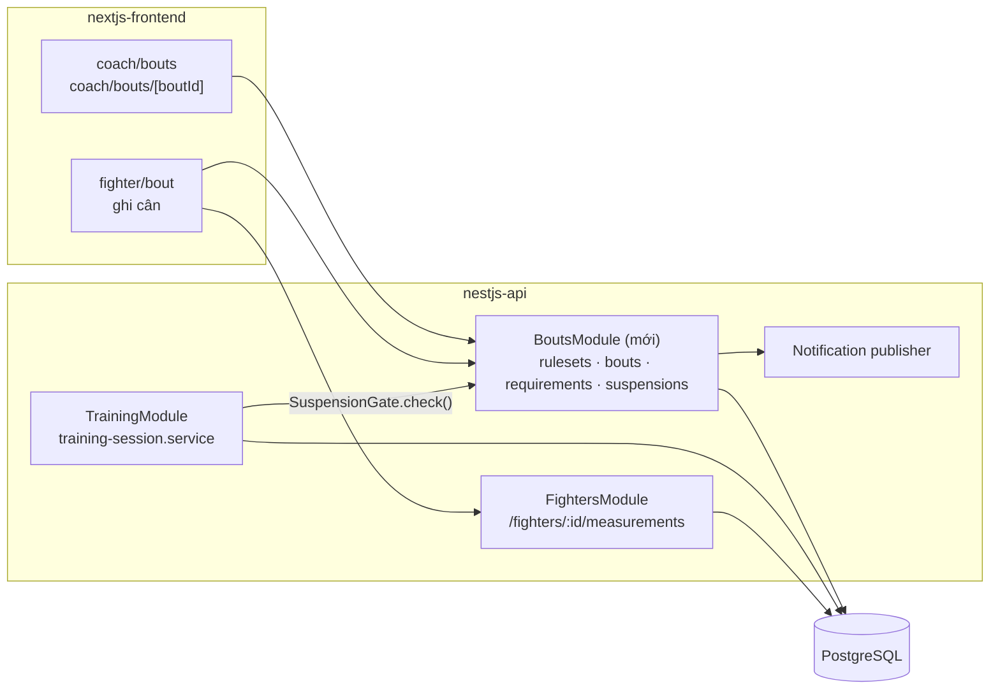

# Fight Camp — Tech spec

**Cập nhật**: 2026-10-14 (thêm §2.7, §2.8; sửa migration, PR theo quyết định 12–15 trong Phạm vi)
**Thuộc bộ tài liệu**: [Phạm vi](./SCOPE-FIGHT-CAMP.md) · [Nghiên cứu](./FIGHT-CAMP-DOMAIN-RESEARCH.md) · [Luồng nghiệp vụ](./FIGHT-CAMP-BUSINESS-FLOWS.md) · **Tech spec** · [Kiểm thử người dùng](./FIGHT-CAMP-USER-TESTING.md) · [Câu hỏi mở](./FIGHT-CAMP-OPEN-QUESTIONS.md)

Spec này mô tả cách hiện thực [Luồng nghiệp vụ](./FIGHT-CAMP-BUSINESS-FLOWS.md) trên codebase hiện tại: chế độ không có bác sĩ trong module medical, một module NestJS mới `bouts`, bốn migration 023–026, một điểm chặn mới trong training (Cổng 2) và các trang mới ở frontend. Phần lớn code mới nên theo đúng khuôn của module `goals` (`nestjs-api/src/goals/`), vì đó là module gần nhất và mới nhất.

Tên bảng, cột, mã lỗi và endpoint dưới đây là **đề xuất**. Người viết PR đầu tiên chốt lại và cập nhật tài liệu này.

---

## 1. Tổng quan



- **Không đổi:** cân hằng ngày vẫn ghi qua endpoint có sẵn `POST /fighters/:id/measurements` (bảng `fighter_measurements`). Module `bouts` chỉ đọc bảng này theo khoảng ngày của camp, nên không cần thêm cột `bout_id` vào đó.
- **Phụ thuộc một chiều:** `TrainingModule` import `SuspensionGate` do `BoutsModule` export. `BoutsModule` không import `TrainingModule`; khi cần tạo camp, nó gọi service plan qua một interface tiêm vào, để tránh vòng phụ thuộc.

## 2. Mô hình dữ liệu

### 2.1 Enum mới

| Enum | Giá trị |
| --- | --- |
| `bout_status` | `SCHEDULED`, `CAMP`, `FIGHT_WEEK`, `WEIGHED_IN`, `COMPLETED`, `CANCELLED` |
| `bout_sport` | `BOXING`, `MUAY_THAI`, `KICKBOXING`, `MMA` |
| `bout_result` | `WIN`, `LOSS`, `DRAW`, `NO_CONTEST` |
| `bout_method` | `KO`, `TKO`, `DECISION`, `SUBMISSION`, `DQ`, `OTHER` |
| `bout_requirement_status` | `MISSING`, `PROVIDED`, `CONFIRMED`, `REJECTED` |
| `suspension_reason` | `KO`, `TKO`, `DQ`, `MANDATORY_REST`, `MEDICAL`, `OTHER` |

### 2.2 `competition_rulesets`

```sql
CREATE TABLE public.competition_rulesets (
  id                     uuid PRIMARY KEY DEFAULT gen_random_uuid(),
  name                   text NOT NULL,
  sport                  public.bout_sport NOT NULL,
  organizer              text,
  verified               boolean NOT NULL DEFAULT false,  -- false = preset tham khảo
  source_note            text,                            -- văn bản / link đã đối chiếu
  weight_classes         jsonb NOT NULL,   -- [{ "code": "60", "label": "60 kg", "limitKg": 60.0 }]
  requirement_templates  jsonb NOT NULL,   -- [{ "code": "HEALTH_CERT", "label": "...", "required": true, "validityDays": 180 }]
  fight_week_days        smallint NOT NULL DEFAULT 7,
  requirements_due_days  smallint NOT NULL DEFAULT 7,
  acute_window_days      smallint NOT NULL DEFAULT 7,
  acute_loss_limit_pct_long   numeric(4,1) NOT NULL DEFAULT 8.0,  -- cân trước thi đấu >= 12 giờ
  acute_loss_limit_pct_short  numeric(4,1) NOT NULL DEFAULT 5.0,  -- cân trước thi đấu < 12 giờ
  suspension_rules       jsonb NOT NULL DEFAULT '[]',  -- xem bên dưới
  default_blocked_session_types public.session_type[] NOT NULL DEFAULT '{SPARRING}',
  rest_days_after_bout   smallint NOT NULL DEFAULT 0,
  created_by_id          uuid NOT NULL REFERENCES public.users(id),
  created_at, updated_at, deleted_at  -- như các bảng khác
);
```

- Check: `weight_classes` và `requirement_templates` là mảng JSON; các số ngày ≥ 0; ngưỡng % nằm trong (0, 20].
- Vì sao dùng `jsonb` cho hạng cân và mẫu hồ sơ: chúng luôn được đọc cùng ruleset và chỉ Admin sửa. Trận lưu snapshot nên không cần join.
- `suspension_rules` là mảng quy tắc. App chọn quy tắc khớp có số ngày lớn nhất. Ví dụ theo luật AIBA ([Nghiên cứu §5](./FIGHT-CAMP-DOMAIN-RESEARCH.md#5-đình-chỉ-sau-trận)):

  ```json
  [
    { "reason": ["KO", "TKO"], "minDays": 30 },
    { "reason": ["KO", "TKO"], "priorCount": 1, "withinDays": 90, "minDays": 90 },
    { "reason": ["KO", "TKO"], "priorCount": 2, "withinDays": 365, "minDays": 365 },
    { "loc": "UNDER_1_MIN", "minDays": 90 },
    { "loc": "OVER_1_MIN", "minDays": 180 }
  ]
  ```

  `priorCount` đếm các đình chỉ lý do KO/TKO trước đó của võ sĩ trong `withinDays` ngày, gồm cả đình chỉ tạo thủ công khi bị KO trong buổi tập. `loc` (mất ý thức) do HLV hoặc bác sĩ nhập khi ghi kết quả. Mảng rỗng nghĩa là ruleset không gợi ý, HLV tự nhập số ngày.
- Migration seed ba preset, `source_note` trỏ tới [Nghiên cứu](./FIGHT-CAMP-DOMAIN-RESEARCH.md):
  - **"MMA – VMMAF 2021"**: hạng cân theo Điều 7 (cận trên 44, 48, 52, 56, 60, 65, 70, 77, 84, 93, 120 kg và trên 120 kg), cân trước ngày thi 1 ngày theo Điều 9. `verified = true` cho hai phần này; `requirement_templates` và `suspension_rules` rỗng vì luật giao cho điều lệ từng giải. Mặc định chặn `SPARRING` và `GRAPPLING` khi đình chỉ.
  - **"Boxing nghiệp dư – AIBA (tham khảo)"**: quy tắc đình chỉ như trên, hạng cân AIBA 2002, `verified = false`, chặn mọi loại buổi tập trừ `RECOVERY` và `PHYSICAL_THERAPY`.
  - **"Tự nhập"**: mọi danh sách rỗng; HLV nhập hạng cân, checklist hồ sơ và số ngày đình chỉ trên từng trận.
- Ngưỡng 5% dùng cho mọi khoảng dưới 12 giờ. Nguồn chỉ nêu 5% cho khoảng 6 giờ trở xuống; khoảng 6–12 giờ không có số liệu nên chọn mức thận trọng.

### 2.3 `bouts`

```sql
CREATE TABLE public.bouts (
  id                 uuid PRIMARY KEY DEFAULT gen_random_uuid(),
  fighter_id         uuid NOT NULL REFERENCES public.fighters(id),
  coach_id           uuid NOT NULL REFERENCES public.coaches(id),
  ruleset_id         uuid NOT NULL REFERENCES public.competition_rulesets(id),
  event_name         text NOT NULL,
  venue              text,
  opponent_name      text,
  weight_class_code  text NOT NULL,
  weight_limit_kg    numeric(5,2) NOT NULL,          -- snapshot từ ruleset
  acute_loss_limit_pct numeric(4,1) NOT NULL,        -- snapshot, tính từ khoảng cân – thi đấu
  requirements_due_days smallint NOT NULL,           -- snapshot từ ruleset, HLV sửa được trên trận
  weigh_in_at        timestamptz NOT NULL,
  bout_at            timestamptz NOT NULL,
  status             public.bout_status NOT NULL DEFAULT 'SCHEDULED',
  training_plan_id   uuid REFERENCES public.training_plans(id),
  official_weight_kg numeric(5,2),
  made_weight        boolean,
  catchweight_kg     numeric(5,2),
  hydration_check    text CHECK (hydration_check IN ('NOT_APPLICABLE','PASSED','FAILED')),
  result             public.bout_result,
  method             public.bout_method,
  result_round       smallint,
  knocked_down       boolean,
  cancel_reason      text,
  notes              text,
  history            jsonb NOT NULL DEFAULT '[]',     -- chuyển trạng thái + lý do, như goals.history
  created_by_id      uuid NOT NULL REFERENCES public.users(id),
  created_at, updated_at, deleted_at
);
```

Ràng buộc chính:

- `weigh_in_at < bout_at`.
- `result`, `method` khác NULL khi và chỉ khi `status = 'COMPLETED'`.
- `cancel_reason` khác NULL khi và chỉ khi `status = 'CANCELLED'`.
- Mỗi võ sĩ tối đa một trận đang chạy: `CREATE UNIQUE INDEX uq_bouts_active_per_fighter ON public.bouts (fighter_id) WHERE status IN ('CAMP','FIGHT_WEEK','WEIGHED_IN') AND deleted_at IS NULL;`
- Trigger `updated_at` và audit `mma_private.audit_domain_mutation()` như `goals` (migration 022).
- `fighter_id` bất biến sau khi tạo.

### 2.4 `bout_requirements`

```sql
CREATE TABLE public.bout_requirements (
  id              uuid PRIMARY KEY DEFAULT gen_random_uuid(),
  bout_id         uuid NOT NULL REFERENCES public.bouts(id) ON DELETE CASCADE,
  code            text NOT NULL,
  label           text NOT NULL,
  required        boolean NOT NULL,
  status          public.bout_requirement_status NOT NULL DEFAULT 'MISSING',
  issued_on       date,
  valid_until     date,
  source          text NOT NULL CHECK (source IN ('PRESET', 'COACH')),  -- COACH = "HLV nhập, chưa xác minh"
  status_reason   text,           -- bắt buộc khi REJECTED
  updated_by_id   uuid REFERENCES public.users(id),
  confirmed_by_id uuid REFERENCES public.users(id),
  confirmed_at    timestamptz,
  UNIQUE (bout_id, code)
);
```

`PROVIDED` và `CONFIRMED` bắt buộc có `valid_until`.

### 2.5 `suspensions`

```sql
CREATE TABLE public.suspensions (
  id                    uuid PRIMARY KEY DEFAULT gen_random_uuid(),
  fighter_id            uuid NOT NULL REFERENCES public.fighters(id),
  bout_id               uuid REFERENCES public.bouts(id),
  reason                public.suspension_reason NOT NULL,
  starts_on             date NOT NULL,
  ends_on               date NOT NULL,
  loss_of_consciousness text CHECK (loss_of_consciousness IN ('NONE','UNDER_1_MIN','OVER_1_MIN','UNKNOWN')),
  suggested_days        smallint,          -- từ suspension_rules; NULL nếu ruleset không gợi ý
  override_reason       text,              -- bắt buộc khi số ngày khác gợi ý
  blocked_session_types public.session_type[] NOT NULL,  -- mặc định lấy từ ruleset
  requires_clearance    boolean NOT NULL,
  cleared_at            timestamptz,
  cleared_by_id         uuid REFERENCES public.users(id),
  clearance_note        text,
  created_by_id         uuid NOT NULL REFERENCES public.users(id),
  created_at, updated_at, deleted_at,
  CHECK (ends_on >= starts_on),
  CHECK ((cleared_at IS NULL) = (cleared_by_id IS NULL))
);
CREATE INDEX idx_suspensions_fighter_active ON public.suspensions (fighter_id, ends_on) WHERE deleted_at IS NULL;
```

Đình chỉ **còn hiệu lực** vào ngày học viện `d` khi:
`starts_on <= d AND (d <= ends_on OR (requires_clearance AND cleared_at IS NULL))`.

### 2.7 Kế hoạch ăn và câu trả lời ăn uống (migration 026)

Nghiệp vụ: [Luồng nghiệp vụ E1](./FIGHT-CAMP-BUSINESS-FLOWS.md#e1-ăn-uống-đi-cùng-kiểm-soát-cân). App chỉ lưu và hiển thị chữ do người dùng nhập, không tính hay sinh ra chế độ ăn.

```sql
ALTER TABLE public.bouts ADD COLUMN nutrition_plan jsonb NOT NULL DEFAULT '{}';
-- { "camp":        { "text": "...", "author": "HLV" | "<tên chuyên gia>", "updatedAt": "<iso>", "updatedById": "<uuid>" },
--   "fightWeek":   { ... },
--   "postWeighIn": { ... } }       -- mỗi khoá có thể vắng

CREATE TYPE public.nutrition_adherence AS ENUM ('ON_PLAN', 'SLIGHTLY_OFF', 'WAY_OFF');

CREATE TABLE public.bout_nutrition_checkins (
  id             uuid PRIMARY KEY DEFAULT gen_random_uuid(),
  bout_id        uuid NOT NULL REFERENCES public.bouts(id) ON DELETE CASCADE,
  fighter_id     uuid NOT NULL REFERENCES public.fighters(id),
  academy_date   date NOT NULL,                 -- ngày được hỏi ("hôm qua" so với lúc trả lời)
  adherence      public.nutrition_adherence NOT NULL,
  note           text CHECK (note IS NULL OR char_length(note) <= 200),
  recorded_by_id uuid NOT NULL REFERENCES public.users(id),
  created_at, updated_at,
  UNIQUE (bout_id, academy_date)                -- trả lời lại thì cập nhật dòng cũ
);
```

- `fighter_id` phải bằng `bouts.fighter_id` (kiểm tra trong service, và bằng trigger nếu dễ làm theo khuôn của 024).
- Mỗi ô kế hoạch: `text` 1–2000 ký tự, `author` 1–100 ký tự.
- Giá trị tính khi đọc `currentNutritionPhase`: `SCHEDULED`, `CAMP` → `camp`; `FIGHT_WEEK` → `fightWeek`; `WEIGHED_IN` → `postWeighIn`; `COMPLETED`, `CANCELLED` → `null`.
- Kiểu jsonb cho kế hoạch: ba ô luôn đọc cùng trận, sửa theo cả khối, không truy vấn chéo trận.

### 2.8 Phân tích đối thủ (migration 027)

Nghiệp vụ: [Luồng nghiệp vụ E2](./FIGHT-CAMP-BUSINESS-FLOWS.md#e2-giáo-án-phân-tích-đối-thủ). Tên đối thủ vẫn ở `bouts.opponent_name`.

```sql
ALTER TABLE public.bouts ADD COLUMN opponent_analysis jsonb NOT NULL DEFAULT '{}';
```

```json
{
  "profile": { "wins": 5, "losses": 1, "draws": 0, "stance": "SOUTHPAW", "style": "STRIKER",
               "heightCm": 175, "reachCm": 180, "source": "Hồ sơ LION Championship" },
  "observations": [
    { "id": "o1", "kind": "OPENING", "text": "Sau cú jab, hạ tay phải",
      "evidenceUrl": "https://...", "evidenceTime": "02:15", "evidenceNote": null, "confidence": "REPEATED" }
  ],
  "tactics": [
    { "id": "t1", "text": "Khi đối thủ jab, lách trái và phản đòn móc phải", "round": null,
      "observationIds": ["o1"], "sessionIds": ["<training_sessions.id>"], "partnerBrief": "Bạn tập đánh tay trái, ép sát",
      "review": { "outcome": "EFFECTIVE", "note": "Trúng 3 lần ở hiệp 2" } }
  ],
  "updatedAt": "<iso>", "updatedById": "<uuid>"
}
```

Kiểm tra khi ghi (Zod và service):

| Quy tắc | Lỗi |
| --- | --- |
| `stance` ∈ `ORTHODOX`, `SOUTHPAW`, `SWITCH`; `style` ∈ `STRIKER`, `WRESTLER`, `GRAPPLER`, `ALL_ROUND`; mọi trường của `profile` là tùy chọn | 422 |
| Tối đa 6 quan sát; `kind` ∈ `STRENGTH`, `OPENING`, `HABIT`; `text` 1–300 ký tự; có `evidenceUrl` (http/https) hoặc `evidenceNote`; `confidence` ∈ `ONCE`, `REPEATED` | 422 |
| Tối đa 5 chiến thuật; mỗi chiến thuật có ít nhất một `observationIds` trỏ tới quan sát có trong cùng tài liệu | 422 `OPPONENT_TACTIC_EVIDENCE_REQUIRED` |
| Mỗi `sessionIds` là `training_sessions` của cùng `fighter_id`, `deleted_at IS NULL` | 422 |
| `review` chỉ ghi được khi trận `COMPLETED`; ngoài `review`, tài liệu chỉ sửa được khi trận chưa `COMPLETED` hay `CANCELLED` | 409 `BOUT_INVALID_TRANSITION` |

- Giá trị tính khi đọc: `tacticsWithoutSessions` (danh sách id chiến thuật chưa gắn buổi tập).
- Kiểu jsonb: tài liệu luôn đọc và sửa cùng trận, do một HLV soạn, không truy vấn chéo trận trong đợt đồ án. Đổi lại, `sessionIds` không có khoá ngoại; buổi tập bị xoá sau đó thì frontend hiện "buổi tập đã xoá".
- **Võ sĩ** chỉ nhận `tactics` (bỏ `review`) và các buổi tập liên quan; không nhận `profile`, `observations`.

### 2.6 Thay đổi bảng có sẵn

| Bảng | Thay đổi | Migration |
| --- | --- | --- |
| `training_plans` | Không thêm cột; trận trỏ tới plan qua `bouts.training_plan_id` | — |
| `goals` | Thêm `bout_id uuid NULL REFERENCES bouts(id)` | Sau đợt đồ án; đánh số khi merge module goals (026, 027 đã dùng) |
| `fighter_measurements` | Không đổi | — |
| `notification_type` | Thêm giá trị mới (§7) | 025 |
| `academy_settings` (mới, một dòng) | Chế độ giám sát y tế (§6a) | 023 |
| `fighters.weight_class` | Giữ nguyên; trận không dùng | — |

## 3. Giá trị tính khi đọc

Giống cách `goals` tính trạng thái khi đọc, các giá trị sau **không lưu** trong DB:

| Giá trị | Cách tính |
| --- | --- |
| `daysToWeighIn` | Số ngày học viện từ hôm nay đến ngày của `weigh_in_at` |
| `requirementsDueOn` | Ngày của `weigh_in_at` − `requirements_due_days` (snapshot trên trận) |
| `gate1` | `{ passed, missing[], expiring[] }` theo [Luồng F4](./FIGHT-CAMP-BUSINESS-FLOWS.md#f4-hồ-sơ-y-tế-và-cổng-1) |
| `weight` | `{ latestKg, latestOn, remainingPct, status, referencePath[] }` theo §5 |
| `canEnterFightWeek` | `status = CAMP`, hôm nay ≥ ngày cân − `fight_week_days`, `gate1.passed` |

## 4. API

Mọi endpoint theo khuôn có sẵn: `AccessTokenGuard` + `AuthorizationGuard`, `@RequirePermissions`, Zod DTO, envelope `ApiSuccessEnvelope`, phân trang bằng cursor như `GET /goals`.

| Method | Path | Quyền | Mô tả |
| --- | --- | --- | --- |
| GET | `/competition-rulesets` | `ruleset:read` | Danh sách ruleset, có cờ `verified` |
| POST, PATCH | `/competition-rulesets[/:id]` | `ruleset:manage` | Admin tạo, sửa |
| GET | `/bouts` | `bout:get_all` | Lọc theo `fighterId`, `status`; sắp theo `weighInAt` |
| POST | `/bouts` | `bout:create` | Tạo trận (F1), sinh checklist hồ sơ |
| GET | `/bouts/:id` | `bout:read` | Kèm `gate1`, `weight`, requirements, suspensions liên quan |
| PATCH | `/bouts/:id` | `bout:update` | Sửa thông tin, đổi ngày, đổi hạng (F8) |
| POST | `/bouts/:id/camp` | `bout:update` | Tạo camp từ template hoặc gắn plan có sẵn, chuyển `CAMP` (F2) |
| POST | `/bouts/:id/fight-week` | `bout:update` | Chuyển `FIGHT_WEEK`; 409 `BOUT_REQUIREMENTS_INCOMPLETE` |
| POST | `/bouts/:id/weigh-in` | `bout:update` | Ghi cân chính thức, chọn catchweight hoặc huỷ (F5) |
| POST | `/bouts/:id/result` | `bout:result` | Ghi kết quả, trả các đình chỉ gợi ý (F6) |
| POST | `/bouts/:id/cancel` | `bout:update` | Huỷ, bắt buộc lý do |
| GET | `/bouts/:id/weight-track` | `bout:read` | Số cân trong camp + đường tham chiếu + trạng thái |
| POST | `/bouts/:id/requirements` | `bout:requirement` | HLV thêm một mục hồ sơ (`source = COACH`) |
| PATCH | `/bouts/:id/requirements/:code` | `bout:requirement` | Cập nhật trạng thái, ngày cấp, hạn; sửa tên, bắt buộc hay không |
| DELETE | `/bouts/:id/requirements/:code` | `bout:requirement` | Bỏ một mục hồ sơ (ghi lịch sử) |
| POST | `/bouts/:id/requirements/:code/confirm` | `bout:requirement_confirm` | Bác sĩ xác nhận hoặc từ chối |
| PUT | `/bouts/:id/nutrition-plan` | `bout:update` | Ghi kế hoạch ăn theo giai đoạn (§2.7); trận chưa `COMPLETED`, `CANCELLED` |
| PUT | `/bouts/:id/nutrition-checkins/:date` | `bout:nutrition_checkin` | Trả lời "ăn theo kế hoạch?" cho ngày `date` (≤ hôm nay theo ngày học viện); ghi lại thì cập nhật. `GET /bouts/:id/weight-track` trả thêm `nutrition: [{ date, adherence }]` |
| PUT | `/bouts/:id/opponent-analysis` | `bout:update` | Ghi cả tài liệu phân tích đối thủ, trừ `review` (§2.8) |
| PUT | `/bouts/:id/opponent-analysis/review` | `bout:result` | Ghi đánh giá từng chiến thuật; chỉ khi `COMPLETED` |
| GET | `/suspensions` | `suspension:read` | Lọc theo `fighterId`, `active` |
| POST | `/suspensions` | `suspension:create` | Tạo thủ công, hoặc xác nhận đình chỉ gợi ý sau trận |
| POST | `/suspensions/:id/clear` | `suspension:clear` | Xác nhận được tập lại, bắt buộc `clearanceNote` |

Mã lỗi mới (thêm vào `bouts.error.ts`, theo khuôn `goals.error.ts`):
`BOUT_NOT_FOUND`, `BOUT_COACH_NOT_ASSIGNED`, `BOUT_INVALID_SCHEDULE`, `BOUT_ACTIVE_EXISTS`, `BOUT_INVALID_TRANSITION`, `BOUT_CAMP_REQUIRED`, `BOUT_REQUIREMENTS_INCOMPLETE`, `BOUT_NOT_STARTED`, `SUSPENSION_OVERRIDE_REASON_REQUIRED`, và `TRAINING_SUSPENSION_ACTIVE` (đặt trong `training.error.ts`).

## 5. Cảnh báo cân nặng

Căn cứ: [Nghiên cứu §4](./FIGHT-CAMP-DOMAIN-RESEARCH.md#4-giảm-cân-cấp-tốc-giới-hạn-khuyến-nghị). Hàm thuần, đặt trong `bouts.model.ts` để test bằng `bouts.model.spec.ts`.

```ts
// Inputs
//   limitKg       = bout.catchweight_kg ?? bout.weight_limit_kg
//   L             = bout.acute_loss_limit_pct        // 8 hoặc 5, snapshot lúc tạo trận
//   A             = ruleset.acute_window_days         // mặc định 7
//   d             = daysToWeighIn
//   W             = số cân mới nhất trong camp (kg); latestOn = ngày của số đó
//   W0, campStart = số cân đầu tiên trong camp và ngày bắt đầu camp
//   tolKg         = dung sai của HLV, mặc định đề xuất 1.0 kg [chỉnh sau kiểm thử vòng 1]

remainingPct = max(0, (W - limitKg) / W * 100)

// Đường tham chiếu: tuyến tính từ W0 về mức "còn đúng L%" tại ngày (cân − A),
// sau đó về limitKg tại ngày cân. Chỉ để HLV nhìn xu hướng, không phải chỉ định.
targetAtWindow = limitKg / (1 - L / 100)

status =
  không có số cân trong 3 ngày gần nhất            → GREY
  d <= A && remainingPct > L                       → RED
  d >  A && W > reference(latestOn) + tolKg        → YELLOW
  ngược lại                                         → GREEN
```

Ví dụ kiểm tra: giới hạn 60 kg, L = 8, còn 2 ngày, W = 66 → `remainingPct` = 9,1 > 8 → `RED`. W = 64,5 → 7,0 → `GREEN`.

Thông báo đỏ chỉ gửi khi trạng thái **chuyển** sang `RED` (so với lần tính trước, lưu ở `bouts.history`), để không gửi lặp mỗi lần ghi cân.

## 6. Cổng 2 trong training

Điểm sửa: `nestjs-api/src/training/sessions/training-session.service.ts`, ở hai chỗ đang gọi medical gate (lên lịch và chuyển `IN_PROGRESS`).

```ts
// BoutsModule export
interface SuspensionGate {
  /** Trả các đình chỉ còn hiệu lực vào ngày học viện của scheduledAt mà chặn sessionType. */
  blockingSuspensions(fighterId: string, sessionType: SessionType, at: Date): Promise<SuspensionSummary[]>;
}
```

- **Lên lịch** (tạo session, hoặc đổi `scheduledAt` / `sessionType`): nếu có đình chỉ chặn thì trả 409 `TRAINING_SUSPENSION_ACTIVE` kèm `{ suspensionId, reason, endsOn, requiresClearance }`. Đây là điểm khác với D9: medical gate không chặn lúc lên lịch, còn Cổng 2 thì chặn, vì ngày đình chỉ đã biết trước.
- **Chuyển `IN_PROGRESS`:** kiểm tra lại, cùng mã lỗi.
- **Hai cổng chạy độc lập:** gọi medical gate trước, rồi Cổng 2. Response gộp lý do của cả hai.
- **Buổi đã xếp từ trước:** `GET /bouts/:id` và lịch tuần trả cờ `blockedBySuspension` cho từng session để frontend hiện cảnh báo.

## 6a. Chế độ không có bác sĩ

Nghiệp vụ: [Luồng nghiệp vụ §7](./FIGHT-CAMP-BUSINESS-FLOWS.md#7-chế-độ-không-có-bác-sĩ). Hệ thống hiện chỉ phục vụ một học viện và chưa có bảng cài đặt chung, nên cần một bảng một dòng:

```sql
CREATE TYPE public.medical_supervision AS ENUM ('DOCTOR', 'NONE');
CREATE TABLE public.academy_settings (
  id                  boolean PRIMARY KEY DEFAULT true CHECK (id),  -- chỉ một dòng
  medical_supervision public.medical_supervision NOT NULL DEFAULT 'DOCTOR',
  change_reason       text,
  updated_by_id       uuid REFERENCES public.users(id),
  updated_at          timestamptz NOT NULL DEFAULT now()
);
INSERT INTO public.academy_settings DEFAULT VALUES;
```

Vì sao lưu trong DB mà không dùng biến môi trường: Admin cần bật/tắt được từ màn cài đặt, và mỗi lần đổi phải có audit (người đổi, lý do).

Điểm sửa trong code:

| File | Thay đổi |
| --- | --- |
| [medical.service.ts](../nestjs-api/src/medical/medical.service.ts) `evaluateEligibility` | Thêm `supervision` vào `EligibilityState`. Khi `NONE` và scope `TRAINING`: bỏ lý do `EXAMINATION_REQUIRED` và `REVIEW_REQUEST_PENDING`; nếu **chưa có** kết luận khám thì trả `eligible: true`; nếu đã có kết luận thì chạy các quy tắc cũ (`NOT_ELIGIBLE`, clearance, `SESSION_TYPE_RESTRICTED`). Scope `COMPETITION` không đổi. Kết quả trả thêm `supervision` |
| `medical.service.ts`, chỗ tạo yêu cầu khám | Khi `NONE`: trả 409 `MEDICAL_SUPERVISION_DISABLED` |
| [doctor-assignment-reminder.service.ts](../nestjs-api/src/medical/doctor-assignment-reminder.service.ts) | Khi `NONE`: không gửi nhắc |
| Module nhỏ mới `academy-settings` | `GET /academy-settings` (mọi vai trò đã đăng nhập, để hiện dòng thông báo); `PATCH /academy-settings` (Admin, bắt buộc `changeReason`); `GET /academy-settings/impact` trả số võ sĩ chưa có BASELINE và số buổi tập sắp tới sẽ bị chặn nếu chuyển về `DOCTOR` |
| Frontend | Công tắc ở `admin/settings` (cắt khỏi đợt đồ án); dòng thông báo cố định trên dashboard HLV và trang sức khỏe võ sĩ khi đang `NONE` |

`evaluateEligibility` là hàm thuần, nên `supervision` được truyền vào qua state, không đọc DB bên trong hàm. Service đọc `academy_settings` một lần cho mỗi lần kiểm tra, trong cùng transaction với các bản ghi y tế.

## 6b. Lưu sự đồng ý xử lý dữ liệu

**Cắt khỏi đợt đồ án:** buổi kiểm thử dùng dữ liệu giả và phiếu đồng ý giấy. Thiết kế dưới đây dành cho khi đưa ra sử dụng thật.

Luật Bảo vệ dữ liệu cá nhân 2025 và Nghị định 356/2025 yêu cầu sự đồng ý rõ ràng, kiểm chứng được, không đặt sẵn "đồng ý" ([Nghiên cứu §8](./FIGHT-CAMP-DOMAIN-RESEARCH.md#8-bảo-vệ-dữ-liệu-cá-nhân)).

```sql
CREATE TABLE public.data_consents (
  id              uuid PRIMARY KEY DEFAULT gen_random_uuid(),
  user_id         uuid NOT NULL REFERENCES public.users(id),
  consent_version text NOT NULL,          -- phiên bản nội dung đã hiển thị, ví dụ '2026-10-v1'
  consented_at    timestamptz NOT NULL DEFAULT now(),
  withdrawn_at    timestamptz,
  UNIQUE (user_id, consent_version)
);
```

- Lần đăng nhập đầu, hoặc khi `consent_version` mới hơn bản người dùng đã đồng ý, frontend hiện màn xin đồng ý. Ô đồng ý không được tick sẵn.
- Chưa đồng ý thì API từ chối mọi thao tác ghi dữ liệu sức khỏe (cân, hồ sơ, đình chỉ, chấn thương) với 403 `DATA_CONSENT_REQUIRED`.
- Rút lại đồng ý: ghi `withdrawn_at`. Việc xoá dữ liệu khi người kiểm thử yêu cầu làm thủ công trong đồ án.

## 7. Quyền và thông báo

Quyền mới, seed trong migration theo đúng mẫu của 021:

| Quyền | FIGHTER | COACH | DOCTOR | ADMIN |
| --- | --- | --- | --- | --- |
| `ruleset:read` | | ✓ | ✓ | ✓ |
| `ruleset:manage` | | | | ✓ |
| `bout:get_all`, `bout:read` | ✓ (của mình) | ✓ | ✓ | ✓ |
| `bout:create`, `bout:update`, `bout:result` | | ✓ | | ✓ |
| `bout:requirement` | | ✓ | ✓ | ✓ |
| `bout:nutrition_checkin` | ✓ (trận của mình) | ✓ | | ✓ |
| `bout:requirement_confirm` | | | ✓ | |
| `suspension:read` | ✓ (của mình) | ✓ | ✓ | ✓ |
| `suspension:create` | | ✓ | ✓ | ✓ |
| `suspension:clear` | | ✓ | ✓ | |

Phạm vi theo bản ghi (fighter chỉ thấy của mình, coach chỉ võ sĩ được phân công, doctor qua `doctor_fighters`) kiểm tra trong service như `goals.service.ts`, không chỉ dựa vào quyền.

Giá trị `notification_type` mới (thêm cả vào `NOTIFICATION_TYPE` trong `shared/contracts/notification.contract.ts`):
`BOUT_CREATED`, `BOUT_WEIGHT_AT_RISK`, `BOUT_REQUIREMENT_REJECTED`, `BOUT_REQUIREMENT_DUE`, `BOUT_WEIGHT_MISSING`, `SUSPENSION_CREATED`, `SUSPENSION_AWAITING_CLEARANCE`.

Thông báo theo sự kiện (M1) gửi ngay trong service, sau khi transaction commit, như `DoctorAssignmentReminder`. Thông báo theo lịch (M2: hồ sơ tới hạn, thiếu số cân, đình chỉ chờ xác nhận) cần một job chạy hằng ngày. Hiện backend chưa có scheduler, nhưng đã có `@nestjs/bullmq`: đề xuất một repeatable job lúc 07:00 `Asia/Ho_Chi_Minh`, dùng dedupe key theo `(loại, đối tượng, ngày)` để chạy lại không gửi trùng.

## 8. Migration

Theo quy ước trong [migrations/README.md](../nestjs-api/migrations/README.md): kiểm tra ledger ở preflight, `pg_advisory_xact_lock`, `lock_timeout`, ghi `mma_private.migration_history`, thêm checksum vào `manifest.json`, thêm script `db:migrate:0xx` vào `package.json`, viết mục mô tả trong README.

| Số | Nội dung | Phụ thuộc |
| --- | --- | --- |
| 023 | Enum `medical_supervision`, bảng `academy_settings` (một dòng, mặc định `DOCTOR`; quyền `academy_settings:manage`, trigger audit | Ledger đã có 020, chưa có 023; không yêu cầu 021, 022 vì module goals chưa merge (quyết định 4). Môi trường demo đổi sang `NONE` bằng `PATCH /academy-settings` |
| 024 | Enum mới, `competition_rulesets` (+ ba preset: MMA – VMMAF 2021, Boxing nghiệp dư – AIBA, Tự nhập), `bouts`, `bout_requirements`, quyền `ruleset:*` và `bout:*`, RLS và revoke như `goals` | 023 |
| 025 | `suspensions`, quyền `suspension:*`, giá trị `notification_type` mới | 024 |
| 026 | `bouts.nutrition_plan`, enum `nutrition_adherence`, bảng `bout_nutrition_checkins`, quyền `bout:nutrition_checkin` (§2.7) | 024. Preflight yêu cầu ledger đã có 024, chưa có 026; không yêu cầu 025, để T-009 không phải chờ T-007 |
| 027 | `bouts.opponent_analysis` (§2.8) | 024. Preflight yêu cầu ledger đã có 024, chưa có 027; không yêu cầu 025, 026 |
| 028 | Giá trị enum `session_type` `TACTICAL_ANALYSIS` (T-026) | Ledger đã có 023 |
| 029 | Bảng `session_templates` và 4 mẫu giáo án, quyền `training.session_template:read` (T-026) | 028 |
| — | `goals.bout_id`, sau đợt đồ án | 021, 022, 024 |

## 9. Frontend

| Hạng mục | Việc |
| --- | --- |
| Routes (`src/lib/routes.ts`) | `coach.bouts`, `coach.bout(id)`, `coach.newBout`; `fighter.bout`; `fighter.weighIn` |
| Điều hướng (`components/layout/navigation.ts`) | Thêm hub "Trận" cho coach (tab: Sắp tới, Đình chỉ) và fighter. Bỏ khỏi `NAVIGATION` các mục đóng băng (performance, admissions, AI models, dataset, live video); trang vẫn truy cập được qua URL cho Admin và test |
| Service | `lib/services/bouts.ts` gọi API, `bouts.demo.ts` cho demo mode, theo mẫu `goals.ts` / `goals.demo.ts` |
| Server actions | `lib/actions/bouts.ts`, theo mẫu `lib/actions/goals.ts` |
| Màn hình | Dùng lại thành phần của prototype `src/app/concept/fight-camp/` (biểu đồ cân, checklist, lịch camp); sau khi có trang thật thì xoá route concept và ngoại lệ trong `proxy.ts` |
| Mobile | Màn ghi cân và trang trận của võ sĩ phải dùng được ở bề rộng 390 px; bottom bar đã có sẵn trong `NavItem.shortLabel` |

## 10. Kiểm thử

- `bouts.model.spec.ts`: bảng chuyển trạng thái (mọi cặp hợp lệ và không hợp lệ), Cổng 1, hàm cảnh báo cân (các ví dụ ở §5 và ở [Luồng nghiệp vụ §6](./FIGHT-CAMP-BUSINESS-FLOWS.md#6-tiêu-chí-nghiệm-thu-chính)), tính ngày theo lịch học viện ở ranh giới nửa đêm.
- `bouts.service.spec.ts`: phạm vi HLV/võ sĩ/bác sĩ, một trận đang chạy mỗi võ sĩ, tạo đình chỉ từ kết quả, thông báo chỉ gửi khi chuyển sang đỏ.
- `training-session.service.spec.ts`: thêm ca Cổng 2 (lên lịch, bắt đầu, loại không bị chặn, đình chỉ chờ xác nhận, hai cổng cùng chặn).
- Migration: thêm 023–026 vào `scripts/test-migrations.mjs`.
- `medical.service.spec.ts`: thêm các ca của chế độ không có bác sĩ theo [Luồng nghiệp vụ §7](./FIGHT-CAMP-BUSINESS-FLOWS.md#7-chế-độ-không-có-bác-sĩ).
- Frontend: test service demo, test `routes.test.ts` cho route mới.

## 11. Thứ tự PR

Đồ án kết thúc 31/10 với 2 buổi review ([Phạm vi – Kế hoạch](./SCOPE-FIGHT-CAMP.md#kế-hoạch-triển-khai)). PR được xếp theo sprint; những PR ghi "Cắt" không làm trước 31/10.

| PR | Nội dung | Sprint |
| --- | --- | --- |
| 1 | Ẩn mục đóng băng khỏi `NAVIGATION` | 1 |
| 2 | Migration 023 + chế độ không có bác sĩ (§6a): `academy_settings` (mặc định `DOCTOR`), sửa `evaluateEligibility`, dòng thông báo | 1, **làm đầu tiên** |
| 3 | Migration 024 + `BoutsModule`: ba preset, bouts, requirements (thêm/sửa/bỏ), `weight-track`, Cổng 1; chưa có UI | 1 |
| 4 | Trang tạo trận, danh sách trận, chi tiết trận, checklist hồ sơ; gắn training plan có sẵn | 1 |
| 5 | Màn ghi cân trên điện thoại, biểu đồ, cảnh báo | 1 |
| 6 | Tuần thi đấu, cân chính thức, kết quả | 2 |
| 7 | Migration 025 + suspensions + Cổng 2 trong training + xác nhận được tập lại | 2 |
| 8 | Dữ liệu demo cho 4 kịch bản qua API của backend (kịch bản 1, 2 có từ Sprint 1 cho review 1); gỡ route concept | 1, 2 |
| 9 | Migration 026 + kế hoạch ăn, câu trả lời ăn uống, chấm màu trên biểu đồ cân (§2.7) | 2 |
| 10 | Migration 027 + phân tích đối thủ, tab "Đối thủ" (§2.8) | 2 |
| — | Màn Admin bật/tắt chế độ; `data_consents` (§6b); camp từ template; ghi buổi tập nhanh; thông báo và job hằng ngày; `goals.bout_id` | Cắt |
