# Thu hẹp phạm vi: Quản lý võ sĩ trước – trong – sau trận

**Cập nhật**: 2026-10-20 (góp ý review 2, mục 20) · **Tác giả**: Khoi Le
**Trạng thái**: **Đã chốt** sau buổi review với giảng viên (ghi nhận ngày 14/10/2026, quyết định 10). Muốn đổi phạm vi thì chủ dự án quyết định và ghi vào bảng [Quyết định và câu hỏi](#quyết-định-và-câu-hỏi).
**Bản đầu (11/10, đã cũ)**: [Claude Docs](https://claude.ai/code/artifact/7eadc14d-f9ae-4c40-9a1c-a25ea5ed090f)
**Thuộc bộ tài liệu**: **Phạm vi** · [Nghiên cứu](./FIGHT-CAMP-DOMAIN-RESEARCH.md) · [Luồng nghiệp vụ](./FIGHT-CAMP-BUSINESS-FLOWS.md) · [Tech spec](./FIGHT-CAMP-TECH-SPEC.md) · [Kiểm thử người dùng](./FIGHT-CAMP-USER-TESTING.md) · [Câu hỏi mở](./FIGHT-CAMP-OPEN-QUESTIONS.md)

## TL;DR

MMA-TMS là **đồ án**. Từ tuần 13/10, sản phẩm chỉ giải một bài toán: **quản lý võ sĩ trước, trong và sau trận đấu**. Cụ thể là giúp HLV đưa một võ sĩ từ lúc nhận trận đến lúc được tập lại sau trận, đúng hạng cân, đủ hồ sơ y tế và không tập khi đang bị đình chỉ. Giảng viên đã duyệt phạm vi này. Tên "Fight Camp" vẫn dùng cho bộ tài liệu và nhánh `fight-camp`. Nghiệp vụ của từng giai đoạn: [Luồng nghiệp vụ – Nghiệp vụ theo giai đoạn](./FIGHT-CAMP-BUSINESS-FLOWS.md#nghiệp-vụ-theo-giai-đoạn).

- **Người dùng chính:** HLV. Võ sĩ là người dùng phụ (ghi cân, xem lịch). Bác sĩ không bắt buộc.
- **Đối tượng trung tâm:** *Trận* (bout). Kế hoạch tập, cân nặng, hồ sơ, video và đình chỉ đều gắn vào một trận.
- **Đóng băng:** phát triển thêm AI (phần AI đã làm vẫn được tính vào đồ án, quyết định 16), tuyển võ sĩ (admissions), cổng Doctor đầy đủ, admin AI models/dataset, app React Native. Không xoá code, chỉ dừng phát triển và ẩn khỏi menu.
- **Hạn:** review 1 đã diễn ra (buổi duyệt phạm vi, trước 14/10). Còn **review 2 ngày 20/10** và **demo cuối ngày 31/10/2026**. Đồ án được đánh giá bằng demo, không có báo cáo (quyết định 17).
- **Team:** 4 dev (2 backend, 1 frontend, 1 dev mobile chuyển sang làm web cho điện thoại) cùng Gemini nhận ticket; Claude viết ticket và review (quyết định 18).
- **Mục tiêu đồ án:** (1) hệ thống chạy trọn vòng đời một trận, có bộ demo dựng sẵn; (2) qua các tiêu chí nghiệm thu của phần lõi. Không có buổi kiểm thử người dùng (quyết định 17).
- **Không phụ thuộc quan hệ:** không cần CLB pilot hay điều lệ từ ban tổ chức. Quy định có sẵn lấy từ văn bản công khai đã xác minh; quy định riêng của từng giải do HLV tự nhập.
- **Dữ liệu:** chỉ dùng dữ liệu giả; không nhập giấy tờ y tế thật ([Nghiên cứu §8](./FIGHT-CAMP-DOMAIN-RESEARCH.md#8-bảo-vệ-dữ-liệu-cá-nhân)).

Việc làm ngay: T-003 phải merge trước hết ngày 18/10 để kịp áp migration lên Supabase và dựng dữ liệu demo cho review 2 ngày 20/10. Xem [Kế hoạch](#kế-hoạch-triển-khai) và [phiếu câu hỏi](./FIGHT-CAMP-OPEN-QUESTIONS.md).

## Vì sao thu hẹp

Hệ thống đang làm nhiều thứ cùng lúc nhưng chưa có việc nào hoàn chỉnh từ đầu đến cuối. Bốn dấu hiệu:

| Dấu hiệu | Số liệu | Nguồn |
| --- | --- | --- |
| Quá nhiều bề mặt | 78 trang, 4 vai trò, khoảng 60 bảng DB | `nextjs-frontend/src/app/(app)`, `schema.ts` |
| Vai trò không có người dùng | Cổng Doctor 17 trang, trong khi phần lớn gym VN không có bác sĩ | [VIETNAM-MARKET-ANALYSIS.md](./VIETNAM-MARKET-ANALYSIS.md) §3.1 (số liệu chưa có nguồn) |
| AI kéo roadmap nhưng chưa ra tay người dùng | Khoảng 20 tài liệu AI trong tuần 06/10; nhận diện 6 đòn chưa đạt nghiệm thu | [archive/README.md](./archive/README.md) |
| Không có hạn chót | DB chưa có bảng nào cho trận đấu, ngày cân hay đình chỉ | `schema.ts` |

Các vấn đề lớn của võ sĩ thi đấu đều xoay quanh một trận: ép cân trước ngày cân, hồ sơ y tế trước giải, và đình chỉ sau KO. Trận đấu tạo ra hạn chót, và hạn chót cho đồ án một luồng nghiệp vụ hoàn chỉnh, dễ demo.

## Phạm vi mới

Một tính năng chỉ được làm nếu nó gắn với một trận cụ thể và giúp HLV trả lời một trong ba câu: *võ sĩ có kịp cân không*, *hồ sơ đủ chưa*, *đã được tập lại chưa*. Khi tranh luận về một task, team dùng câu này làm thước. Có một ngoại lệ do chủ dự án quyết ngày 14/10: phân tích đối thủ (quyết định 13).

| | Trong phạm vi | Ngoài phạm vi |
| --- | --- | --- |
| Người dùng | HLV, võ sĩ có trận (thật hoặc giả định) | Hội viên phong trào, chủ gym, ban tổ chức giải |
| Loại trận | Một trận đơn, có ngày cân và ngày thi xác định | Giải nhiều vòng nhiều ngày (mô hình dữ liệu vẫn chừa chỗ) |
| Quy định giải | Preset từ văn bản công khai (VMMAF 2021, AIBA); HLV tự nhập phần riêng của giải | Thu thập điều lệ từ ban tổ chức |
| Huấn luyện | Camp đếm ngược từ template, ghi buổi tập nhanh; phân tích đối thủ gắn với trận, nối chiến thuật với buổi tập | Periodization cả năm, performance trend 12 tuần |
| Cân nặng | Cân hằng ngày, đường cân tham chiếu, cảnh báo; kế hoạch ăn theo giai đoạn do HLV hoặc chuyên gia nhập, một chạm "ăn theo kế hoạch?" khi ghi cân | Dinh dưỡng chi tiết, thực đơn, đếm calo; app tự đề xuất chế độ ăn hay ép nước |
| Y tế | Checklist hồ sơ (trạng thái, ngày hết hạn), đình chỉ sau trận, chặn tập | Lưu ảnh giấy tờ y tế; bác sĩ khám và kê điều trị trong app |
| Video / AI | Upload video trận và sparring, HLV ghi chú | Nghiên cứu model mới, dataset export, chấm điểm tự động |
| Kênh | Web responsive trên điện thoại, thông báo trong app | App React Native, tích hợp Zalo |

Giả định về trải nghiệm. Không còn buổi kiểm thử người dùng (quyết định 17), nên team tự kiểm các điểm này khi tổng duyệt demo:

1. Võ sĩ ghi được số cân trong 30 giây trở xuống trên điện thoại.
2. HLV hiểu cảnh báo cân và trạng thái hồ sơ mà không cần giải thích.
3. HLV tự nhập được quy định riêng của một giải từ thông báo giải.

## Vòng đời một trận

Mỗi trận đi qua chín bước trong ba giai đoạn. Hai cổng chặn là phần nghiệp vụ đặc trưng nhất của hệ thống.

```mermaid
flowchart LR
    subgraph truoc["Trước trận · camp 6–8 tuần"]
        direction LR
        A["Tạo trận<br/>giải, ngày cân, ngày thi<br/>hạng cân (kg), đối thủ"] --> B["Camp đếm ngược<br/>plan từ template camp<br/>ghi buổi tập nhanh"] --> C["Cân và hồ sơ<br/>cân hằng ngày, cảnh báo<br/>checklist hồ sơ y tế"]
    end
    subgraph trong["Trong trận · tuần thi đấu"]
        direction LR
        D["Tuần thi đấu<br/>giảm tải, cân sát<br/>hồ sơ đã khoá"] --> E["Cân chính thức<br/>ghi số cân thực tế<br/>không đạt: đổi hạng, huỷ"] --> F["Thi đấu<br/>HLV ghi kết quả<br/>cách thắng, hiệp, chấn thương"]
    end
    subgraph sau["Sau trận"]
        direction LR
        G["Đình chỉ<br/>tự tạo khi thua KO/TKO<br/>chặn bài tập đối kháng"] --> H["Theo dõi đình chỉ<br/>Cổng 2 chặn buổi tập bị cấm<br/>hết hạn: chờ xác nhận"] ==>|"Cổng 2"| I["Được tập lại<br/>hết đình chỉ, có xác nhận<br/>sẵn sàng nhận trận mới"]
    end
    C ==>|"Cổng 1: hồ sơ đủ"| D
    F --> G
```



Mũi tên đậm là cổng chặn: chưa qua thì app không cho sang bước sau.

Quy tắc nghiệp vụ của từng bước:

1. **Tạo trận** bắt buộc có bộ môn, giải, ngày cân, ngày thi và hạng cân theo kg. HLV chọn preset quy định hoặc "Tự nhập". Đối thủ có thể bổ sung sau.
2. **Camp** được tạo từ template và đếm ngược từ ngày thi. Đổi ngày thi thì lịch dịch theo.
3. **Cân nặng** được ghi mỗi ngày. App vẽ đường tham chiếu từ cân hiện tại về hạng cân và cảnh báo khi lệch quá ngưỡng.
4. **Cổng 1:** mọi mục trong checklist hồ sơ của trận phải đủ và còn hiệu lực đến ngày thi, trước hạn nộp. Nếu chưa đủ, trận không sang được Tuần thi đấu.
5. **Cân chính thức** ghi số cân thực tế. Không đạt thì HLV chọn đổi hạng hoặc huỷ trận.
6. **Kết quả** gồm thắng/thua/hoà, cách kết thúc và hiệp. Thua KO hoặc TKO thì app tạo đình chỉ: gợi ý số ngày nếu preset có quy tắc, nếu không thì HLV nhập.
7. **Cổng 2:** còn đình chỉ thì không xếp được buổi tập đối kháng. Hết hạn và có xác nhận thì võ sĩ về trạng thái được tập.

Trạng thái của bảng `bouts`: `SCHEDULED` → `CAMP` → `FIGHT_WEEK` → `WEIGHED_IN` → `COMPLETED`, cộng thêm `CANCELLED`. Chi tiết ở [Luồng nghiệp vụ](./FIGHT-CAMP-BUSINESS-FLOWS.md).

## Giữ, gộp, đóng băng

Phần lớn nền tảng đã có sẵn. Việc mới thực sự chỉ là bộ luật theo giải (ruleset), bảng `bouts`, đình chỉ và checklist hồ sơ. Thiết kế chi tiết ở [Tech spec](./FIGHT-CAMP-TECH-SPEC.md). *Đóng băng* nghĩa là ẩn khỏi menu, không mở việc mới, chỉ sửa lỗi nếu chặn luồng chính. Không xoá code hay bảng.

| Khu vực | Hiện có | Quyết định | Việc cần làm |
| --- | --- | --- | --- |
| Trận đấu | Chưa có | **Mới** | Bảng `bouts`: võ sĩ, giải, ngày cân, ngày thi, hạng cân (kg), đối thủ, trạng thái, kết quả; kế hoạch ăn (quyết định 12) và phân tích đối thủ (quyết định 13) |
| Kế hoạch tập | `training_plans` (có phase `fight_camp`, `taper`), `training_sessions`; trang `coach/training-plans`, `coach/sessions` | **Gộp vào camp** | Trận trỏ tới plan; tạo plan từ template, đếm ngược từ ngày thi; ghi buổi tập nhanh |
| Mục tiêu | Module `goals` mới (migration 021, 022, chưa merge); trang `coach/goals`, `fighter/goals` | **Gộp vào camp** | Goal trở thành mục tiêu của một camp; xem lại schema trước khi merge |
| Cân nặng | `fighter_measurements` (đã có context `WEIGH_IN`) | **Giữ, mở rộng** | Đường cân tham chiếu, cảnh báo, nhập 1 chạm trên điện thoại |
| Hồ sơ y tế | `medical_clearances` (loại `COMPETITION`, có `valid_until`); trang clearance ở coach và doctor | **Gộp** | Checklist hồ sơ của trận do HLV quản lý, có hạn hiệu lực; bác sĩ chỉ xác nhận |
| Chấn thương | `injury_records`; trang `doctor/injuries`, `fighter/health/injuries` | **Giữ** | Trong đợt đồ án, HLV ghi chấn thương sau trận bằng ô chữ trong form kết quả trận. Quyền ghi `injury_records` hiện chỉ cấp cho DOCTOR; mở cho HLV để sau (quyết định 11, H2) |
| Đình chỉ | Chưa có | **Mới** | Tự tạo từ kết quả trận; chặn xếp buổi tập đối kháng khi còn hiệu lực |
| Video | `videos`, upload, xem; `coach/video-analysis`, `fighter/videos` | **Giữ, rút gọn** | Gắn video vào trận hoặc buổi sparring, HLV ghi chú; ẩn kết quả AI |
| AI | `python-worker`, `coaching`, `jobs`, `admin/ai-jobs`, `admin/ai-models` | **Đóng băng phát triển, tính vào đồ án** | Không mở việc mới. Giữ worker chạy được; một chương báo cáo tổng hợp kết quả đã đo (tài liệu ở `docs/archive/ai`) và một demo ngắn chạy worker trên video có sẵn (quyết định 16) |
| Dataset | `dataset-export`, bảng `dataset_*` | **Đóng băng** | Không |
| Tuyển võ sĩ | `fighter-admissions`, `(applicant)`, `admin/admissions`, `coach/admissions` | **Đóng băng** | HLV tạo võ sĩ trực tiếp |
| Cổng Doctor | 17 trang: examinations, recovery, ai-alerts, medical-records… | **Đóng băng** (trừ injuries) | Bác sĩ chỉ còn màn xác nhận hồ sơ |
| Hiệu suất | `coach/performance`, `fighter/performance`, `progress_snapshots` | **Đóng băng** | Không |
| Live video | `fighter/videos/live` | **Đóng băng** | Không |
| Mobile | `reactnative-mobile` | **Đóng băng** | Làm web responsive thay thế |
| Nền tảng | auth, users, roles, audit logs, notifications | **Giữ** | Thêm loại thông báo cho cân nặng, hồ sơ sắp hết hạn, đình chỉ |

## Kế hoạch triển khai

Mốc (quyết định 17): review 1 đã diễn ra trước 14/10 (buổi duyệt phạm vi); **review 2 ngày 20/10**; **demo cuối ngày 31/10**. Không có báo cáo và không có buổi kiểm thử người dùng. Mỗi ticket giao cho một dev hoặc cho Gemini (quyết định 18); người nhận đề xuất ở [danh sách ticket](./tickets/README.md).

```mermaid
gantt
    title Review 2 ngày 20/10, demo cuối ngày 31/10
    dateFormat YYYY-MM-DD
    axisFormat %d/%m
    section Sprint 1
    Trước trận: trận, cân, hồ sơ, Cổng 1          :s1, 2026-10-14, 2026-10-19
    Áp migration 023, 024; dữ liệu demo           :d1, 2026-10-18, 2026-10-19
    Review 2                                      :milestone, crit, r2, 2026-10-20, 0d
    section Sprint 2
    Trong và sau trận, đình chỉ, Cổng 2           :s2, 2026-10-21, 2026-10-27
    Ăn uống, phân tích đối thủ                    :s3, 2026-10-21, 2026-10-28
    Đồng bộ với main, demo AI                     :s4, 2026-10-27, 2026-10-29
    Dữ liệu demo 4 kịch bản, tổng duyệt           :d2, 2026-10-29, 2026-10-30
    Demo cuối                                     :milestone, crit, f, 2026-10-31, 0d
```

### Sprint 1 · Trước trận (14/10 – 19/10), demo ở review 2 ngày 20/10

- [x] Ẩn các khu vực đóng băng khỏi menu (T-001)
- [ ] Migration 023: chế độ không có bác sĩ, mặc định `DOCTOR`; chưa làm màn cài đặt cho Admin (T-002)
- [ ] Migration 024 + `BoutsModule`: preset MMA (VMMAF 2021), Boxing nghiệp dư (AIBA), "Tự nhập"; tạo trận; gắn training plan có sẵn; checklist hồ sơ HLV thêm, sửa, bỏ; Cổng 1 (T-003)
- [ ] Màn tạo trận, danh sách trận, chi tiết trận cho HLV (T-004)
- [ ] Màn ghi cân cho võ sĩ trên điện thoại (dùng `fighter_measurements`), biểu đồ cân, cảnh báo xanh / vàng / đỏ / xám (T-005)
- [ ] Chủ dự án áp migration 023, 024 lên Supabase sau khi T-002, T-003 merge; dựng dữ liệu demo kịch bản 1, 2 qua API; chuyển chế độ `NONE` bằng `PATCH /academy-settings`; T-004, T-005 chạy ở API mode (T-008a)

**Mốc chốt:** T-003 merge trước hết ngày **17/10**. Nếu trễ, phương án dự phòng là demo phần trước trận ở demo mode của frontend tại review 2, kèm giải thích backend đang tích hợp. Phương án này cần chủ dự án đồng ý khi xảy ra; demo cuối vẫn chạy với backend thật (quyết định 14).

Demo review 2: tạo trận → võ sĩ ghi cân → cân chuyển đỏ → thêm mục hồ sơ → Cổng 1 chặn vì thiếu hồ sơ → đủ hồ sơ thì vào tuần thi đấu.

### Sprint 2 · Trong và sau trận, mở rộng (21/10 – 30/10), demo cuối ngày 31/10

- [ ] Cân chính thức, xử lý không đạt cân, ghi kết quả trận (T-006)
- [ ] Migration 025 + `suspensions`: tạo khi thua KO/TKO; Cổng 2 trong training service; xác nhận được tập lại (T-007)
- [ ] Kế hoạch ăn theo giai đoạn và một chạm "ăn theo kế hoạch?" trên màn ghi cân (T-009, migration 026, quyết định 12)
- [ ] Phân tích đối thủ: tab "Đối thủ", nối chiến thuật với buổi tập, đánh giá sau trận (T-010, migration 027, quyết định 13)
- [ ] Đồng bộ `fight-camp` với `main`: xung đột ở `navigation.ts` với PR #22, đưa bản sửa storage `39c00f1` lên `main` (T-011)
- [ ] Demo AI ngắn bằng worker hiện có trên một video có sẵn (T-012, quyết định 16)
- [ ] Dữ liệu demo cho 4 kịch bản (T-008); chủ dự án áp migration 025–027 lên Supabase
- [ ] Tổng duyệt demo ngày 30/10

Demo cuối: toàn bộ vòng đời một trận theo 4 kịch bản ở mục Thước đo, kế hoạch ăn, phân tích đối thủ và demo AI.

### Cắt khỏi đợt đồ án

Những phần dưới đây vẫn nằm trong thiết kế nhưng **không làm trước 31/10**:

| Phần | Lý do cắt | Thay thế trong demo |
| --- | --- | --- |
| Tự sinh camp từ template | Tốn thời gian, không phải lõi của hai cổng | Gắn training plan có sẵn vào trận |
| Ghi buổi tập nhanh, ghi cho cả nhóm | Không bắt buộc cho luồng trận | Dùng màn buổi tập hiện có |
| Thông báo trong app và job chạy hằng ngày | Cần scheduler mới | Cảnh báo hiển thị ngay trên dashboard |
| Gắn video vào trận | Không thuộc hai cổng | Không |
| Màn Admin bật/tắt chế độ không có bác sĩ | Demo chỉ cần một chế độ | Gọi `PATCH /academy-settings` khi dựng dữ liệu demo |
| Bảng lưu sự đồng ý (`data_consents`) | Chỉ dùng dữ liệu giả, không có người dùng thật | Không |
| `goals.bout_id` (số migration chốt khi merge module goals; 026 và 027 đã dùng cho quyết định 12, 13) | Module goals giữ chưa merge (quyết định 4) | Không |
| Checklist ngày thi | Không có luồng hay dữ liệu, không thuộc hai cổng (quyết định 11, H1) | Không |
| HLV ghi `injury_records` | Cần đổi quyền của module medical (quyết định 11, H2) | Ô chữ "Chấn thương sau trận" trong form kết quả |
| Kiểm thử người dùng, báo cáo | Đồ án chỉ đánh giá bằng demo (quyết định 17) | Team tự kiểm khi tổng duyệt demo ngày 30/10 |

## Thước đo

| Chỉ số | Mục tiêu | Cách đo |
| --- | --- | --- |
| Tiêu chí nghiệm thu của phần lõi | 100% qua | [Luồng nghiệp vụ §6, §7](./FIGHT-CAMP-BUSINESS-FLOWS.md#6-tiêu-chí-nghiệm-thu-chính), trừ các phần đã cắt; ưu tiên test tự động |
| Kịch bản demo chạy được trên backend thật ở demo cuối | 4/4, cộng kế hoạch ăn, phân tích đối thủ và demo AI | (1) cân chuyển đỏ; (2) Cổng 1 chặn vì thiếu hồ sơ; (3) thua KO tạo đình chỉ, chặn sparring; (4) chế độ không có bác sĩ: võ sĩ chưa khám vẫn tập được |

## Quyết định và câu hỏi

Câu trả lời ghi vào [phiếu câu hỏi mở](./FIGHT-CAMP-OPEN-QUESTIONS.md). Câu nào có đề xuất mặc định thì làm theo đề xuất nếu không ai phản đối.

| # | Câu hỏi | Đề xuất / quyết định | Vì sao quan trọng |
| --- | --- | --- | --- |
| 1 | Loại trận đầu tiên | Trận đơn. Mô hình dữ liệu là Sự kiện → Trận để mở rộng sau | Quyết định giai đoạn "Trong" kéo dài 1 ngày hay nhiều ngày |
| 2 | Bộ môn đầu tiên | **MMA**, vì [Luật thi đấu VMMAF 2021](https://vmmaf.org/images/pdf_file/2021/mau-mma_1618298572.pdf) là bộ quy định Việt Nam duy nhất đã xác minh được (hạng cân, giờ cân). Boxing nghiệp dư theo AIBA giữ làm preset thứ hai | Quyết định template camp và preset |
| 3 | Ai nhập liệu hằng ngày | Võ sĩ tự nhập cân; HLV nhập hồ sơ và kết quả | Quyết định màn nào tối ưu cho điện thoại trước |
| 4 | Module goals | **Đã quyết (13/10):** chưa merge 021/022; `goals.bout_id` (migration 026) để sau đợt đồ án | Tránh viết migration sửa schema ngay sau đó |
| 5 | Bác sĩ còn đăng nhập không | Có, nhưng chỉ màn xác nhận hồ sơ và chấn thương | Ảnh hưởng phân quyền và các trang cần ẩn |
| 6 | Số ngày đình chỉ | Theo quy tắc của preset (AIBA có; VMMAF không quy định); không có thì HLV nhập | Không có quy định Việt Nam công khai cho MMA ([Nghiên cứu §5](./FIGHT-CAMP-DOMAIN-RESEARCH.md#5-đình-chỉ-sau-trận)) |
| 7 | Quy định riêng của giải | **Đã quyết (13/10):** HLV tự nhập trên trận của mình (hồ sơ, hạn nộp, giờ cân, hạng cân); app đánh dấu "HLV nhập, chưa xác minh" | Team không có quan hệ với ban tổ chức để lấy điều lệ |
| 8 | CLB không có bác sĩ | **Đã quyết (11/10):** tắt các yêu cầu cần bác sĩ khi Admin bật chế độ "không có bác sĩ"; kết luận bác sĩ ghi từ trước vẫn áp dụng | Hiện code chặn mọi buổi tập nếu chưa có bác sĩ ([Luồng nghiệp vụ §7](./FIGHT-CAMP-BUSINESS-FLOWS.md#7-chế-độ-không-có-bác-sĩ)) |
| 9 | Dữ liệu dùng khi kiểm thử | **Đã quyết (13/10):** dữ liệu giả hoặc của người kiểm thử đã đồng ý; không nhập giấy tờ y tế thật | Dữ liệu sức khỏe là dữ liệu nhạy cảm; database đặt ở nước ngoài ([Nghiên cứu §8](./FIGHT-CAMP-DOMAIN-RESEARCH.md#8-bảo-vệ-dữ-liệu-cá-nhân)) |
| 10 | Phạm vi đồ án | **Đã quyết (14/10, sau review với giảng viên):** chốt phạm vi "Quản lý võ sĩ trước – trong – sau trận" đúng như tài liệu này; không thêm, không bớt tính năng so với bản 13/10. Nghiệp vụ từng giai đoạn được làm rõ ở [Luồng nghiệp vụ](./FIGHT-CAMP-BUSINESS-FLOWS.md#nghiệp-vụ-theo-giai-đoạn) | Kế hoạch sprint và ticket bám theo phạm vi đã chốt; đề xuất mở rộng nào cũng chuyển sang phần "hướng phát triển" của báo cáo |
| 11 | Bảy điểm nghiệp vụ chưa định nghĩa (H1–H7) | **Đã quyết (14/10):** theo đề xuất trong [Luồng nghiệp vụ – Các điểm đã làm rõ](./FIGHT-CAMP-BUSINESS-FLOWS.md#các-điểm-đã-làm-rõ-h1h7): cắt checklist ngày thi; HLV ghi chấn thương bằng ô chữ trong kết quả; thua TKO thì hỏi trận dừng vì đòn vào đầu không; huỷ trận không tạo đình chỉ; khám của BTC dùng lý do huỷ "Khác" hoặc đình chỉ thủ công `MEDICAL`; bị đánh ngã chỉ để lưu; trạng thái "sẵn sàng" hiện ở hub Trận | Là đầu vào cho T-006, T-007 |
| 12 | Ăn uống đi cùng kiểm soát cân ([Luồng nghiệp vụ E1](./FIGHT-CAMP-BUSINESS-FLOWS.md#e1-ăn-uống-đi-cùng-kiểm-soát-cân)) | **Đã quyết (14/10): làm trong đợt đồ án**, ticket T-009, migration 026. Kế hoạch ăn theo giai đoạn do HLV hoặc chuyên gia nhập; một chạm "ăn theo kế hoạch?" trên màn ghi cân; chấm màu trên biểu đồ cân. App vẫn không tự đề xuất chế độ ăn hay ép nước | Mở rộng phạm vi giảng viên đã duyệt (sửa quyết định 10); cần báo giảng viên ở buổi review tiếp theo |
| 13 | Giáo án phân tích đối thủ ([Luồng nghiệp vụ E2](./FIGHT-CAMP-BUSINESS-FLOWS.md#e2-giáo-án-phân-tích-đối-thủ)) | **Đã quyết (14/10): làm trong đợt đồ án**, ticket T-010, migration 027 | Không giúp trả lời câu nào trong ba câu của phạm vi, nên là ngoại lệ của thước đo phạm vi; ước lượng 2–3 ngày, làm Sprint 2 dày thêm; cần báo giảng viên |
| 14 | Môi trường demo | **Đã quyết (14/10):** demo ở review 2 và demo cuối chạy với **backend thật**, không dùng demo mode của frontend. Database: **Supabase hiện có** | Review 1 cần T-003 đã merge và adapter API của T-004, T-005 đã đối chiếu với backend trước khoảng 22/10; dữ liệu demo cho kịch bản 1, 2 chuyển lên Sprint 1. Chủ dự án tự áp từng migration 023–027 lên Supabase (Gemini và Claude không chạy `db:migrate:*`), chỉ sau khi ticket tương ứng đã APPROVED và merge. Chỉ dùng dữ liệu giả (quyết định 9), vì database đặt ở Tokyo |
| 15 | Nơi để tài liệu và prototype | **Đã quyết (14/10):** tài liệu và prototype `concept/fight-camp` đưa lên `main` để cả team cùng thấy. Từ nay tài liệu commit trên `fight-camp` rồi đưa lên `main` (thay Q08) | Nhánh `docs/fight-camp-scope` thôi dùng sau khi đã merge vào `fight-camp`. Tài liệu lên `main` qua PR (CI của repo chạy cho PR), không push thẳng |
| 16 | Phần AI đã làm | **Đã quyết (14/10):** được tính vào đồ án. Không phát triển thêm; trình bày bằng một demo ngắn chạy worker hiện có (T-012) | Chuẩn bị demo AI trong khoảng 27–29/10. Các bản sửa worker gần nhất (`7a651c1`, `d87f894`, `d39e463`, `40e7e77`) mới có trên `fight-camp`, chưa có trên `main` |
| 17 | Mốc và hình thức đánh giá | **Đã quyết (14/10):** review 1 đã diễn ra (buổi duyệt phạm vi); review 2 ngày 20/10; demo cuối ngày 31/10. Chỉ đánh giá bằng demo: không báo cáo, không kiểm thử người dùng | Sprint 1 rút còn 14–19/10; bỏ các thước đo lấy từ buổi kiểm thử (tỷ lệ hoàn thành, thời gian ghi cân, SUS) |
| 18 | Nhân lực và người làm ticket | **Đã quyết (14/10):** 4 dev (2 backend, 1 frontend, 1 mobile) cùng Gemini nhận ticket; Claude viết ticket và review mọi ticket. Dev mobile chuyển sang các màn của võ sĩ trên web cho điện thoại; app React Native vẫn đóng băng | Quy trình trong [TEAM-WORKFLOW.md](./TEAM-WORKFLOW.md) áp dụng cho cả dev và Gemini |
| 19 | Dev dùng Supabase khi phát triển | **Đã quyết (14/10):** dev được chạy backend và frontend bằng `.env` của team, nối với Supabase hiện có, để thử ở API mode; chỉ qua app và API, chỉ dữ liệu giả. Không chạy `db:migrate:*`, không chạy SQL trực tiếp; áp migration vẫn chỉ chủ dự án làm. Gemini vẫn không kết nối Supabase | Phần B của T-008a làm được; dữ liệu thử của dev nằm chung database với dữ liệu demo, nên dùng email `@example.com` và không xoá dữ liệu của người khác |
| 20 | Góp ý của thầy ở review 2 (20/10) | **Chờ chốt.** Thầy muốn làm rõ hai giai đoạn **trong trận** và **sau trận**. Với phần trong trận, thầy gợi ý có thể làm thêm **phân tích trong trận đấu** | Là đầu vào cho T-006, T-007 (đang DRAFT). Gợi ý này khác hai điều tài liệu đang ghi: bảng "Trong trận" của [Luồng nghiệp vụ](./FIGHT-CAMP-BUSINESS-FLOWS.md#trong-trận) ghi app không làm gì trong lúc thi đấu (không chấm điểm, không theo dõi trực tiếp); "Xem lại video trận" và "Gắn video vào trận" đã cắt khỏi đợt đồ án, AI đóng băng phát triển (quyết định 16). Cần chủ dự án chốt "phân tích trong trận" là gì và có làm trước 31/10 không, rồi mới viết T-006, T-007 |
