# Thu hẹp phạm vi: Fight Camp trước – trong – sau trận

**Cập nhật**: 2026-10-13 · **Tác giả**: Khoi Le
**Bản đầu (11/10, đã cũ)**: [Claude Docs](https://claude.ai/code/artifact/7eadc14d-f9ae-4c40-9a1c-a25ea5ed090f)
**Thuộc bộ tài liệu**: **Phạm vi** · [Nghiên cứu](./FIGHT-CAMP-DOMAIN-RESEARCH.md) · [Luồng nghiệp vụ](./FIGHT-CAMP-BUSINESS-FLOWS.md) · [Tech spec](./FIGHT-CAMP-TECH-SPEC.md) · [Kiểm thử người dùng](./FIGHT-CAMP-USER-TESTING.md) · [Câu hỏi mở](./FIGHT-CAMP-OPEN-QUESTIONS.md)

## TL;DR

MMA-TMS là **đồ án**. Từ tuần 13/10, sản phẩm chỉ giải một bài toán: giúp HLV đưa một võ sĩ từ lúc nhận trận đến lúc được tập lại sau trận, đúng hạng cân, đủ hồ sơ y tế và không tập khi đang bị đình chỉ.

- **Người dùng chính:** HLV. Võ sĩ là người dùng phụ (ghi cân, xem lịch). Bác sĩ không bắt buộc.
- **Đối tượng trung tâm:** *Trận* (bout). Kế hoạch tập, cân nặng, hồ sơ, video và đình chỉ đều gắn vào một trận.
- **Đóng băng:** nghiên cứu AI, tuyển võ sĩ (admissions), cổng Doctor đầy đủ, admin AI models/dataset, app React Native. Không xoá code, chỉ dừng phát triển và ẩn khỏi menu.
- **Hạn:** đồ án kết thúc **31/10/2026**, có **2 buổi review với giảng viên**. Chỉ còn khoảng 2,5 tuần nên chia thành 2 sprint, mỗi sprint kết thúc bằng một buổi review.
- **Mục tiêu đồ án:** (1) hệ thống chạy trọn vòng đời một trận, có bộ demo dựng sẵn; (2) qua các tiêu chí nghiệm thu của phần lõi; (3) có bằng chứng kiểm thử với 3–5 người dùng qua một buổi làm tác vụ 30 phút.
- **Không phụ thuộc quan hệ:** không cần CLB pilot hay điều lệ từ ban tổ chức. Quy định có sẵn lấy từ văn bản công khai đã xác minh; quy định riêng của từng giải do HLV tự nhập.
- **Dữ liệu:** chỉ dùng dữ liệu giả, hoặc dữ liệu của người kiểm thử đã đồng ý; không nhập giấy tờ y tế thật ([Nghiên cứu §8](./FIGHT-CAMP-DOMAIN-RESEARCH.md#8-bảo-vệ-dữ-liệu-cá-nhân)).

Việc làm ngay: bắt đầu Sprint 1 từ 14/10; hỏi ngày của 2 buổi review (Q23) và yêu cầu của giảng viên (Q24); tìm người kiểm thử (Q25) trước 20/10. Xem [phiếu câu hỏi](./FIGHT-CAMP-OPEN-QUESTIONS.md).

## Vì sao thu hẹp

Hệ thống đang làm nhiều thứ cùng lúc nhưng chưa có việc nào hoàn chỉnh từ đầu đến cuối. Bốn dấu hiệu:

| Dấu hiệu | Số liệu | Nguồn |
| --- | --- | --- |
| Quá nhiều bề mặt | 78 trang, 4 vai trò, khoảng 60 bảng DB | `nextjs-frontend/src/app/(app)`, `schema.ts` |
| Vai trò không có người dùng | Cổng Doctor 17 trang, trong khi phần lớn gym VN không có bác sĩ | [VIETNAM-MARKET-ANALYSIS.md](./VIETNAM-MARKET-ANALYSIS.md) §3.1 (số liệu chưa có nguồn) |
| AI kéo roadmap nhưng chưa ra tay người dùng | Khoảng 20 tài liệu AI trong tuần 06/10; nhận diện 6 đòn chưa đạt nghiệm thu | [archive/README.md](./archive/README.md) |
| Không có hạn chót | DB chưa có bảng nào cho trận đấu, ngày cân hay đình chỉ | `schema.ts` |

Các vấn đề lớn của võ sĩ thi đấu đều xoay quanh một trận: ép cân trước ngày cân, hồ sơ y tế trước giải, và đình chỉ sau KO. Trận đấu tạo ra hạn chót, và hạn chót cho đồ án một luồng nghiệp vụ hoàn chỉnh, dễ demo.

## Phạm vi mới

Một tính năng chỉ được làm nếu nó gắn với một trận cụ thể và giúp HLV trả lời một trong ba câu: *võ sĩ có kịp cân không*, *hồ sơ đủ chưa*, *đã được tập lại chưa*. Khi tranh luận về một task, team dùng câu này làm thước.

| | Trong phạm vi | Ngoài phạm vi |
| --- | --- | --- |
| Người dùng | HLV, võ sĩ có trận (thật hoặc giả định) | Hội viên phong trào, chủ gym, ban tổ chức giải |
| Loại trận | Một trận đơn, có ngày cân và ngày thi xác định | Giải nhiều vòng nhiều ngày (mô hình dữ liệu vẫn chừa chỗ) |
| Quy định giải | Preset từ văn bản công khai (VMMAF 2021, AIBA); HLV tự nhập phần riêng của giải | Thu thập điều lệ từ ban tổ chức |
| Huấn luyện | Camp đếm ngược từ template, ghi buổi tập nhanh | Periodization cả năm, performance trend 12 tuần |
| Cân nặng | Cân hằng ngày, đường cân tham chiếu, cảnh báo | Dinh dưỡng chi tiết, thực đơn |
| Y tế | Checklist hồ sơ (trạng thái, ngày hết hạn), đình chỉ sau trận, chặn tập | Lưu ảnh giấy tờ y tế; bác sĩ khám và kê điều trị trong app |
| Video / AI | Upload video trận và sparring, HLV ghi chú | Nghiên cứu model mới, dataset export, chấm điểm tự động |
| Kênh | Web responsive trên điện thoại, thông báo trong app | App React Native, tích hợp Zalo |

Giả định cần kiểm chứng qua kiểm thử người dùng:

1. Võ sĩ ghi được số cân trong 30 giây trở xuống trên điện thoại.
2. HLV hiểu cảnh báo cân và trạng thái hồ sơ mà không cần giải thích.
3. HLV tự nhập được quy định riêng của một giải từ thông báo giải.

## Vòng đời một trận

Mỗi trận đi qua chín bước trong ba giai đoạn. Hai cổng chặn là phần nghiệp vụ đặc trưng nhất của hệ thống.

```mermaid
flowchart LR
    subgraph truoc["Trước trận · camp 6–8 tuần"]
        direction LR
        A["Tạo trận<br/>giải, ngày cân, ngày thi<br/>hạng cân (kg), đối thủ"] --> B["Camp đếm ngược<br/>plan từ template camp<br/>ghi buổi tập nhanh"] --> C["Cân và hồ sơ<br/>cân hằng ngày, cảnh báo<br/>checklist hồ sơ y tế"]
    end
    subgraph trong["Trong trận · tuần thi đấu"]
        direction LR
        D["Tuần thi đấu<br/>giảm tải, cân sát<br/>hồ sơ đã khoá"] --> E["Cân chính thức<br/>ghi số cân thực tế<br/>không đạt: đổi hạng, huỷ"] --> F["Thi đấu<br/>checklist ngày thi<br/>kết quả, cách thắng, hiệp"]
    end
    subgraph sau["Sau trận"]
        direction LR
        G["Đình chỉ<br/>tự tạo khi thua KO/TKO<br/>chặn bài tập đối kháng"] --> H["Chấn thương, video<br/>HLV ghi chấn thương<br/>xem lại video trận"] ==>|"Cổng 2"| I["Được tập lại<br/>hết đình chỉ, có xác nhận<br/>sẵn sàng nhận trận mới"]
    end
    C ==>|"Cổng 1: hồ sơ đủ"| D
    F --> G
```



Mũi tên đậm là cổng chặn: chưa qua thì app không cho sang bước sau.

Quy tắc nghiệp vụ của từng bước:

1. **Tạo trận** bắt buộc có bộ môn, giải, ngày cân, ngày thi và hạng cân theo kg. HLV chọn preset quy định hoặc "Tự nhập". Đối thủ có thể bổ sung sau.
2. **Camp** được tạo từ template và đếm ngược từ ngày thi. Đổi ngày thi thì lịch dịch theo.
3. **Cân nặng** được ghi mỗi ngày. App vẽ đường tham chiếu từ cân hiện tại về hạng cân và cảnh báo khi lệch quá ngưỡng.
4. **Cổng 1:** mọi mục trong checklist hồ sơ của trận phải đủ và còn hiệu lực đến ngày thi, trước hạn nộp. Nếu chưa đủ, trận không sang được Tuần thi đấu.
5. **Cân chính thức** ghi số cân thực tế. Không đạt thì HLV chọn đổi hạng hoặc huỷ trận.
6. **Kết quả** gồm thắng/thua/hoà, cách kết thúc và hiệp. Thua KO hoặc TKO thì app tạo đình chỉ: gợi ý số ngày nếu preset có quy tắc, nếu không thì HLV nhập.
7. **Cổng 2:** còn đình chỉ thì không xếp được buổi tập đối kháng. Hết hạn và có xác nhận thì võ sĩ về trạng thái được tập.

Trạng thái của bảng `bouts`: `SCHEDULED` → `CAMP` → `FIGHT_WEEK` → `WEIGHED_IN` → `COMPLETED`, cộng thêm `CANCELLED`. Chi tiết ở [Luồng nghiệp vụ](./FIGHT-CAMP-BUSINESS-FLOWS.md).

## Giữ, gộp, đóng băng

Phần lớn nền tảng đã có sẵn. Việc mới thực sự chỉ là bộ luật theo giải (ruleset), bảng `bouts`, đình chỉ và checklist hồ sơ. Thiết kế chi tiết ở [Tech spec](./FIGHT-CAMP-TECH-SPEC.md). *Đóng băng* nghĩa là ẩn khỏi menu, không mở việc mới, chỉ sửa lỗi nếu chặn luồng chính. Không xoá code hay bảng.

| Khu vực | Hiện có | Quyết định | Việc cần làm |
| --- | --- | --- | --- |
| Trận đấu | Chưa có | **Mới** | Bảng `bouts`: võ sĩ, giải, ngày cân, ngày thi, hạng cân (kg), đối thủ, trạng thái, kết quả |
| Kế hoạch tập | `training_plans` (có phase `fight_camp`, `taper`), `training_sessions`; trang `coach/training-plans`, `coach/sessions` | **Gộp vào camp** | Trận trỏ tới plan; tạo plan từ template, đếm ngược từ ngày thi; ghi buổi tập nhanh |
| Mục tiêu | Module `goals` mới (migration 021, 022, chưa merge); trang `coach/goals`, `fighter/goals` | **Gộp vào camp** | Goal trở thành mục tiêu của một camp; xem lại schema trước khi merge |
| Cân nặng | `fighter_measurements` (đã có context `WEIGH_IN`) | **Giữ, mở rộng** | Đường cân tham chiếu, cảnh báo, nhập 1 chạm trên điện thoại |
| Hồ sơ y tế | `medical_clearances` (loại `COMPETITION`, có `valid_until`); trang clearance ở coach và doctor | **Gộp** | Checklist hồ sơ của trận do HLV quản lý, có hạn hiệu lực; bác sĩ chỉ xác nhận |
| Chấn thương | `injury_records`; trang `doctor/injuries`, `fighter/health/injuries` | **Giữ** | Cho phép HLV ghi chấn thương sau trận |
| Đình chỉ | Chưa có | **Mới** | Tự tạo từ kết quả trận; chặn xếp buổi tập đối kháng khi còn hiệu lực |
| Video | `videos`, upload, xem; `coach/video-analysis`, `fighter/videos` | **Giữ, rút gọn** | Gắn video vào trận hoặc buổi sparring, HLV ghi chú; ẩn kết quả AI |
| AI | `python-worker`, `coaching`, `jobs`, `admin/ai-jobs`, `admin/ai-models` | **Đóng băng** | Giữ worker chạy được; trình bày trong báo cáo như phần đã nghiên cứu |
| Dataset | `dataset-export`, bảng `dataset_*` | **Đóng băng** | Không |
| Tuyển võ sĩ | `fighter-admissions`, `(applicant)`, `admin/admissions`, `coach/admissions` | **Đóng băng** | HLV tạo võ sĩ trực tiếp |
| Cổng Doctor | 17 trang: examinations, recovery, ai-alerts, medical-records… | **Đóng băng** (trừ injuries) | Bác sĩ chỉ còn màn xác nhận hồ sơ |
| Hiệu suất | `coach/performance`, `fighter/performance`, `progress_snapshots` | **Đóng băng** | Không |
| Live video | `fighter/videos/live` | **Đóng băng** | Không |
| Mobile | `reactnative-mobile` | **Đóng băng** | Làm web responsive thay thế |
| Nền tảng | auth, users, roles, audit logs, notifications | **Giữ** | Thêm loại thông báo cho cân nặng, hồ sơ sắp hết hạn, đình chỉ |

## Kế hoạch triển khai

Đồ án kết thúc 31/10, có 2 buổi review với giảng viên. Ngày review chưa biết (Q23); kế hoạch dưới đây giả định **review 1 khoảng 23/10** và **review 2 khoảng 30/10**, cần chỉnh khi có ngày thật. Mỗi sprint kết thúc bằng một bản demo chạy được, không dồn hết vào cuối.

```mermaid
gantt
    title Hai sprint, mỗi sprint kết thúc bằng một buổi review
    dateFormat YYYY-MM-DD
    axisFormat %d/%m
    section Sprint 1
    Trước trận: trận, cân, hồ sơ, Cổng 1   :s1, 2026-10-14, 2026-10-22
    Review 1 (giả định)                    :milestone, crit, r1, 2026-10-23, 0d
    section Sprint 2
    Trong và sau trận, đình chỉ, Cổng 2    :s2, 2026-10-24, 2026-10-28
    Kiểm thử người dùng (30 phút/người)    :t1, 2026-10-27, 2026-10-29
    Review 2 (giả định)                    :milestone, crit, r2, 2026-10-30, 0d
    section Kết thúc
    Báo cáo, sửa lỗi                       :e1, 2026-10-30, 2026-10-31
```

### Sprint 1 · Trước trận (14/10 – 22/10), demo ở review 1

- [ ] Ẩn các khu vực đóng băng khỏi menu
- [ ] Migration 023: chế độ không có bác sĩ, **bật sẵn** cho môi trường demo; chưa làm màn cài đặt cho Admin
- [ ] Migration 024 + `BoutsModule`: preset MMA (VMMAF 2021), Boxing nghiệp dư (AIBA), "Tự nhập"; tạo trận; checklist hồ sơ HLV thêm, sửa, bỏ; Cổng 1
- [ ] Màn tạo trận, danh sách trận, chi tiết trận cho HLV
- [ ] Màn ghi cân cho võ sĩ trên điện thoại (dùng `fighter_measurements`), biểu đồ cân, cảnh báo xanh/vàng/đỏ/xám
- [ ] Gắn một training plan có sẵn vào trận (không tự sinh camp từ template)
- [ ] Liên hệ 3–5 người kiểm thử (Q25), hẹn lịch 27–29/10

Demo review 1: tạo trận → võ sĩ ghi cân → cân chuyển đỏ → thêm mục hồ sơ → Cổng 1 chặn vì thiếu hồ sơ → đủ hồ sơ thì vào tuần thi đấu.

### Sprint 2 · Trong và sau trận (24/10 – 29/10), demo ở review 2

- [ ] Cân chính thức, xử lý không đạt cân, ghi kết quả trận
- [ ] Migration 025 + `suspensions`: tạo khi thua KO/TKO (gợi ý theo preset hoặc HLV nhập); Cổng 2 trong training service
- [ ] Xác nhận được tập lại
- [ ] Dữ liệu demo cho 4 kịch bản (mục Thước đo)
- [ ] Buổi kiểm thử với 3–5 người theo [hướng dẫn kiểm thử](./FIGHT-CAMP-USER-TESTING.md); sửa lỗi mức "chặn"

Demo review 2: toàn bộ vòng đời, cộng kết quả kiểm thử người dùng.

### 30/10 – 31/10 · Kết thúc

- [ ] Tổng hợp kết quả kiểm thử, viết báo cáo
- [ ] Sửa lỗi còn lại, chốt bản demo

### Cắt khỏi đợt đồ án

Những phần dưới đây vẫn nằm trong thiết kế nhưng **không làm trước 31/10**, và được trình bày trong báo cáo như hướng phát triển:

| Phần | Lý do cắt | Thay thế trong demo |
| --- | --- | --- |
| Tự sinh camp từ template | Tốn thời gian, không phải lõi của hai cổng | Gắn training plan có sẵn vào trận |
| Ghi buổi tập nhanh, ghi cho cả nhóm | Không bắt buộc cho luồng trận | Dùng màn buổi tập hiện có |
| Thông báo trong app và job chạy hằng ngày | Cần scheduler mới | Cảnh báo hiển thị ngay trên dashboard |
| Gắn video vào trận | Không thuộc hai cổng | Không |
| Màn Admin bật/tắt chế độ không có bác sĩ | Demo chỉ cần một chế độ | Bật bằng migration cho môi trường demo |
| Bảng lưu sự đồng ý (`data_consents`) | Kiểm thử chỉ là buổi 30 phút với dữ liệu giả | Phiếu đồng ý giấy cho người kiểm thử |
| Migration 026 `goals.bout_id` | Module goals giữ chưa merge (quyết định 4) | Không |
| Kiểm thử dùng thật 2 tuần | Không đủ thời gian | Chỉ buổi kiểm thử có quan sát |

## Thước đo

| Chỉ số | Mục tiêu | Cách đo |
| --- | --- | --- |
| Tiêu chí nghiệm thu của phần lõi | 100% qua | [Luồng nghiệp vụ §6, §7](./FIGHT-CAMP-BUSINESS-FLOWS.md#6-tiêu-chí-nghiệm-thu-chính), trừ các phần đã cắt; ưu tiên test tự động |
| Hoàn thành tác vụ khi kiểm thử | ≥ 80% người kiểm thử làm được mà không cần trợ giúp | Kịch bản trong [hướng dẫn kiểm thử](./FIGHT-CAMP-USER-TESTING.md) |
| Thời gian ghi một lần cân | Trung vị ≤ 30 giây trên điện thoại | Bấm giờ khi kiểm thử |
| Điểm SUS (System Usability Scale) | ≥ 68 | Phiếu SUS 10 câu cuối buổi kiểm thử |
| Kịch bản demo chạy được | 4/4 | (1) cân chuyển đỏ; (2) Cổng 1 chặn vì thiếu hồ sơ; (3) thua KO tạo đình chỉ, chặn sparring; (4) chế độ không có bác sĩ: võ sĩ chưa khám vẫn tập được |

Mốc SUS 68 là mức trung bình thường dùng để so sánh; điểm trên 68 nghĩa là dễ dùng hơn mức trung bình.

## Quyết định và câu hỏi

Câu trả lời ghi vào [phiếu câu hỏi mở](./FIGHT-CAMP-OPEN-QUESTIONS.md). Câu nào có đề xuất mặc định thì làm theo đề xuất nếu không ai phản đối.

| # | Câu hỏi | Đề xuất / quyết định | Vì sao quan trọng |
| --- | --- | --- | --- |
| 1 | Loại trận đầu tiên | Trận đơn. Mô hình dữ liệu là Sự kiện → Trận để mở rộng sau | Quyết định giai đoạn "Trong" kéo dài 1 ngày hay nhiều ngày |
| 2 | Bộ môn đầu tiên | **MMA**, vì [Luật thi đấu VMMAF 2021](https://vmmaf.org/images/pdf_file/2021/mau-mma_1618298572.pdf) là bộ quy định Việt Nam duy nhất đã xác minh được (hạng cân, giờ cân). Boxing nghiệp dư theo AIBA giữ làm preset thứ hai | Quyết định template camp và preset |
| 3 | Ai nhập liệu hằng ngày | Võ sĩ tự nhập cân; HLV nhập hồ sơ và kết quả | Quyết định màn nào tối ưu cho điện thoại trước |
| 4 | Module goals | **Đã quyết (13/10):** chưa merge 021/022; `goals.bout_id` (migration 026) để sau đợt đồ án | Tránh viết migration sửa schema ngay sau đó |
| 5 | Bác sĩ còn đăng nhập không | Có, nhưng chỉ màn xác nhận hồ sơ và chấn thương | Ảnh hưởng phân quyền và các trang cần ẩn |
| 6 | Số ngày đình chỉ | Theo quy tắc của preset (AIBA có; VMMAF không quy định); không có thì HLV nhập | Không có quy định Việt Nam công khai cho MMA ([Nghiên cứu §5](./FIGHT-CAMP-DOMAIN-RESEARCH.md#5-đình-chỉ-sau-trận)) |
| 7 | Quy định riêng của giải | **Đã quyết (13/10):** HLV tự nhập trên trận của mình (hồ sơ, hạn nộp, giờ cân, hạng cân); app đánh dấu "HLV nhập, chưa xác minh" | Team không có quan hệ với ban tổ chức để lấy điều lệ |
| 8 | CLB không có bác sĩ | **Đã quyết (11/10):** tắt các yêu cầu cần bác sĩ khi Admin bật chế độ "không có bác sĩ"; kết luận bác sĩ ghi từ trước vẫn áp dụng | Hiện code chặn mọi buổi tập nếu chưa có bác sĩ ([Luồng nghiệp vụ §7](./FIGHT-CAMP-BUSINESS-FLOWS.md#7-chế-độ-không-có-bác-sĩ)) |
| 9 | Dữ liệu dùng khi kiểm thử | **Đã quyết (13/10):** dữ liệu giả hoặc của người kiểm thử đã đồng ý; không nhập giấy tờ y tế thật | Dữ liệu sức khỏe là dữ liệu nhạy cảm; database đặt ở nước ngoài ([Nghiên cứu §8](./FIGHT-CAMP-DOMAIN-RESEARCH.md#8-bảo-vệ-dữ-liệu-cá-nhân)) |
