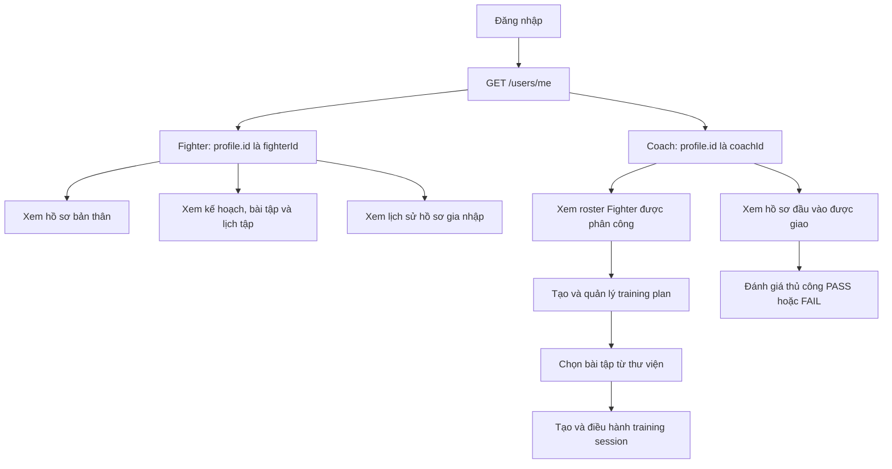
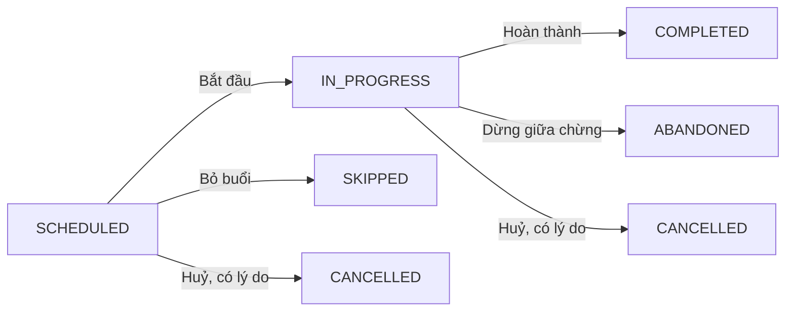
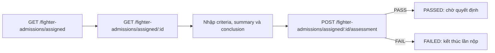

# Fighter & Coach — các luồng hiện có cho Frontend

> Snapshot source cập nhật ngày 27/09/2026, gồm cả thay đổi chưa commit trong workspace. Phạm vi: Fighter, Coach, đọc hồ sơ Medical, yêu cầu khám và điều kiện y tế của Training; không mô tả màn hình Admin/Doctor hoặc luồng phân tích AI. Guest chỉ xuất hiện để giải thích đường trở thành Fighter. Backend đã được kiểm tra cục bộ; chưa xác nhận deployment/migration trên server hay việc triển khai các màn hình FE. Medical cần môi trường đã áp dụng migration 011–012.

## 1. FE cần biết trước khi nối API

- **Base URL là origin của NestJS**: dùng `/auth/login`, `/users/me`, `/training-plans`… `main.ts` hiện **không** gọi `setGlobalPrefix('api/v1')`. Nếu môi trường có proxy thêm prefix, cấu hình riêng theo môi trường. Swagger ở `/docs` và `/api-docs`.
- Gửi `Authorization: Bearer <accessToken>` cho các route bảo vệ. Request dùng camelCase; UUID là ID profile/domain, không thay bằng ID tài khoản.
- Sau login, gọi `GET /users/me`: `data.id` là **userId**, `data.profile.id` là **fighterId hoặc coachId** theo `data.role`. Login chỉ trả user cơ bản và session, không trả profile.
- Quyền truy cập = permission đang có **và** scope tài nguyên. Role một mình không bảo đảm HTTP 200; explicit user deny thắng role grant. Login và `/users/me` hiện không trả danh sách effective permissions.
- Quyền mặc định trong tài liệu suy ra từ SQL: Fighter có 7 quyền **đọc Training** trong migration 008; Coach có quyền đánh giá hồ sơ trong 009 và **21 quyền** trong 010 sau revert. Migration 011 bổ sung cho cả Fighter và Coach `fighter.medical:read`, `fighter.medical_review_request:create`, `fighter.doctor:read`, luôn kèm scope ở §11. Chưa xác minh các migration đã chạy trên database đích.

**Envelope thực tế:**

```json
{ "success": true, "message": "...", "data": { "id": "..." } }
```

| Loại kết quả | Đường dẫn sau khi parse JSON response |
| --- | --- |
| Một đối tượng | `body.data` |
| List Fighters / Coach roster / Training / Exercises | `body.data.data` là array; `body.data.total`, `body.data.hasNextPage` |
| List hồ sơ admission | `body.data.items` là array; `body.data.total`, `body.data.page`, `body.data.limit` |
| List bài tập của plan / lịch sử Coach assignment | `body.data` là array |
| Medical dossier / Medical summary / tạo yêu cầu khám | `body.data` là object; dossier và summary có shape khác nhau |
| Medical history / examinations / review requests / Doctor assignment history | `body.data.data` là array; `body.data.total`, `body.data.hasNextPage` |
| Lỗi | `body.error.statusCode`, `body.error.code`, `body.error.message`, `body.error.details?` |

Hai cấp `data` ở collection là kết quả hiện tại của service pagination cộng global envelope; FE cần adapter theo endpoint. Pagination thông thường: `page=1`, `limit=20`, tối đa `100`. Query/body strict sẽ từ chối field ngoài schema; gửi PATCH chỉ với các field cần sửa, không gửi nguyên response object.

Nguồn: [bootstrap](../../nestjs-api/src/main.ts), [Auth contracts](../../nestjs-api/src/auth/auth.model.ts), [Users controller](../../nestjs-api/src/users/users.controller.ts), [profile projection](../../nestjs-api/src/users/users.repo.ts), [envelope](../../nestjs-api/src/shared/interceptors/api-response.interceptor.ts), [guard](../../nestjs-api/src/shared/guards/auth.guard.ts), [008](../../nestjs-api/migrations/008_grant_training_read_permissions_to_fighter.sql), [010](../../nestjs-api/migrations/010_grant_coach_permissions.sql), [011](../../nestjs-api/migrations/011_medical_clinical_records.sql).

## 2. Bản đồ các flow



Sơ đồ trên mô tả điều hướng FE đề xuất từ các API đã có, không khẳng định các màn hình FE đã được xây dựng. Session có thể tạo độc lập, không bắt buộc phải có plan. Có [bản diagram chỉnh sửa bằng diagrams.net](diagrams/fighter-coach-flows.drawio).

Luồng Medical bổ sung ở §11: Fighter mở hồ sơ sức khỏe của mình; Coach chọn Fighter trong roster để xem hồ sơ, lịch sử và gửi yêu cầu khám. Khi bắt đầu buổi tập, Coach xử lý kết quả kiểm tra điều kiện y tế của backend. Sơ đồ và file diagrams.net phía trên chỉ mô tả các flow cơ bản trước phần bổ sung này.

## 3. Flow chung — đăng nhập, khôi phục và nạp lại danh tính

1. `POST /auth/login` với `{ email, password }` → 200, nhận `data.user` và `data.session` (`accessToken`, `refreshToken`, `expiresAt`, `expiresIn`, `tokenType`).
2. `GET /users/me` → lấy role và profile ID; điều hướng vào Fighter hoặc Coach. Tài khoản GUEST chưa có Fighter profile.
3. Khi phiên hết hạn, `POST /auth/refresh` với `{ refreshToken }` → thay **cả hai token** bằng session mới. FE nên gom các lần refresh đồng thời và không retry vô hạn nếu refresh thất bại.
4. `POST /auth/logout` có bearer → `{ loggedOut: true }`; FE xoá state phiên.
5. Quên mật khẩu: `POST /auth/forgot-password` với `{ email }`. Luôn hiện thông báo chung theo response, không kết luận tài khoản tồn tại hoặc email đã giao thành công.
6. Từ recovery link, đọc `token_hash`, gửi `POST /auth/reset-password` với `{ tokenHash, newPassword }`. Response là `{ passwordUpdated, admissionActivationReady }`, **không có session token mới**. Nếu cần activation thì bảo đảm có bearer hợp lệ; có thể đăng nhập lại bằng mật khẩu mới.

Nguồn: [Auth controller](../../nestjs-api/src/auth/auth.controller.ts), [Auth service](../../nestjs-api/src/auth/auth.service.ts).

## 4. Flow trở thành Fighter và xem lịch sử gia nhập

| Bước phía ứng viên | API / kết quả hiện tại |
| --- | --- |
| Đăng ký | `POST /auth/register { email, password }` → 201; tạo GUEST. Nếu `confirmationRequired=true`, làm xác nhận email theo provider; `session` có thể null. |
| Nộp hồ sơ | `POST /fighter-admissions/applications` → 201, chỉ GUEST. Bắt buộc `firstName`, `lastName`, `dateOfBirth`, `weightClass`; không gửi email/role trong body. |
| Theo dõi hồ sơ | `GET /fighter-admissions/applications/me` và `GET /fighter-admissions/applications/me/:id`. GUEST và FIGHTER đều đọc lịch sử của chính mình. |
| Chờ đánh giá/quyết định | Các trạng thái application: `SUBMITTED`, `PASSED`, `FAILED`, `APPROVED`, `REJECTED`, `ACTIVATED`. Các bước phân công/phê duyệt nằm ngoài tài liệu này. |
| Đặt mật khẩu qua recovery | Gọi `/auth/reset-password`; nếu hồ sơ đã được duyệt, thành công sẽ cho phép bước activation. |
| Kích hoạt | `POST /fighter-admissions/activation` có bearer, không cần body → 200; trả `applicationId`, `status`, `role: FIGHTER`, `alreadyActive`. Gọi lại sau hoàn tất là idempotent. |
| Vào Fighter | Gọi lại `/users/me` để lấy role và Fighter profile mới; không tiếp tục dùng profile null cache từ GUEST. |

Một tài khoản chỉ có một application đang mở; `FAILED`/`REJECTED` cho phép nộp lần mới khi vẫn là GUEST. `PASSED` **chưa** cấp quyền Fighter. Không phải Fighter nào cũng có admission history: tài khoản được tạo qua đường tuyển trực tiếp có thể có danh sách rỗng.

Activation tạo Fighter profile nhưng source của `activate()` không tự tạo `coach_fighters`; không coi Coach đánh giá đầu vào là Coach phụ trách luyện tập sau activation.

Nguồn: [admission controller](../../nestjs-api/src/fighter-admissions/fighter-admissions.controller.ts), [service](../../nestjs-api/src/fighter-admissions/fighter-admissions.service.ts), [schema](../../nestjs-api/src/fighter-admissions/fighter-admissions.model.ts), [statuses](../../nestjs-api/src/fighter-admissions/fighter-admissions.constants.ts).

## 5. Fighter — xem hồ sơ và lịch luyện tập

Luồng cơ bản: `/users/me` → lịch tập → chi tiết session → kế hoạch liên quan → danh sách bài tập → chi tiết bài tập.

| Màn hình / thao tác | API và điểm cần dùng |
| --- | --- |
| Hồ sơ cá nhân | `GET /users/me` không cần permission riêng. Đây là đường đọc hồ sơ mặc định. |
| Danh sách kế hoạch | `GET /training-plans?page=1&limit=20`; backend tự scope Fighter về chính mình. Có filter `status`, `isActive`. |
| Chi tiết kế hoạch | `GET /training-plans/:id`; có `progress: { totalSessions, completedSessions, completionPercentage }`. |
| Bài tập của kế hoạch | `GET /training-plans/:id/exercises`; lấy `exerciseId` để đọc `/exercises/:exerciseId`. |
| Lịch sử / lịch tập | `GET /training-sessions`; lọc `planId`, `status`, `sessionType`, `fromDate`, `toDate`; ngày lọc dựa trên `scheduledAt`. |
| Chi tiết buổi tập | `GET /training-sessions/:id`; hiển thị lịch, loại buổi tập, ghi chú, trạng thái, thời gian thực tế nếu có. |
| Thư viện bài tập | `GET /exercises`, `GET /exercises/:id`; có filter `category`, `targetMuscle`, `search`. |
| Hồ sơ sức khỏe, lịch sử và yêu cầu khám | Dùng `fighterId = /users/me.data.profile.id` với các API §11; không cần gọi `/fighters/:id` trước. |

**Fighter mặc định chỉ đọc Training** theo migration 008: không dựng nút check-in, hoàn thành buổi tập, đổi trạng thái, nhập RPE hoặc chỉnh plan như quyền mặc định. Các API ghi có tồn tại nhưng cần grant riêng; không suy quyền ghi từ việc đọc được session.

`GET /fighters/:id`, `/fighters/:id/coaches`, `/fighters/:id/sessions` và `PATCH /fighters/:id` cần permission `fighter:*` tương ứng. Migrations đang đọc không cấp baseline những quyền này cho FIGHTER; FE không nên phụ thuộc chúng để mở màn hình cá nhân mặc định. Việc self-scope trong service không tự cấp quyền qua guard.

Nguồn: [Training access](../../nestjs-api/src/training/training-access.service.ts), [plan service](../../nestjs-api/src/training/plans/training-plan.service.ts), [session service](../../nestjs-api/src/training/sessions/training-session.service.ts), [Training contracts](../../nestjs-api/src/training/training.model.ts), [Fighters controller](../../nestjs-api/src/fighters/fighters.controller.ts).

## 6. Coach — roster và Fighter đang phụ trách

1. `GET /users/me` → lấy `coachId = data.profile.id`.
2. `GET /coaches/:coachId/fighters?page=1&limit=20` → roster hiện tại. Coach chỉ dùng Coach ID của chính mình; không có assignment thì 200 với list rỗng.
3. Chọn một Fighter → `GET /fighters/:fighterId` (cùng contract `PublicFighterDto`, không có projection riêng cho Coach).
4. Mở tab lịch sử phân công: `GET /fighters/:fighterId/coaches`. Mở lịch sử tập: `GET /fighters/:fighterId/sessions`.
5. Mở các plan/session thuộc phạm vi được phép và tạo mới qua flow bên dưới.

Sau revert, `/fighters`, `/fighters/:id` và `/coaches/:id/fighters` dùng `PublicFighterDto`: thông tin định danh/profile, `dateOfBirth`, `heightCm`, `reachCm`, số đo tay/chân, `currentMedicalStatus`, `bio`, `isActive`, timestamps… Xem schema trong nguồn bên dưới để lấy contract đầy đủ. Filter roster hiện hỗ trợ `weightClass`, `dominantStance`, `gym`, **`medicalStatus`**, `search`. Không dùng lại contract `CoachFighterSummary` đã bị gỡ.

Coach đọc được `GET /fighters/:fighterId/measurements` trong assignment scope, qua quyền `fighter.measurement:read`; không có quyền ghi số đo mặc định. Phần measurements giữ nguyên trong đợt Medical này. Với hồ sơ khám, chấn thương, phục hồi và clearance, dùng các API ở §11; không suy điều kiện được tập chỉ từ `currentMedicalStatus` trên Fighter profile.

Scope được kiểm tra bằng assignment hiệu lực: `startsAt <= now` và (`endsAt=null` hoặc `endsAt > now`), với profile hoạt động. Assignment đã hết hạn hoặc chưa bắt đầu không cấp quyền. Khi quyền bị thu hồi trong lúc đang mở màn hình, FE xử lý 403 và xoá dữ liệu stale khỏi view đó.

**Điểm dễ bỏ sót:** `GET /training-plans?fighterId=...` và `GET /training-sessions?fighterId=...` khi gọi bởi Coach còn tự lọc `coachId` về Coach hiện tại. Vì vậy list chỉ chứa record mang Coach ID đó, không phải toàn bộ record do các Coach khác tạo cho cùng Fighter. Muốn xem lịch sử buổi tập tổng quát của Fighter được assign, dùng `/fighters/:id/sessions`. Session tạo thiếu `coachId` sẽ lưu null và không xuất hiện trong danh sách session của Coach này.

Nguồn: [Coaches service](../../nestjs-api/src/coaches/coaches.service.ts), [roster schema](../../nestjs-api/src/coaches/coaches.model.ts), [Fighters service](../../nestjs-api/src/fighters/fighters.service.ts), [projection](../../nestjs-api/src/fighters/fighters.model.ts), [Training list queries](../../nestjs-api/src/training/training.repo.ts).

## 7. Coach — lập kế hoạch và cấu hình bài tập

| Thứ tự | API / payload |
| --- | --- |
| 1. Chọn Fighter trong roster | Giữ `fighterId`, `coachId` của profile hiện tại. |
| 2. Tạo plan | `POST /training-plans` → 201. Bắt buộc `{ fighterId, coachId, title, startDate }`; tuỳ chọn `description`, `endDate`, `goals`, `milestones`. `startDate/endDate` là `YYYY-MM-DD`. |
| 3. Chọn bài từ thư viện | `GET /exercises`, rồi `GET /exercises/:id` nếu cần chi tiết. Coach mặc định chỉ đọc thư viện. |
| 4. Gắn bài vào plan | `POST /training-plans/:id/exercises` → 201. Bắt buộc `{ exerciseId, orderIndex }`; tuỳ chọn `sets`, `reps`, `durationSeconds`, `targetRpe`, `coachNotes`. |
| 5. Sửa / bỏ bài khỏi plan | `PATCH` hoặc `DELETE /training-plans/:id/exercises/:exerciseId`. **Path `:exerciseId` ở đây là ID của record plan-exercise**, không phải ID bài trong thư viện. DELETE trả 200 với `{ id }`. |
| 6. Sửa plan | `PATCH /training-plans/:id`; gửi field được phép như `title`, `goals`, `milestones`, `startDate`, `endDate`. Không đổi `fighterId/coachId` qua PATCH. |
| 7. Đổi trạng thái plan | `PATCH /training-plans/:id/status { status }`; enum `DRAFT`, `ACTIVE`, `COMPLETED`, `CANCELLED`. |

Plan mới mặc định `DRAFT`. Code hiện chỉ cấm `COMPLETED → DRAFT` và `CANCELLED → DRAFT`, **không** enforce một chuỗi tuyến tính DRAFT → ACTIVE → COMPLETED. Không mô tả chuỗi đó là state machine đầy đủ. Milestone của **training plan** hoàn tất cần `completedAt`; milestone chưa hoàn tất không gửi `completedAt`. Đây là contract riêng, không dùng chung với milestones của **recovery plan** ở §11.5, nơi `completedAt` do server quản lý.

Tạo plan và gắn bài **không tự tạo session**. Tạo session trong flow tiếp theo. Tiến độ plan tính từ số session `COMPLETED` / tổng session gắn plan, làm tròn phần trăm; không có session thì bằng 0. Sửa milestones không tự hoàn tất plan.

Nguồn: [plan controller](../../nestjs-api/src/training/plans/training-plan.controller.ts), [plan service](../../nestjs-api/src/training/plans/training-plan.service.ts), [Training schemas](../../nestjs-api/src/training/training.model.ts), [repository](../../nestjs-api/src/training/training.repo.ts), [transition rules](../../nestjs-api/src/training/training.constants.ts).

## 8. Coach — tạo và điều hành buổi tập

`POST /training-sessions` → 201. Bắt buộc `fighterId`, `title`, `scheduledAt` (ISO timestamp có timezone), `sessionType`; truyền `coachId` hiện tại để session xuất hiện trong list Coach. `planId` là tuỳ chọn; nếu có phải trỏ tới plan còn tồn tại, `isActive=true` và cùng Fighter. `isActive` khác với `status=ACTIVE`.

Các field tuỳ chọn khác: `plannedDurationSec`, `roundCount`, `location`, `coachNotes`. `roundCount` mặc định 0. Session mới là `SCHEDULED`.



- Đổi trạng thái: `PATCH /training-sessions/:id/status { status }`. Nếu `CANCELLED`, bắt buộc thêm `cancellationReason`; trạng thái khác không được gửi field này.
- Gửi lại cùng status thường trả session hiện tại; riêng `IN_PROGRESS` vẫn kiểm tra điều kiện y tế và có thể trả 409. Các trạng thái kết thúc không chuyển sang trạng thái khác; chuyển sai trả 400, xung đột cập nhật trả 409.
- Backend tự ghi mốc thời gian và `actualDurationSec` khi buổi tập đã bắt đầu rồi kết thúc. FE không gửi `actualDurationSec`, `checkedInAt`, `completedAt` trong PATCH.
- `PATCH /training-sessions/:id` để sửa lịch, tiêu đề, ghi chú hoặc `reportedRpe` (số nguyên 1–10); status và cancellationReason dùng route riêng ở trên.
- Khi chuyển sang `IN_PROGRESS`, hoặc đổi `sessionType` của session đang `IN_PROGRESS`, backend kiểm tra điều kiện y tế với loại buổi tập thực tế. Nếu bị chặn, nhận 409 `TRAINING_MEDICAL_ELIGIBILITY_REQUIRED` với `error.details.reasons`; cách xử lý ở §11.6. Tạo lịch tập thành công không bảo đảm được bắt đầu tập.
- Sau mutation, FE nên refetch session và plan detail/progress liên quan. Session không có plan thì chỉ refetch session/list.

Các `sessionType` được chấp nhận: `SHADOW_BOXING`, `PAD_WORK`, `HEAVY_BAG`, `SPARRING`, `GRAPPLING`, `STRENGTH_CONDITIONING`, `RECOVERY`, `PHYSICAL_THERAPY`. Giới hạn trong clearance có thể chỉ cho phép một phần danh sách này.

Nguồn: [session controller](../../nestjs-api/src/training/sessions/training-session.controller.ts), [session service](../../nestjs-api/src/training/sessions/training-session.service.ts), [status map](../../nestjs-api/src/training/training.constants.ts), [request schemas](../../nestjs-api/src/training/training.model.ts).

## 9. Coach — đánh giá đầu vào thủ công



List/detail chỉ dành cho hồ sơ có **assignment đánh giá đang mở** của Coach; đây là assignment admission, không dùng `coach_fighters`. List nhận `page/limit`, không có status filter. UI có thể dựa trên status và assessment của từng row để hiển thị hành động.

Payload assessment: `{ conclusion: "PASS" | "FAIL", summary, criteria }`, với 1–30 criteria. Mỗi criterion cần `criterionName`, `method`, `observation`; `value`, `unit`, `note` là tuỳ chọn. API trả 201 với staff view mới. Gửi đánh giá chỉ hợp lệ khi application còn `SUBMITTED` và Coach vẫn được giao; assessment đã nộp không có API sửa/xoá. PASS không tự kích hoạt Fighter.

Nguồn: [admission controller](../../nestjs-api/src/fighter-admissions/fighter-admissions.controller.ts), [submitAssessment](../../nestjs-api/src/fighter-admissions/fighter-admissions.service.ts), [assessment schema](../../nestjs-api/src/fighter-admissions/fighter-admissions.model.ts).

## 10. Quyền, lỗi và các giới hạn FE cần xử lý

| Nhóm thao tác | Fighter baseline | Coach baseline |
| --- | --- | --- |
| `/users/me`, logout | Authenticated | Authenticated |
| Đọc Training Plan/Session/Plan Exercise/Exercise | Có, self-scope | Có, assignment scope; library đọc chung |
| Tạo/sửa plan, cấu hình bài trong plan, tạo/sửa/chuyển trạng thái session | Chưa cấp | Có theo 010 |
| Tạo/sửa bài trong thư viện | Chưa cấp | Chưa cấp |
| Roster và Fighter detail qua `/fighters` | Chưa cấp | Có theo 010, chỉ Fighter đang phụ trách |
| Lịch sử Coach assignment, Fighter session history | Chưa cấp | Có theo 010, assignment scope |
| Đọc measurements | Chưa cấp mặc định | Có theo 010, assignment scope; giữ nguyên trong đợt Medical |
| Medical dossier, summary, examinations, review requests và history | Có theo 011, chỉ bản thân | Có theo 011, Fighter đang phụ trách |
| Tạo yêu cầu khám | Có theo 011, chỉ bản thân | Có theo 011, Fighter đang phụ trách |
| Lịch sử Doctor assignment | Có theo 011, chỉ bản thân | Có theo 011, Fighter đang phụ trách |
| Ghi chấn thương/điều trị/phục hồi, kết luận khám, cấp/thu hồi clearance | Không; chỉ Doctor đủ điều kiện | Không; chỉ Doctor đủ điều kiện |
| Sửa profile, tự assign/end Coach | Không coi là quyền mặc định | Không coi là quyền mặc định |
| Lịch sử admission của bản thân | Có, role-gated | Không dùng route applicant |
| Đánh giá admission được giao | Không | Có theo 009 |

Baseline không phải danh sách quyền của mọi tài khoản thật. Override theo user/role và trạng thái migration đích có thể thay đổi kết quả.

| HTTP | FE xử lý |
| --- | --- |
| 401 | Xử lý phiên hết hạn/đăng nhập lại; không refresh lặp khi chính login/recovery token không hợp lệ. |
| 403 | Không đủ permission hoặc ngoài scope; không mặc định logout. |
| 404 | Resource không tồn tại/không còn khả dụng; quay lại danh sách phù hợp. |
| 400 | Lệnh nghiệp vụ không hợp lệ, ví dụ chuyển trạng thái session sai. Hiển thị `error.code/message`. |
| 409 | Conflict trạng thái/cập nhật đồng thời, hồ sơ đang mở hoặc assessment đã nộp; refetch trước thao tác tiếp. Với `TRAINING_MEDICAL_ELIGIBILITY_REQUIRED`, đọc danh sách `error.details.reasons` ở §11.6; đây không phải lỗi field validation. |
| 422 | Validation; map `error.details` về field. |
| 429 | Bị giới hạn tần suất, chờ rồi thử lại. |
| 5xx | Hiển thị lỗi và cho thử lại phù hợp; không suy ra mutation thất bại tuyệt đối rồi tự gửi lặp mọi POST. |

Các flow trên có code backend và module registration; không đồng nghĩa mọi màn hình, seed dữ liệu hay quyền trên server đã sẵn sàng. Source chưa cung cấp flow thông báo realtime cho các thao tác này; hướng tích hợp đơn giản là refetch sau mutation và khi quay lại view. Những đề xuất xử lý state/refetch trong tài liệu là hướng dẫn FE, không phải hành vi tự động của backend.

Phần Medical dành cho Fighter/Coach được mô tả ở §11; AI và các màn hình vận hành Admin/Doctor nằm ngoài phạm vi. Các source chính để đối chiếu khi backend thay đổi: [AppModule](../../nestjs-api/src/app.module.ts), [Auth](../../nestjs-api/src/auth/auth.controller.ts), [Fighters](../../nestjs-api/src/fighters/fighters.controller.ts), [Coaches](../../nestjs-api/src/coaches/coaches.controller.ts), [Training model](../../nestjs-api/src/training/training.model.ts), [Admissions](../../nestjs-api/src/fighter-admissions/fighter-admissions.controller.ts).

## 11. Medical — xem hồ sơ, yêu cầu khám và điều kiện được tập

Phần này thay thế chính sách dự kiến ngày 25/09: mô tả backend hiện tại sau migration 011–012. `fighter_measurements`, ROM, asymmetry và cảnh báo AI không nằm trong thay đổi này. FE dùng NestJS API để đọc hồ sơ và lịch sử; không truy vấn trực tiếp các bảng mới qua Supabase client.

### 11.1 Quyền và assignment hiện tại

| Vai trò | Đọc hồ sơ chính thức và lịch sử | Tạo yêu cầu khám | Ghi chuyên môn, cấp/thu hồi clearance |
| --- | --- | --- | --- |
| FIGHTER | Chỉ bản thân | Chỉ bản thân | Không |
| COACH | Chỉ Fighter đang được phân công | Chỉ Fighter đang được phân công | Không |
| DOCTOR có profile hoạt động | Chỉ Fighter đang được phân công | Chỉ Fighter đang được phân công | Có, trong assignment hiện tại |
| ADMIN | Tất cả Fighter | Không | Không; chỉ quản lý phân công |

Mỗi thao tác vẫn cần permission tương ứng. Quyền ghi chuyên môn còn kiểm tra role DOCTOR và assignment; override permission không biến Coach/Fighter/Admin thành người ký hồ sơ. Quyền đọc report lịch sử **giống hồ sơ hiện tại**: từng phụ trách Fighter hoặc từng ký bản ghi không cấp quyền đọc sau khi assignment đã kết thúc.

Các route đọc lâm sàng, gồm `/medical-summary`, kiểm tra scope và ghi audit truy cập. 403 có thể là `MEDICAL_ACCESS_DENIED` hoặc `FORBIDDEN`; FE đóng view và bỏ dữ liệu cache ngoài scope. Nếu audit không ghi được, backend có thể trả 500 `MEDICAL_OPERATION_FAILED`; không dùng đường đọc khác để vượt kiểm tra.

`GET /fighters/:id/doctors` trả lịch sử phân công có phân trang, gồm `doctorId`, `doctorName?`, `startsAt`, `endsAt`, `endReason` và thông tin người phân công/kết thúc. Assignment mới do ADMIN tạo, hiệu lực ngay theo thời gian server; Fighter/Coach không có nút assign/end. Doctor chỉ có thể kết thúc assignment của chính mình; hồ sơ đã ký vẫn được giữ lại.

### 11.2 API và dữ liệu để dựng màn hình

Trong bảng dưới, `:id` là **fighterId**. Các GET trả 200; POST yêu cầu khám trả 201.

| Nhu cầu | API / query | Permission |
| --- | --- | --- |
| Hồ sơ sức khỏe tổng hợp | `GET /fighters/:id/medical` | `fighter.medical:read` |
| Report lịch sử, gồm cả hồ sơ đã đóng | `GET /fighters/:id/medical/history?page=1&limit=20&recordType=RECOVERY_PLAN` | `fighter.medical:read` |
| Lịch sử kết luận khám | `GET /fighters/:id/medical-examinations?page=1&limit=20&scope=TRAINING` | `fighter.medical:read` |
| Theo dõi yêu cầu khám | `GET /fighters/:id/medical-review-requests?page=1&limit=20&status=OPEN` | `fighter.medical:read` |
| Gửi yêu cầu khám | `POST /fighters/:id/medical-review-requests` với `{ "reason": "Đau gối sau buổi tập" }` | `fighter.medical_review_request:create` |
| Lịch sử Doctor assignment | `GET /fighters/:id/doctors?page=1&limit=20` | `fighter.doctor:read` |
| Summary tương thích màn hình cũ | `GET /fighters/:id/medical-summary` | `fighter.medical:read` |

Các filter `recordType`, `scope`, `status` đều tuỳ chọn. `recordType` nhận `INJURY`, `TREATMENT`, `RECOVERY_PLAN`, `MEDICAL_EXAMINATION`, `MEDICAL_CLEARANCE`, `MEDICAL_REVIEW_REQUEST`; `scope` nhận `TRAINING`, `COMPETITION`; trạng thái yêu cầu khám là `OPEN`, `RESOLVED`. Các list Medical dùng `body.data.data`, `total`, `hasNextPage`, không phải `items`.

`GET /medical` trả dossier trong `body.data`:

| Field | Cách dùng |
| --- | --- |
| `fighterId` | ID Fighter đang xem |
| `activeInjuries` | Chấn thương `ACTIVE` hoặc `RECOVERING`; bản `RESOLVED` xem trong history |
| `activeRecoveryPlans` | Kế hoạch phục hồi `ACTIVE`, gồm milestones; kế hoạch `COMPLETED`/`CANCELLED` xem trong history |
| `currentExaminations.training`, `.competition` | Kết luận hiện hành theo từng phạm vi, có thể null; gồm `decision`, `reason`, `restrictions`, `validUntil` |
| `activeClearances` | Các giấy có trạng thái lưu là `ACTIVE`; từng giấy có `isCurrentlyValid`, thời hạn và hạn chế. Có mặt trong list không bảo đảm giấy đang chi phối quyền được tập |
| `openReviewRequests` | Các yêu cầu khám chưa xử lý |
| `eligibility.training`, `.competition` | `{ scope, eligible, reasons }` theo phạm vi; xem giới hạn đánh giá theo loại session ở §11.6 |

`/medical-summary` giữ shape cũ: `fighterId`, `currentMedicalStatus`, `activeClearance` (số ít, có thể null), `activeInjuries`, `jointStates`, `disclaimer`. Không dùng summary làm nguồn quyết định cho phép bắt đầu tập. Các field AI legacy trong summary không phải cam kết rằng luồng AI/ROM mới đã hoàn thành.

### 11.3 Fighter/Coach gửi yêu cầu khám

1. Fighter lấy ID bản thân từ `/users/me`; Coach lấy Fighter từ roster hiện tại.
2. Mở dossier, danh sách yêu cầu khám và Doctor assignment nếu cần. Không có Doctor assignment không ngăn Fighter/Coach trong scope gửi yêu cầu khám.
3. Gửi `POST /fighters/:id/medical-review-requests` chỉ với `reason` (trim, 1–2000 ký tự). Không gửi người yêu cầu, trạng thái, thời gian hay kết luận chẩn đoán; server tự ghi.
4. Khi thành công, refetch dossier và danh sách yêu cầu. Yêu cầu `OPEN` tạo nghĩa vụ khám và chặn thao tác bắt đầu tập qua Medical gate; không chỉ là một ghi chú thông báo.
5. Doctor khám và liên kết các yêu cầu được xử lý với kết luận TRAINING. `RESOLVED` nghĩa là yêu cầu đã được xử lý, **không** có nghĩa Fighter đã đủ điều kiện tập; đọc lại kết luận, clearance và eligibility.

Không có API để Fighter/Coach tự resolve, huỷ hay xoá yêu cầu. POST hiện tạo bản ghi mới, không phải thao tác idempotent: chống bấm lặp và đọc lại danh sách khi response bị mất trước khi quyết định gửi lại. Gửi yêu cầu không tự phân công Doctor; không mô tả việc AI tự assign/review là hành vi đã có của luồng này.

### 11.4 Kết luận khám và clearance là hai dữ liệu khác nhau

Kết luận khám có `scope = TRAINING | COMPETITION`, `decision = ELIGIBLE | ELIGIBLE_WITH_RESTRICTIONS | NOT_ELIGIBLE`. Kết luận không đạt lưu lý do chuyên môn và tự thu hồi clearance ACTIVE cùng phạm vi. Kết luận đạt vẫn cần Doctor cấp clearance riêng; không đổi nhãn “đã khám đạt” thành “được tập/thi đấu” chỉ từ `decision`.

Clearance có `clearanceType = TRAINING | RETURN_FROM_INJURY | COMPETITION`, `status = ACTIVE | EXPIRED | REVOKED`. TRAINING và RETURN_FROM_INJURY thuộc phạm vi TRAINING; chúng không thay thế giấy COMPETITION. Hiển thị `validFrom`, `validUntil`, `restrictions.allowedSessionTypes`, `allowedTechniqueTypes`, `excludedJoints`, `restrictions.notes` và `notes` của giấy khi có. `restrictions.notes` là điều kiện chuyên môn từ kết luận khám, khác với ghi chú riêng `notes` của giấy.

Backend chọn kết luận hiện hành theo thứ tự phát hành server, rồi chọn clearance mới nhất của kết luận đó **trước khi xét trạng thái**. Nếu giấy chi phối bị thu hồi hoặc chưa đến ngày hiệu lực, giấy cũ không được dùng thay. Ví dụ A loại TRAINING và B loại RETURN_FROM_INJURY cùng từ một kết luận: B cấp sau, chỉ cho PHYSICAL_THERAPY; thu hồi B không làm A tự cấp lại quyền SPARRING.

Response clearance hiện **không có** `issueSequence` hay `isGoverning`. FE không tự chọn giấy chi phối bằng `createdAt`, UUID hoặc phần tử đầu của `activeClearances`; `isCurrentlyValid=true` chỉ mô tả giấy đó. Dùng `eligibility` để hiển thị kết quả theo phạm vi, và response của thao tác Training để quyết định thao tác có thành công hay không.

Thi đấu luôn cần clearance COMPETITION còn hiệu lực theo kết luận hiện hành. Dossier đã có `eligibility.competition`; tài liệu này chưa xác nhận có endpoint đăng ký giải đấu được tích hợp gate, nên không suy rằng việc đọc dossier đã đăng ký hoặc duyệt Fighter tham gia giải.

### 11.5 Hiển thị recovery milestones và lịch sử bất biến

Fighter/Coach chỉ đọc kế hoạch phục hồi, không có checkbox chỉnh sửa hay API đánh dấu hoàn thành cho các vai trò này. Milestone chuẩn trong response:

```json
{
  "id": "00000000-0000-4000-8000-000000000001",
  "title": "Đi bộ không đau",
  "criteria": "Bác sĩ xác nhận đạt tiêu chí phục hồi",
  "targetDate": "2026-10-01",
  "isCompleted": false,
  "completedAt": null,
  "notes": null
}
```

`id` là UUID do server tạo, giữ nguyên khi Doctor sửa nội dung hoặc đổi vị trí; thứ tự phần tử là thứ tự hiển thị, không có field `order`. `targetDate` là `YYYY-MM-DD | null`; `completedAt` là ISO timestamp hoặc null, do server ghi khi hoàn thành, giữ nguyên nếu vẫn hoàn thành và xoá về null khi mở lại mốc. Hoàn thành tất cả mốc không tự hoàn tất plan hoặc cấp clearance.

`milestones` cũng có thể là **JSON array legacy**, chứa string, số, boolean, null, array hoặc object không theo schema trên. FE kiểm tra dạng dữ liệu trước khi render: dùng view mốc chuẩn nếu toàn bộ array hợp lệ, còn legacy dùng view chỉ đọc phù hợp và giữ nguyên giá trị/thứ tự, không tự biến `{ label, done }` thành schema mới. Không cắt dữ liệu trả về ở 50 phần tử: 50 chỉ là giới hạn input mới, không phải giới hạn đọc hoặc giới hạn y khoa. Doctor PATCH không gửi `milestones` thì giá trị cũ được giữ nguyên.

History trả từng entry có `recordType`, `recordId`, `revision`, `source`, `recordedAt`, `recordedByUserId`, `snapshot`. Envelope và metadata dùng camelCase, nhưng các key trong `snapshot` giữ tên cột **snake_case** (ví dụ `actual_end_date`, `allowed_session_types`); viết adapter theo `recordType`, không ép snapshot thành DTO hiện hành. `recordedByUserId` có thể null.

`source = APPLICATION` là revision từ ứng dụng; `MIGRATION_BASELINE` là trạng thái được ghi nhận khi migration 011 chạy, không phải lịch sử đầy đủ được khôi phục trước đó. Treatment và examination là bản ghi chỉ thêm mới, `source=null`; kết luận đính chính có `supersedesId` và vẫn giữ bản trước. Bản injury/recovery đã đóng vẫn có thể được Doctor đính chính nội dung thành revision mới, không mở lại trạng thái. UI lịch sử không có thao tác xoá/chỉnh sửa snapshot; quyền đọc vẫn theo §11.1.

### 11.6 Coach xử lý điều kiện y tế khi bắt đầu tập

Fighter chưa từng khám và không có yêu cầu khám OPEN vẫn được tập bình thường; backend không bắt khám định kỳ cho mọi session. Có yêu cầu OPEN hoặc kết luận `NOT_ELIGIBLE` thì bị chặn. Sau kết luận đạt, cần clearance từ kết luận hiện hành; giấy bị thu hồi hoặc chưa có hiệu lực tiếp tục chặn. Giấy hết hạn chặn khi có hạn chế hoặc thuộc COMPETITION; giấy TRAINING không hạn chế đã hết hạn dưới kết luận không hạn chế không tự tạo nghĩa vụ khám định kỳ.

`eligibility.training` trong dossier **chưa nhận sessionType**: có thể `eligible=true` nhưng SPARRING vẫn bị cấm. Backend đánh giá lại khi `PATCH /training-sessions/:id/status { "status": "IN_PROGRESS" }`, kể cả gửi lại cùng trạng thái, và khi đổi loại session đang chạy. Không dùng `activeClearances`, `currentMedicalStatus` hoặc một lần đọc dossier trước đó để bỏ qua lỗi gate.

Khi lỗi 409 có `error.code = TRAINING_MEDICAL_ELIGIBILITY_REQUIRED`, đọc `error.details.reasons` (có thể nhiều lý do):

| Reason code thực tế | Hướng hiển thị / xử lý |
| --- | --- |
| `REVIEW_REQUEST_PENDING` | Còn yêu cầu khám chưa xử lý; mở danh sách yêu cầu và trạng thái khám |
| `EXAMINATION_NOT_ELIGIBLE` | Kết luận hiện hành chưa đủ điều kiện; hiển thị lý do chuyên môn |
| `CLEARANCE_REQUIRED` | Chưa có giấy phù hợp từ kết luận hiện hành, hoặc giấy chi phối đã thu hồi/chưa hiệu lực; chờ Doctor xử lý |
| `CLEARANCE_EXPIRED` | Giấy phải còn hiệu lực đã hết hạn; cần Doctor đánh giá/cấp lại |
| `SESSION_TYPE_RESTRICTED` | Loại buổi tập nằm ngoài phạm vi được phép; hiển thị các hạn chế đã trả, không tự chuyển sang loại khác |

Giữ trạng thái session theo server khi mutation bị từ chối, không optimistic chuyển sang `IN_PROGRESS`; refetch session, dossier và yêu cầu khám để hiện thông tin mới. Tạo yêu cầu khám hay thu hồi giấy không tự đổi một session đang chạy thành `ABANDONED`: code hiện chặn tại các thao tác nêu trên, không tự dừng session hoặc phát sự kiện realtime. `allowedTechniqueTypes`, `excludedJoints` và ghi chú cần được Coach đọc khi chọn bài; gate Training hiện kiểm tra `sessionType`, không tự kiểm từng bài tập/kỹ thuật/khớp.

Nguồn đối chiếu: [Medical routes](../../nestjs-api/src/medical/medical.controller.ts), [assignment routes](../../nestjs-api/src/medical/medical-assignment.controller.ts), [input/output schemas](../../nestjs-api/src/medical/medical.model.ts), [scope và audit](../../nestjs-api/src/medical/medical-access.service.ts), [business logic và eligibility](../../nestjs-api/src/medical/medical.service.ts), [history và clearance queries](../../nestjs-api/src/medical/medical.repo.ts), [reason codes](../../nestjs-api/src/medical/medical.constants.ts), [Training gate](../../nestjs-api/src/training/sessions/training-session.service.ts), [migration 011](../../nestjs-api/migrations/011_medical_clinical_records.sql), [migration 012](../../nestjs-api/migrations/012_medical_clearance_issue_order.sql).

## 12. Thông báo — hộp thông báo và realtime (SSE)

> Bổ sung ngày 29/09/2026, nhánh `User_Feature`. Backend đã viết nhưng **chưa build, chưa test, chưa áp dụng migration 014, chưa deploy**. Áp dụng cho mọi user đã đăng nhập (GUEST, FIGHTER, COACH, DOCTOR, ADMIN).

### 12.1 REST (có envelope chung)

| Route | Kết quả |
| --- | --- |
| `GET /notifications?page=&limit=&unreadOnly=true` | `body.data.data` là array, `body.data.total`, `body.data.hasNextPage`; mới nhất trước |
| `GET /notifications/unread-count` | `body.data.count` |
| `PATCH /notifications/:id/read` | `body.data` là notification. Idempotent: gọi lại giữ `readAt` lần đầu. ID của người khác hoặc không tồn tại trả 404 `NOTIFICATION_NOT_FOUND` |

Mọi route chỉ đọc/sửa hộp của chính token; không có tham số userId. Mỗi item: `id`, `type`, `title`, `message`, `payload`, `isRead`, `readAt`, `createdAt`. `payload` có dạng `{ v: 1, target?: { type, id }, data? }`. `target.type` là `FIGHTER_APPLICATION | FIGHTER | COACH_ASSIGNMENT | TRAINING_PLAN | TRAINING_SESSION`: mở màn hình qua API của resource đó, và API vẫn kiểm tra quyền hiện tại (có thể trả 403/404 nếu quyền đã đổi). Thông báo kết thúc assignment có thể không có `target`. Record cũ (trước 014) có thể có `payload` rỗng và `type` cũ.

`type` mới: `ADMISSION_APPLICATION_SUBMITTED`, `ADMISSION_ASSESSMENT_ASSIGNED`, `ADMISSION_ASSESSMENT_UNASSIGNED`, `ADMISSION_DECISION_REQUIRED`, `ADMISSION_ASSESSMENT_RESULT` (`data.conclusion`), `ADMISSION_DECISION_RECORDED` (`data.decision`), `ADMISSION_ACTIVATION_COMPLETED`, `COACH_ASSIGNMENT_STARTED`, `COACH_ASSIGNMENT_ENDED`, `TRAINING_PLAN_ACTIVATED`, `TRAINING_SESSION_SCHEDULED`, `TRAINING_SESSION_RESCHEDULED`, `TRAINING_SESSION_CANCELLED` (session có `data.scheduledAt`, `data.location`). Hiển thị `title`/`message` do server trả; renderer nên chịu được `type` lạ.

Đã đọc thông báo **không** có nghĩa việc nghiệp vụ đã được xử lý (ví dụ hồ sơ vẫn chờ quyết định).

### 12.2 Stream `GET /notifications/stream`

- Trả `text/event-stream` chuẩn, **không** có envelope. Native `EventSource` không gửi được header `Authorization`, nên dùng SSE client dựa trên `fetch` (có parser event và retry), ví dụ `@microsoft/fetch-event-source`. Không đặt token trên query string.
- SSE là một HTTP response giữ mở, không phải polling. Server gửi `retry:` gợi ý thời gian reconnect.
- Lỗi trước khi mở stream trả JSON envelope thường: 401 (token), 429 `NOTIFICATION_STREAM_LIMIT` (quá số kết nối/tài khoản trên một instance), 503 `NOTIFICATION_STREAM_UNAVAILABLE` (Redis chưa sẵn sàng; thử lại có backoff).

| `event:` | `data` | FE làm gì |
| --- | --- | --- |
| `ready` | `{ connectionId }` | Stream đã đăng ký. **Sau** event này mới tải `GET /notifications` + `unread-count` |
| `notification.created` | `{ notificationId }` | Refetch list/count (hoặc chèn sau khi tải item), dedupe theo `id` |
| `notification.read` | `{ notificationId }` | Tab/thiết bị khác đã đọc; cập nhật trạng thái và count |
| `resync` | `{}` | Server có thể đã lỡ signal; tải lại list + count |
| `heartbeat` | `{}` | Giữ kết nối; không cần xử lý |
| `closing` | `{ reason }` | Server đóng stream có trật tự: `TOKEN_EXPIRED`, `AUTH_REVOKED`, `LIFETIME_REACHED`, `SERVER_SHUTDOWN` |

Client đọc chậm (buffer vượt giới hạn) hoặc lỗi socket bị server **cắt ngay, không có event `closing`**; xử lý như mất kết nối: reconnect có backoff rồi tải lại từ REST. `resync` chỉ được gửi sau khi server đăng ký lại kênh realtime thành công, tối đa một lần cho mỗi lần đăng ký lại.

Quy tắc đồng bộ:

1. Mở stream → chờ `ready` → tải list + count. Nếu có event tới trong lúc đang tải, đặt cờ dirty và tải lại sau khi xong, để không mất cập nhật.
2. Mỗi lần reconnect hoặc tab được focus lại: tải lại từ REST, dedupe theo `id`. Có thể thêm đối soát nhẹ định kỳ (ví dụ vài phút) khi stream vẫn mở.
3. Không có replay: server không xử lý `Last-Event-ID`, event trong lúc mất kết nối chỉ khôi phục bằng REST.
4. `TOKEN_EXPIRED`/401: refresh token bằng luồng auth hiện có rồi mở lại; `AUTH_REVOKED` lặp lại hoặc 401 sau refresh thì dừng retry và về đăng nhập. Logout phải abort stream. Không retry vô hạn lỗi auth.
5. Proxy/CDN phải không buffer và không cắt kết nối idle ngắn hơn chu kỳ heartbeat (mặc định 25 giây); server gửi `X-Accel-Buffering: no` và `Cache-Control: no-cache, no-transform`.

Nguồn: [controller](../../nestjs-api/src/notifications/notifications.controller.ts), [stream](../../nestjs-api/src/notifications/notification-stream.service.ts), [constants](../../nestjs-api/src/notifications/notifications.constant.ts), [errors](../../nestjs-api/src/notifications/notifications.error.ts), [contract](../../nestjs-api/src/shared/contracts/notification.contract.ts), [migration 014](../nestjs-api/migrations/014_notifications_delivery.sql).
