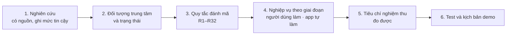
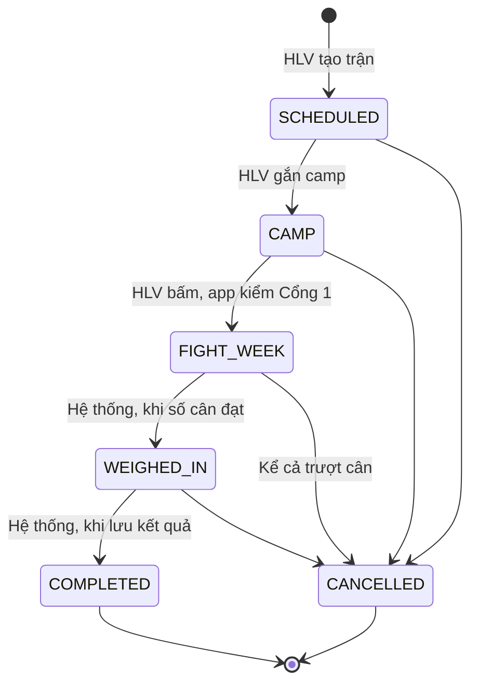
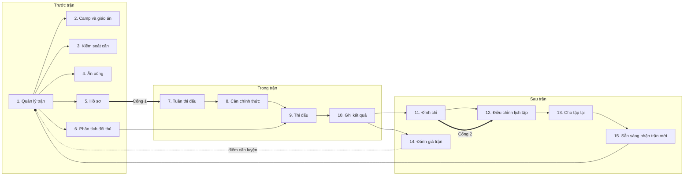
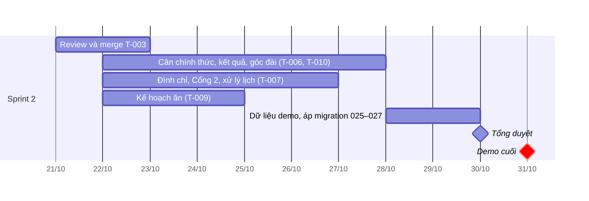

# Fight Camp: nghiệp vụ và luồng quản lý võ sĩ trước, trong và sau trận

**Ngày**: 2026-10-21 · **Góc nhìn**: người triển khai dự án · **Thời lượng đọc**: khoảng 15 phút

Tài liệu này trình bày dự án theo hướng nghiệp vụ: bài toán, những gì nghiên cứu được, cách tổ chức quy tắc, và 15 nghiệp vụ ở ba giai đoạn của một trận. Chi tiết từng quy tắc nằm trong [Luồng nghiệp vụ](../FIGHT-CAMP-BUSINESS-FLOWS.md#nghiệp-vụ-hệ-thống-trước-trong-và-sau-trận-đề-xuất-2010-chờ-duyệt). Phần trước trận đã được duyệt; backend đã code trên nhánh T-003, đang chờ review. Phần trong và sau trận là **đề xuất sau review 2 (20/10), chờ chủ dự án duyệt**.

---

## 1. Bài toán

Với một võ sĩ có trận, HLV phải trả lời một chuỗi câu hỏi. Mỗi giai đoạn có câu hỏi riêng, và câu trả lời của giai đoạn trước quyết định giai đoạn sau.

| Giai đoạn | HLV cần trả lời | Nếu trả lời sai |
| --- | --- | --- |
| Trước trận (camp 6–8 tuần) | Võ sĩ có kịp xuống cân an toàn không? Hồ sơ y tế đủ và còn hạn đến ngày thi chưa? | Ép cân cấp tốc nguy hiểm; bị loại ở bàn cân hoặc bàn hồ sơ |
| Trong trận (tuần thi đấu, buổi cân, ngày thi) | Có đạt cân không? Kế hoạch thi đấu có hiệu quả không, hiệp sau đánh thế nào? | Trượt cân; đánh theo kế hoạch đã không còn đúng |
| Sau trận | Võ sĩ phải nghỉ bao lâu, được tập loại buổi nào, khi nào được tập lại? Trận này để lại bài học gì cho trận sau? | Cho võ sĩ đối kháng khi chưa hồi phục sau chấn động; lặp lại sai lầm ở trận sau |

**Vì sao dự án nặng về nghiệp vụ:**

- **Quy định thay đổi theo từng giải.** Hạng cân, giờ cân, hồ sơ và số ngày đình chỉ không giống nhau giữa các tổ chức (mục 2).
- **Có yếu tố an toàn.** Sai ở cân nặng hoặc đình chỉ có thể gây hại thật cho võ sĩ. App phải biết mình được làm gì và không được làm gì.
- **Phụ thuộc thời gian.** Gần như mọi trạng thái (cảnh báo cân, hạn nộp hồ sơ, tuần thi đấu, đình chỉ còn hiệu lực) đổi theo ngày, không cần ai thao tác.
- **Cắt ngang nhiều khu vực.** Một kết quả trận làm thay đổi lịch tập: đình chỉ chặn buổi sparring đã xếp ở module training.

## 2. Nghiên cứu nghiệp vụ

Nguồn đầy đủ: [Nghiên cứu nghiệp vụ](../FIGHT-CAMP-DOMAIN-RESEARCH.md).

| Chủ đề | Tìm được | Nguồn | Mức tin cậy |
| --- | --- | --- | --- |
| Luật MMA Việt Nam | Hạng cân theo khoảng (Điều 7); kiểm tra y tế trước và sau trận, chi tiết theo điều lệ giải (Điều 8); giải một ngày thì cân trước 1 ngày (Điều 9). **Không** quy định dung sai cân, danh mục hồ sơ hay đình chỉ sau KO | [Luật thi đấu Võ thuật tổng hợp, VMMAF, 2021](https://vmmaf.org/images/pdf_file/2021/mau-mma_1618298572.pdf) | Đã đọc toàn văn |
| Giảm cân cấp tốc | Tối đa 8% khối lượng cơ thể nếu cân trước thi trên 12 giờ; 5% nếu khoảng 6 giờ trở xuống | Reale (2018), [GSSI Sports Science Exchange #183](https://www.gssiweb.org/sports-science-exchange/article/acute-weight-management-in-combat-sports-pre-weigh-in-weight-loss-post-weigh-in-recovery-and-competition-nutrition-strategies) | Nguồn khoa học thể thao |
| Đình chỉ sau KO (boxing nghiệp dư) | Tối thiểu 30 ngày; KO lần 2 trong 90 ngày: 90 ngày; KO lần 3 trong 12 tháng: 1 năm; mất ý thức dưới 1 phút: 90 ngày, trên 1 phút: 180 ngày. Cấm cả tập lẫn đối kháng. KO trong buổi tập cũng tính. Muốn thi đấu lại cần xác nhận bằng văn bản của bác sĩ | Luật AIBA, qua [hướng dẫn y tế của Boxing Scotland (2018)](https://www.boxingscotland.org/version2/wp-content/uploads/2018/02/BSL-Generic-Medical-Advice.pdf) | Nguồn thứ cấp, chưa xác minh với BTC Việt Nam |
| Nghỉ bắt buộc sau mọi trận | 15 ngày sau mỗi trận (Illinois, Mỹ) | [Ill. Admin. Code tit. 68 §1370.200](https://www.law.cornell.edu/regulations/illinois/Ill-Admin-Code-tit-68-SS-1370.200) | Văn bản gốc |
| Dữ liệu cá nhân | Từ 01/01/2026, tình trạng sức khỏe là dữ liệu nhạy cảm theo Luật 91/2025/QH15 và Nghị định 356/2025/NĐ-CP | [Bản tin pháp lý của EY, 03/2026](https://www.ey.com/content/dam/ey-unified-site/ey-com/vi-vn/technical/tax/documents/ey-vietnam-legal-alert-march-2026-decree-no356-2025-nd-cp-providing-detailed-guidance-for-implementation-of-personal-data-protection-law-viet.pdf) | Tóm tắt, không phải tư vấn pháp lý |

**Kết luận rút ra cho thiết kế:**

1. **Không có bộ luật Việt Nam chuẩn để cài cứng.** Quy định được lưu thành *bộ luật (ruleset) theo từng giải*, có cờ "đã xác minh" và ghi chú nguồn. HLV tự nhập phần riêng của giải, app đánh dấu "HLV nhập, chưa xác minh".
2. **Trận chụp lại quy định lúc tạo** (giới hạn kg, ngưỡng giảm cấp tốc, hạn nộp), để việc sửa ruleset sau này không làm đổi trận cũ.
3. **Đình chỉ là danh sách quy tắc có điều kiện**, không phải vài con số, vì AIBA tăng mức theo số lần KO và mức mất ý thức.
4. **App chỉ cảnh báo, không kê chế độ.** Không gợi ý ăn kiêng, hạn chế nước hay xông hơi.
5. **Chỉ dùng dữ liệu giả** trong đồ án, vì database đặt ở nước ngoài và dữ liệu là dữ liệu nhạy cảm.

## 3. Cách người triển khai tổ chức một dự án nặng nghiệp vụ

1. **Nghiên cứu trước khi thiết kế.** Mỗi con số có nguồn hoặc ghi rõ là "đề xuất, chưa có nguồn". Con số không có văn bản gốc thì không dùng làm căn cứ.
2. **Chọn một đối tượng trung tâm: Trận.** Kế hoạch tập, cân nặng, hồ sơ, phân tích đối thủ và đình chỉ đều gắn vào một trận. Trận có máy trạng thái rõ ràng, không quay lui.
3. **Mỗi quy tắc có mã số** (R1–R32). Một quy tắc là một hàm thuần, test được độc lập (ở backend đặt trong `bouts.model.ts`).
4. **Mỗi giai đoạn liệt kê các nghiệp vụ của nó**, mỗi nghiệp vụ ghi người dùng làm gì và app tự làm gì. Cách viết này làm lộ ra chỗ nào app chỉ đang nhận dữ liệu. Đây là điều thầy đã chỉ ra ở review 2.
5. **Tiêu chí nghiệm thu đo được.** Ví dụ: "giới hạn 60 kg, còn 2 ngày, cân 66 kg thì trạng thái là đỏ". Mỗi tiêu chí thành một test.
6. **Kịch bản demo đi trọn vòng đời**, chạy trên backend thật.

Ba nguyên tắc kỹ thuật đi kèm:

- **Giá trị tính khi đọc.** Trạng thái cân, Cổng 1, đình chỉ còn hiệu lực, trạng thái võ sĩ được tính mỗi lần đọc từ dữ liệu gốc, không lưu. Nhờ vậy chúng tự đổi theo ngày mà không cần job chạy nền.
- **Cổng chặn ở backend.** Vi phạm quy tắc trả lỗi có mã (409 `BOUT_REQUIREMENTS_INCOMPLETE`, 409 `TRAINING_SUSPENSION_ACTIVE`), không chỉ ẩn nút ở giao diện.
- **Mọi chuyển trạng thái có lịch sử**: ai làm, lúc nào, lý do gì.

## 4. Vòng đời một trận

Mỗi võ sĩ chỉ có tối đa một trận ở `CAMP`, `FIGHT_WEEK` hoặc `WEIGHED_IN`. `COMPLETED` và `CANCELLED` là trạng thái cuối.

**15 nghiệp vụ, ba giai đoạn.** Mỗi giai đoạn giải quyết một nhóm nghiệp vụ. Đầu ra của giai đoạn trước là đầu vào của giai đoạn sau, và kết quả sau trận quay lại làm đầu vào cho trận tiếp theo.

## 5. Trước trận: 6 nghiệp vụ

**Mục tiêu:** đưa võ sĩ vào tuần thi đấu đúng hạng cân và đủ hồ sơ. Thầy đã nhận xét phần này là ổn. Backend đã code trên nhánh T-003, đang chờ review.

| # | Nghiệp vụ | Người dùng làm | App tự làm |
| --- | --- | --- | --- |
| 1 | **Quản lý trận** | HLV tạo trận: võ sĩ, bộ luật, giải, hạng cân, giờ cân, giờ thi, đối thủ, số hiệp. Đổi ngày, đổi hạng, huỷ | Kiểm tra phạm vi HLV và ngày giờ; chụp giới hạn kg; chọn ngưỡng giảm cấp tốc 8% hay 5% theo khoảng cân – thi; sinh checklist hồ sơ; kiểm tra ngay trên form võ sĩ có kịp xuống cân an toàn không; nhắc điểm cần luyện của trận trước |
| 2 | **Lập camp và giáo án** | HLV gắn kế hoạch tập, xếp buổi tập, tạo giáo án từng buổi bằng mẫu | Kiểm tra plan cùng võ sĩ; mỗi võ sĩ một trận đang chạy; điền sẵn buổi tập từ mẫu |
| 3 | **Kiểm soát cân** | Võ sĩ ghi một số kg mỗi sáng | Mỗi ngày giữ một số; phần còn phải giảm, đường tham chiếu, trạng thái xanh / vàng / đỏ / xám |
| 4 | **Ăn uống** | HLV hoặc chuyên gia nhập kế hoạch ăn; võ sĩ một chạm "ăn theo kế hoạch?" | Hiện đúng kế hoạch của giai đoạn; chấm màu trên biểu đồ cân |
| 5 | **Hồ sơ thi đấu** | HLV đánh dấu giấy tờ đã có, ngày cấp, hạn | Hạn nộp; cảnh báo từ 14 ngày trước hạn; **Cổng 1**: mọi mục bắt buộc đã có và còn hạn đến ngày thi |
| 6 | **Phân tích đối thủ** | Tối đa 6 quan sát có bằng chứng, 3–5 chiến thuật, gắn buổi tập | Chiến thuật phải có quan sát làm căn cứ; đánh dấu chiến thuật chưa luyện |

Giáo án có ba mức. Đợt này làm hai: **mẫu cho từng buổi** (T-026) và **giáo án theo đối thủ** (nghiệp vụ 6, T-010). Giáo án cả camp, tức app tự dàn 6–8 tuần buổi tập, vẫn cắt khỏi đợt đồ án.

Giai đoạn kết thúc khi HLV bấm "Vào tuần thi đấu". App chỉ cho chuyển khi đã đến ngày cân − 7 và Cổng 1 đạt, và báo trong Việc cần làm ngay khi trận đủ điều kiện.

**Ví dụ cảnh báo cân** (Tech spec §5): giới hạn 60 kg, cân trước thi 24 giờ nên ngưỡng 8%. Còn 2 ngày đến cân, võ sĩ ghi 66 kg: còn phải giảm (66 − 60) / 66 = 9,1%, vượt 8%, nên trạng thái **đỏ**. App hiện "Trao đổi với bác sĩ hoặc chuyên gia dinh dưỡng, cân nhắc đổi hạng cân" và không gợi ý cách ép cân.

## 6. Trong trận: 4 nghiệp vụ

**Mục tiêu:** võ sĩ qua cân chính thức, HLV có thông tin để chỉnh chiến thuật giữa các hiệp, và kết quả được ghi lại. Thiết kế cũ ghi "app không làm gì trong lúc thi đấu". Phần này thay bằng **phân tích đối thủ giữa hiệp**, theo gợi ý của thầy.

| # | Nghiệp vụ | Người dùng làm | App tự làm |
| --- | --- | --- | --- |
| 7 | **Tuần thi đấu** | Không nhập thêm | Khoá hồ sơ; dùng ngưỡng cân tuần cuối; đổi sang kế hoạch ăn "Tuần thi đấu"; nhắc nếu hôm nay chưa ghi cân |
| 8 | **Cân chính thức** | HLV nhập số cân, và kết quả kiểm tra nước nếu giải yêu cầu | Đạt thì tự sang `WEIGHED_IN`. Không đạt (kể cả kiểm tra nước không đạt): tính phần vượt, chỉ hỏi catchweight hay huỷ. Kiểm mức giảm trong 7 ngày cuối, gắn cờ "giảm cấp tốc vượt ngưỡng" |
| 9 | **Thi đấu** | Xem thẻ góc đài trên điện thoại hoặc in ra. Trợ lý ghi mỗi hiệp 4 chạm; không ghi kịp thì ghi lại sau trận | Dựng thẻ góc đài từ phân tích đối thủ; sau mỗi hiệp: xếp lại chiến thuật, lời dặn hiệp sau, thế trận, cảnh báo an toàn |
| 10 | **Ghi kết quả** | 2 chạm: kết quả, cách kết thúc (thêm 2 câu nếu thua KO/TKO) | Điền sẵn từ bản ghi các hiệp; kiểm tra mâu thuẫn; trận `COMPLETED`; chạy ngay các nghiệp vụ sau trận |

**4 chạm mỗi hiệp:** hai chiến thuật đang được dặn (*hiệu quả*, *không hiệu quả*, *không dùng*), quan sát chính (*thấy lại*, *không thấy*), và HLV tự chấm hiệp (*thắng*, *thua*, *sát*). Tình trạng võ sĩ (bị đánh ngã, choáng, chảy máu, đuối sức) chỉ chạm thêm khi có chuyện.

**App xếp chiến thuật thế nào:** mỗi chiến thuật +1 cho mỗi hiệp hiệu quả, −1 cho mỗi hiệp không hiệu quả, chưa dùng thì 0. Lời dặn lấy 2 chiến thuật điểm cao nhất. Bằng điểm thì chiến thuật có căn cứ "thấy nhiều lần" xếp trước, rồi đến chiến thuật đã luyện. Không hiệu quả 2 hiệp liền thì chiến thuật bị "Bỏ".

### Ví dụ: một trận 3 hiệp

Kế hoạch thi đấu soạn trước trận:

| Mã | Chiến thuật | Căn cứ | Đã luyện |
| --- | --- | --- | --- |
| t1 | Khi đối thủ jab, lách trái và phản đòn móc phải | o1 "Sau cú jab, hạ tay phải" (thấy nhiều lần) | Có |
| t2 | Khi đối thủ jab, cúi né rồi đấm thân | o1 | Chưa |
| t3 | Ép góc khi đối thủ lùi thẳng | o2 "Lùi theo đường thẳng" (thấy 1 lần) | Có |

Thẻ góc đài hiệp 1 xếp t1, t2, t3: t1 và t2 dựa trên quan sát thấy nhiều lần, và t1 đã luyện nên đứng đầu. Lời dặn hiệp 1: t1, t2.

| Sau hiệp | Trợ lý chạm | Hệ thống tính | Lời dặn / hiển thị |
| --- | --- | --- | --- |
| 1 | t1 không hiệu quả, t2 không dùng, o1 thấy lại, chấm thua; chạm thêm: bị đánh ngã 1 lần | t1 −1, t2 0, t3 0. Bằng điểm thì t2 (căn cứ thấy nhiều lần) trước t3. Thắng 0, thua 1, còn 2 hiệp | "Ưu tiên t2, t3. Cần thắng ít nhất 2 trong 2 hiệp còn lại" |
| 2 | t2 hiệu quả, t3 hiệu quả, o1 thấy lại, chấm thắng; chạm thêm: bị đánh ngã 1 lần | t2 +1, t3 +1, t1 −1. Bị đánh ngã cộng dồn 2 lần. Thắng 1, thua 1, còn 1 hiệp | "Ưu tiên t2, t3. Cần thắng hiệp cuối". Cảnh báo đỏ trước hiệp 3: "Cân nhắc dừng trận, báo bác sĩ của giải" |
| 3 | t2 hiệu quả, t3 không dùng, o1 thấy lại, chấm thắng | Hiệp cuối: không hiện lời dặn nữa | Chuyển sang màn ghi kết quả |

HLV ghi kết quả bằng 2 chạm: **Thắng, tính điểm**. Thắng tính điểm thì hiệp kết thúc bỏ trống; app tự điền "bị đánh ngã: có (2 lần)". Nếu t1 được dùng và không hiệu quả thêm một hiệp liền nữa thì app chuyển t1 sang "Bỏ".

Các ngưỡng "2 hiệp liền" và "2 lần bị đánh ngã" là đề xuất, chưa có nguồn, cần HLV có chuyên môn duyệt. Điểm tự chấm từng hiệp chỉ là đánh giá của HLV, không phải điểm chính thức.

## 7. Sau trận: 5 nghiệp vụ

**Mục tiêu:** võ sĩ không tập các loại buổi bị cấm khi chưa hồi phục, khi được tập lại thì có căn cứ, và trận này để lại dữ liệu cho trận sau.

| # | Nghiệp vụ | Người dùng làm | App tự làm |
| --- | --- | --- | --- |
| 11 | **Đình chỉ** | Không; chỉ nhập số ngày khi bộ luật không có quy tắc; sửa thì ghi lý do | Chọn quy tắc nặng nhất theo lý do, số lần KO trước (kể cả KO khi tập) và mức mất ý thức; cộng nghỉ bắt buộc; đình chỉ có hiệu lực ngay, kèm câu giải thích |
| 12 | **Điều chỉnh lịch tập** | Một chạm "Áp dụng tất cả" | **Cổng 2** chặn loại buổi bị cấm; tìm buổi đã xếp bị xung đột, đề xuất đổi sang hồi phục, dời hoặc huỷ |
| 13 | **Cho tập lại** | Căn cứ, chỉ khi đình chỉ cần xác nhận | Tính trạng thái theo ngày; tạo việc "Chờ xác nhận được tập lại" vào ngày sau ngày kết thúc |
| 14 | **Đánh giá trận** | Không (sửa nếu cần) | Đánh giá từng chiến thuật từ các hiệp; cập nhật hồ sơ đối thủ; lập điểm cần luyện cho trận sau |
| 15 | **Sẵn sàng nhận trận mới** | Không | Không có trận đang chạy, không có đình chỉ còn hiệu lực; bảng sẵn sàng toàn CLB, lọc theo hạng cân và ngày thi dự kiến; quay lại nghiệp vụ 1 |

**Tiếp ví dụ trận 3 hiệp ở trên (thắng):** thắng thì không tự tạo đình chỉ, nhưng vì có cảnh báo an toàn nên app tạo việc "Cân nhắc đình chỉ thủ công" cho HLV. Báo cáo trận tự sinh: t1 *không hiệu quả* (0 hiệp hiệu quả, 1 hiệp không), t2 *hiệu quả* (2 hiệp), t3 *hiệu quả* (1 hiệp). Điểm cần luyện cho camp sau: t1 và "bị đánh ngã ở hiệp 1 và hiệp 2".

**Ví dụ thua KO (preset AIBA):** võ sĩ từng có đình chỉ KO (tạo thủ công sau buổi sparring) 40 ngày trước, nay thua KO, mất ý thức dưới 1 phút.

| Quy tắc khớp | Số ngày |
| --- | --- |
| KO, mức tối thiểu | 30 |
| KO lần 2 trong vòng 90 ngày | 90 |
| Mất ý thức dưới 1 phút | 90 |
| **Áp dụng: quy tắc nặng nhất** | **90** |

App tạo đình chỉ 90 ngày có hiệu lực ngay, chặn mọi loại buổi trừ `RECOVERY` và `PHYSICAL_THERAPY`, cần xác nhận mới được tập lại. Buổi `SPARRING` đã xếp vào ngày thứ 5 được đề xuất đổi sang `RECOVERY`. Ngày thứ 91, tức ngày sau ngày kết thúc, app tạo việc "Chờ xác nhận được tập lại"; HLV ghi căn cứ, nếu không có giấy thì app ghi rõ "không có xác nhận y tế".

## 8. Hai cổng chặn và thẻ "Việc cần làm"

| Cổng | Chặn gì | Điều kiện qua | Lỗi |
| --- | --- | --- | --- |
| **Cổng 1** | Trận vào tuần thi đấu | Mọi mục hồ sơ bắt buộc đã có, còn hạn đến hết ngày thi; đã đến ngày cân − 7 | 409 `BOUT_REQUIREMENTS_INCOMPLETE`, kèm danh sách mục thiếu |
| **Cổng 2** | Xếp lịch hoặc bắt đầu loại buổi tập bị chặn | Không còn đình chỉ có hiệu lực; đình chỉ cần xác nhận thì phải đã được xác nhận | 409 `TRAINING_SUSPENSION_ACTIVE` |

Cổng chỉ ngăn trận và lịch tập đi tiếp **trong app**; app không ngăn được việc võ sĩ ra thi hay tập ngoài đời. Vì vậy app phải làm cho thiếu sót **hiện ra rõ ràng**.

Thẻ **"Việc cần làm"** trên dashboard HLV gom mọi việc sinh từ quy tắc của cả ba giai đoạn: hồ sơ sắp tới hạn, cân vàng hoặc đỏ, chiến thuật chưa luyện, đủ điều kiện vào tuần thi đấu, hôm nay cân chính thức, đã qua ngày thi mà chưa có kết quả, buổi tập xung đột đình chỉ, đình chỉ chờ xác nhận, cân nhắc đình chỉ thủ công. Thẻ tính khi đọc, không gửi thông báo, vì thông báo đã cắt khỏi đợt đồ án.

## 9. Những gì app cố ý không làm

| App không làm | Lý do |
| --- | --- |
| Gợi ý chế độ ăn, lượng calo, hạn chế nước, xông hơi, chế độ bù nước sau cân | Team không có chuyên môn dinh dưỡng; ép cân sai cách có thể gây hậu quả nghiêm trọng, kể cả tử vong (Reale 2018) |
| Chấm điểm chính thức, quyết định dừng trận | Thuộc trọng tài, giám định và bác sĩ của giải. App chỉ ghi HLV tự chấm và cảnh báo |
| Thay xác nhận y tế khi cho tập lại sau KO | AIBA yêu cầu xác nhận bằng văn bản của bác sĩ. App ghi căn cứ, và ghi rõ khi không có giấy |
| Phân tích video trực tiếp giữa hiệp | Worker AI chạy theo lô, nhận diện đòn chưa đủ độ chính xác, live video đang đóng băng |
| Coi preset là quy định chính thức | Preset ghi "tham khảo, chưa xác minh" cho đến khi có văn bản của giải |
| Tự dàn giáo án cả camp 6–8 tuần | Cắt khỏi đợt đồ án (quyết định 21, chủ dự án giữ cắt ngày 21/10). Đợt này làm mẫu cho từng buổi và giáo án theo đối thủ |

## 10. Triển khai và kiểm chứng

| Phần | Thành phần chính | Ticket | Trạng thái (21/10) |
| --- | --- | --- | --- |
| Chế độ không có bác sĩ | Migration 023, cài đặt học viện | T-002 | Đã merge |
| Trận, ruleset, hồ sơ, Cổng 1, theo dõi cân | Migration 024, `BoutsModule` | T-003 | Đã có handover, chờ review |
| Màn trận cho HLV, màn ghi cân cho võ sĩ | Frontend | T-004, T-005 | Đã demo ở review 2 (demo mode) |
| Cân chính thức, góc đài, kết quả | Bảng ghi theo hiệp; thẻ góc đài xem và in được; màn ghi hiệp trên điện thoại | T-006, T-010 | Chờ duyệt đề xuất, chưa có ticket |
| Đình chỉ, Cổng 2, trạng thái võ sĩ, xử lý lịch | Migration 025, `SuspensionGate` trong training | T-007 | Chưa có ticket |
| Kế hoạch ăn | Migration 026 | T-009 | Chưa có ticket |
| Phân tích đối thủ, báo cáo trận | Migration 027 (gộp bảng ghi theo hiệp) | T-010 | Chưa có ticket |

**Kiểm chứng:**

- Mỗi quy tắc có test đơn vị; mỗi migration có ca trong `test-migrations.mjs`; mỗi ticket được review bằng cách chạy lại lint, build, test.
- Dữ liệu demo có 5 võ sĩ giả, mỗi người đứng ở một giai đoạn, để demo không phải chờ ngày.
- Bốn kịch bản demo cuối, chạy trên backend thật: (1) cân chuyển đỏ; (2) Cổng 1 chặn vì thiếu hồ sơ; (3) thua KO tạo đình chỉ, chặn sparring; (4) chế độ không có bác sĩ, võ sĩ chưa khám vẫn tập được. Đề xuất thêm kịch bản 5: trận 3 hiệp có ghi giữa hiệp, ra báo cáo trận (ví dụ ở mục 6).

## 11. Kế hoạch, rủi ro và việc cần chốt

**Rủi ro:**

| Rủi ro | Ảnh hưởng | Cách xử lý |
| --- | --- | --- |
| T-003 chưa merge (hạn cũ là 17/10) | Mọi phần trong và sau trận phụ thuộc T-003 | Review T-003 ngay ngày 21/10 |
| Phần mới thêm khoảng 3–3,5 ngày công | Sprint 2 vốn đã dày | Chủ dự án chọn phần cắt bù; giữ hai cổng và góc đài làm lõi |
| Các ngưỡng góc đài chưa có nguồn | Lời dặn và cảnh báo có thể không hợp lý với HLV thật | HLV có chuyên môn duyệt trước tổng duyệt 30/10 |
| Chưa rõ giải có cho dùng điện thoại ở góc đài | Màn ghi hiệp có thể phải dành cho trợ lý ngồi ngoài | Thiết kế cho người cầm máy là trợ lý; giải không cho dùng điện thoại thì dùng thẻ in và ghi lại sau trận |

**Việc cần chủ dự án chốt:**

1. Duyệt đề xuất 15 nghiệp vụ, gồm: tự chuyển `WEIGHED_IN`, đình chỉ tự áp dụng, thẻ góc đài và ghi giữa hiệp, báo cáo trận tự sinh.
2. Ai ghi giữa hiệp: HLV chính hay trợ lý.
3. Phần cắt bù trong Sprint 2.
